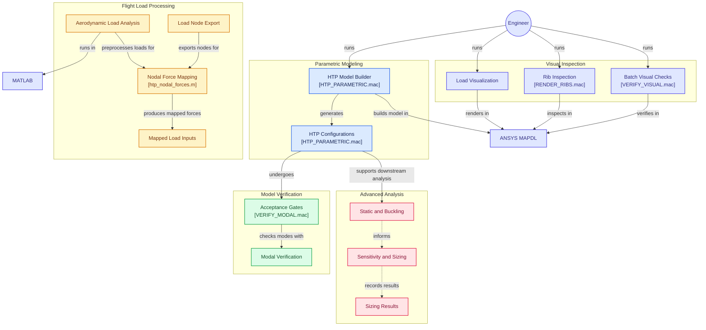

# Parametric APDL-Based Horizontal Tailplane Structural Modelling and Verification under EASA CS-25 Flight Loads

[](https://iaai.kmitl.ac.th/)
[](https://iaai.kmitl.ac.th/)
[](https://www.easa.europa.eu/)
[](https://www.ansys.com/)
[](https://www.ansys.com/academic/free-student-products)

---

## 📌 Project Overview

This repository contains the complete computational source code, verification macros, aerodynamic pre-processing pipelines, literature resources, and the final laboratory report for the **Aircraft Structure Mini-Project** (`15016606`), Semester 1, Academic Year 2026, Aeronautical Engineering Program, International Academy of Aviation Industry (IAAI), King Mongkut's Institute of Technology Ladkrabang (KMITL).

* **Course Instructor:** Assoc. Prof. Dr. Eng. Suwin Sleesongsom
* **Project Team:**
  * Archawin Chindarattanaporn (ID: 67130043)
  * Aryan Sajith (ID: 67130044)
  * Thanatchai Khunpiluke (ID: 67130036)
  * Sirasak Permsup (ID: 67130029)
  * Peeradol Singsamran (ID: 67130061)
* **Final Report Document:** [`reference/Stage_Docment/HTP_Final_Report_v7.pdf`](reference/Stage_Docment/HTP_Final_Report_v7.pdf)

---

## 🎯 Project Scope & Objectives

In conventional airframe design, every change of internal structural layout requires rebuilding, repairing, and remeshing CAD geometry. Following the foundational parametric workflow of **Palumbo et al. (2026)** (*"A Parametric APDL-Based Workflow for Efficient Structural Design of a Civil Aircraft Horizontal Tailplane"*, *Eng. Proc.* 2026, 133, 15), this project develops a fully script-driven workflow that builds, meshes, loads, and verifies multiple internal layouts of a horizontal tailplane (HTP) in **ANSYS Mechanical APDL (MAPDL)** without manual GUI interaction.

The project scope is focused on three certified core objectives:

### 🗺️ System Architecture & Workflow Diagram


*(Vector architecture diagram rendered natively by GitHub. Raw SVG vector is also available at [`assets/architecture_diagram.svg`](assets/architecture_diagram.svg)).*

1. **Objective 1 (Parametric APDL Model):** Develop a unified APDL macro (`HTP_PARAMETRIC.mac`) that generates three complete internal airframe topologies from parameters alone:
   * **Configuration A (Reference Baseline):** 14 ribs, 3 spars, 8 stringers (2-cell box)
   * **Configuration B:** 9 ribs, 2 spars, 8 stringers (1-cell box)
   * **Configuration C:** 7 ribs, 2 spars, 6 stringers (1-cell box)
2. **Objective 2 (Flight Load Reconstruction & Mapping):** Reconstruct aerodynamic flight loads for the ATR 42-600 under EASA CS-25, identify the governing dive-speed download case $D_{fwd}$ ($V_D = 312.5\text{ kt EAS}$, half-tail limit load $P = -9,142.84\text{ N}$, root moment $M_{\text{root}} = -16,058\text{ N}\cdot\text{m}$), and map discrete nodal forces to conformal skin shells using MATLAB with root equilibrium error **$< 0.001\%$**.
3. **Objective 3 (Model Verification):** Enforce three rigorous acceptance gates (Free-Free Rigid-Body Modes, Mass Conservation, and 1g Gravity Equilibrium) to verify complete nodal connectivity, element formulation, and physical integrity before conducting downstream stress assessments.

*(Note: Advanced post-verification extensions including linear static stress, linear eigenvalue buckling, and sensitivity-guided sizing optimization are archived in `optimization/` and outlined as Future Work in Section 6.4 of the final report).*

---

## 🔄 Parametric APDL Macro Execution Flowchart (10-Block Pipeline)

The master APDL script [`Ansys_Scripts/HTP_PARAMETRIC.mac`](HTP_PARAMETRIC.mac) executes an automated, monolithic 10-block finite element modeling and solution pipeline (1,060 lines of native APDL code). It constructs the complete 3D internal structural assembly—including aerodynamic skins, 3 longitudinal spars, up to 14 transverse ribs with lightening holes and pass-through stringer mouseholes, 8 Hat-section stringers, spar caps, and dual-zone contoured rib flanges—**entirely from parametric code in pure MAPDL**.

### 🏗️ Architectural Phase Organization & Block 6 Integration Narrative

The 10 execution blocks are organized into **four sequential engineering phases**:
* **Phase I: Mathematical & Aerodynamic Pre-computation (Blocks 1–3)**
* **Phase II: 3D CAD Solid Modeling & Boolean Geometry (Blocks 4–5)**
* **Phase III: FEA Discretization, Physics & Direct Coupling (Blocks 7–8)** — *(Featured in Presentation Slide 06a)*
* **Phase IV: Solution, Pre-Stress & Extraction (Blocks 9–10)** — *(Featured in Presentation Slide 06b)*

> [!NOTE]
> **Clarification on Block 6 Integration:**  
> In the preliminary conceptual architecture, solid area generation (skins/spars) and topological boundary line extraction were planned as separate execution blocks (Block 5 and Block 6). During production script hardening, **Block 6 was integrated directly into the conclusion of Block 5 (Lines 591–594)**. Executing global topological merging (`NUMMRG, ALL, 1.0E-4` and `NUMCMP, ALL`) immediately following rib boolean subtractions (`ASBA`), skin lofting, and spar creation ensures that all adjacent areas share coincident lines and keypoints, producing a watertight solid boundary before entering Section & Material attribution (Block 7).

---

### 🗺️ Native GitHub Mermaid Execution Flowchart

```mermaid
flowchart LR

  %% ==========================================
  %% PHASE I: PRE-COMPUTATION
  %% ==========================================
  subgraph phase1["Phase I: Pre-computation"]
    direction TB
    b1["<b>Block 1: Parametric Inputs</b><br/>Config A/B/C selector & material DVs"]
    b2["<b>Block 2: Airfoil & Stations</b><br/>Rib positions, taper & NACA 0012"]
    b3["<b>Block 3: Spar-Aware Bays</b><br/>Bay partitioning & cutout logic"]
    b1 --> b2 --> b3
  end

  %% ==========================================
  %% PHASE II: 3D CAD MODELING
  %% ==========================================
  subgraph phase2["Phase II: CAD Modeling"]
    direction TB
    b4["<b>Block 4: Keypoints & Lines</b><br/>Airfoil keypoints & stringer lines"]
    b5["<b>Block 5: Areas & Cutouts</b><br/>Ribs with R10 cutouts, skins & spars"]
    b4 --> b5
  end

  %% ==========================================
  %% PHASE III: FEA COUPLING (SLIDE 06a)
  %% ==========================================
  subgraph phase3["Phase III: FEA Coupling (Slide 06a)"]
    direction TB
    b7["<b>Block 7: Elements & Sections</b><br/>SHELL181 + BEAM188, Al / CFRP"]
    b8["<b>Block 8: Meshing & Coupling</b><br/>Shell/beam mesh & NUMMRG 6-DOF"]
    b7 --> b8
  end

  %% ==========================================
  %% PHASE IV: SOLUTION & POST-PROCESS (SLIDE 06b)
  %% ==========================================
  subgraph phase4["Phase IV: Solution (Slide 06b)"]
    direction TB
    b9["<b>Block 9: Boundary & Loads</b><br/>Clamped root & CS-25 SFBM loads"]
    b10["<b>Block 10: Solve & Extract</b><br/>Static solve, SMAX & Tip UZ"]
    b9 --> b10
  end

  %% Sequential Inter-phase Connections (Left to Right)
  b3 -->|"Airfoil Coords"| b4
  b5 -->|"Watertight CAD"| b7
  b8 -->|"Conformal Mesh"| b9
  b10 -->|"FEA Responses"| opt["<b>Downstream</b><br/>Sizing Optimization"]

  %% Class styling definitions (Soft Pastels with Clear Structural Borders)
  classDef toneAmber fill:#fef3c7,stroke:#d97706,stroke-width:1.5px,color:#78350f
  classDef toneBlue fill:#dbeafe,stroke:#2563eb,stroke-width:1.5px,color:#172554
  classDef toneMint fill:#dcfce7,stroke:#16a34a,stroke-width:1.5px,color:#14532d
  classDef toneRose fill:#ffe4e6,stroke:#e11d48,stroke-width:1.5px,color:#881337
  classDef tonePurple fill:#ede9fe,stroke:#7c3aed,stroke-width:1.5px,color:#4c1d95

  class b1,b2,b3 toneAmber
  class b4,b5 toneBlue
  class b7,b8 toneMint
  class b9,b10 toneRose
  class opt tonePurple
```



---

### 📊 Master 10-Block Pipeline Specification Table

| Block # & Name | Line Range in `HTP_PARAMETRIC.mac` | Key APDL Commands & Syntax | Engineering Physics & Mathematical Purpose | Relevant Presentation Slide |
| :--- | :---: | :--- | :--- | :---: |
| **Block 1: Parametric Input Variables** | `Lines 1–97` | `/CWD`, `*IF`, `*ELSEIF`, `*ENDIF`, scalar assignments, `ACOS(-1)` | Initializes semi-span ($b/2 = 3,978\text{ mm}$), chords ($C_{\text{root}} = 3,090\text{ mm}$, $C_{\text{tip}} = 1,860\text{ mm}$), dihedral ($\Lambda = 7.0^\circ$), and config selector (A: 14-3-8, B: 9-2-8, C: 7-2-6). Declares initial sizing DVs, optimization override hook (`OPT_OVERRIDE`), and material properties in $(N, \text{mm}, \text{tonne}, \text{MPa})$ for Al 7075-T6 and CFRP. | **Slide 06b** |
| **Block 2: Station Calculation & Airfoil** | `Lines 99–191` | `*DIM`, `*DO`, `*ENDDO`, `TAN`, `SQRT`, array indexing | Evaluates linear station spacing $Y_{\text{sta}}(i) = (i-1)\Delta Y$, chord law $C_i(y)$, and dihedral elevation $Z_{\text{off}}(y) = y \tan(7^\circ)$. Generates closed 49-point NACA 0012 thickness distribution ($t/c = 12\%$) via exact 5th-order polynomial and identifies spar/stringer chordwise fractions. | **Slide 06b** |
| **Block 3: Spar-Aware Hole Bay Definition** | `Lines 193–225` | `*DIM`, `*DO`, `*IF`, `*ELSEIF`, `*ENDIF` | Defines structural bay boundaries: Bay 1 (LE nose, $0.0\text{–}0.300C$) disables cutouts (`BAY_HOLES=0`) to prevent sliver mesh failure; Bay 2 (wingbox torque box, $0.300\text{–}0.764C$) hosts 5–7 lightening holes; Bay 3 (TE bay) disables cutouts to preserve trailing edge shear stiffness. | **Slide 06b** |
| **Block 4: Keypoints & Line Generation** | `Lines 227–315` | `/PREP7`, `*DO`, `K`, `L`, `*GET`, `LSEL`, `CM`, `ALLSEL` | Calculates 3D Cartesian coordinates referencing straight trailing edge ($X_{\text{offset}} = C_{\text{root}} - C_i$). Generates spanwise rib-to-rib guide lines along spar web and stringer paths; partitions into APDL components (`COMP_STR_UPPER`, `COMP_FLANGE_UPPER`, etc.). | **Slide 06b** |
| **Block 5: Area Generation (Ribs, Cutouts, Skins, Spars)** | `Lines 317–594` | `AL`, `WPCSYS`, `WPOFFS`, `WPROTA`, `CYL4`, `A`, `ASBA`, `CM`, `NUMMRG, ALL, 1.0E-4`, `NUMCMP, ALL` | Creates solid ribs, transforms working plane per station, generates circular lightening holes with **Dynamic Safe Capping (Web Pillar $\ge 14.0\text{ mm}$)**, and builds 8-KP tangent circular filleted mouseholes ($R=10\text{ mm}$, $K_t: 2.4 \to 1.4$). Executes boolean subtraction (`ASBA`), lofts aerodynamic skins and spar webs, and **unifies solid geometry topology (historic Block 6, lines 591–594)**. | **Slide 06a & 06b** |
| **Block 7: Element Types, Materials & Sections** | `Lines 596–652` | `ET`, `KEYOPT`, `MP`, `SECTYPE`, `SECDATA`, `*GET`, `SECOFFSET`, `SAVE` | Sets `SHELL181` (Keyopt 3=2 full integration) and `BEAM188` (Keyopt 3=3 cubic shape functions). Defines Al 7075-T6 (`MAT 1`) and CFRP skin (`MAT 2`). Assigns Hat-section stringer (`SEC 4`) and rectangular flanges (`SEC 5–8`) with **calibrated centroidal offsets (`SECOFFSET`)**, ensuring $0\text{ mm}$ skin puncture and $0\text{ mm}$ gap. Saves checkpoint `HTP_PARAMETRIC.db`. | **Slide 06a** |
| **Block 8: Meshing & Direct Coupling** | `Lines 653–981` | `ESIZE`, `LESIZE`, `AATT`, `MSHAPE`, `MSHKEY`, `AMESH`, `SHPP, OFF/ON`, `LATT`, `LMESH`, `NUMMRG, NODE, 0.01` | Meshes skins/spars (quads, $100\text{ mm}$) and cutout ribs (unstructured triangles, $15\text{ mm}$, hole line division 6). Applies beam inward normals ($\vec{n} = \vec{L} \times \vec{T}$). Meshes rib flanges using **Dual-Zone Sagitta Filtering ($DM_{\text{tol}} = 22\text{ mm}$ vs $12\text{ mm}$)** and **Dual-Zone Normal Blending ($NY=0$ apex vs $7^\circ$ dihedral)**. Merges coincident shell-beam nodes (`NUMMRG, NODE, 0.01`) for seamless 6-DOF direct coupling. | **Slide 06a** |
| **Block 9: Boundary Conditions & Flight Loads** | `Lines 982–1017` | `/SOLU`, `ANTYPE, 0`, `PSTRES, ON`, `NSEL`, `D, ALL, ALL, 0`, `/INPUT`, `SFA` | Sets static solution (`ANTYPE, 0`) and turns on pre-stress matrix generation (`PSTRES, ON`) for downstream buckling. Enforces fully fixed cantilever clamp ($UX=UY=UZ=ROTX=ROTY=ROTZ=0$) at root plane $Y=0$. Reads reconstructed EASA CS-25 flight load card (`htp_loads_D_fwd_cfg%CONFIG%.inp`, $\sum F_z = -9,142.84\text{ N}$) mapped onto conformal skin corner nodes. | **Slide 06b** |
| **Block 10: Solve & Post-Process** | `Lines 1019–1060` | `/PREP7`, `NSLE`, `NSEL, INVE`, `NDELE, ALL`, `/SOLU`, `SOLVE`, `/POST1`, `SET, LAST`, `NSORT`, `*GET`, `*VWRITE` | Purges unattached floating nodes while safeguarding beam orientation nodes (`NSLE` -> `INVE` -> `NDELE`). Solves linear system $[K]\{u\} = \{F\}$. In `/POST1`, renders 3D shape (`/ESHAPE, 1`), extracts peak Von Mises stress ($\sigma_{\text{vM, max}}$) and outboard aerodynamic tip deflection ($U_{z, \text{tip}}$), and appends data to `HTP_Results.txt`. | **Slide 06b** |

---

### 🔬 Engineering Breakthrough Highlights Integrated in the Codebase

1. **Dual-Zone Sagitta Outer Mold Line (OML) Filtering (Block 8, Lines 823–893):**  
   Due to the extreme leading-edge curvature of the NACA 0012 section, standard endpoint proximity checks erroneously mistook internal cutout edges for the skin boundary. A 3-point mathematical filter evaluates endpoints ($D_1, D_2 < 2.0\text{ mm}$) and mid-chord sagitta $D_M$:
   $$\text{DM\_TOL} = \begin{cases} 22.0\text{ mm} & \text{if } x/c < 0.05 \text{ (LE Apex, Max Sagitta } = 16.19\text{ mm}) \\ 12.0\text{ mm} & \text{if } x/c \ge 0.05 \text{ (Wingbox, strictly rejects cutouts } R \ge 25\text{ mm}) \end{cases}$$
   This guarantees 100% perimeter continuity for rib caps across all 14 stations without missing segments.

2. **Dual-Zone Rib Flange Normal Blending (Block 8, Lines 906–935):**  
   * **Nose Apex ($x/c < 0.025$):** Setting pure in-plane normal ($NY = 0$, `BLEND_FAC = 0.0`) eliminates forward aerodynamic beak overhang.
   * **Main Wingbox ($x/c \ge 0.065$):** Full 3D dihedral normal ($NY = -NZ_{\text{ip}} \cdot \text{Slope}_Y$, `BLEND_FAC = 1.0`) tilts the $40\text{ mm}$ flange by exactly $7.0^\circ$, ensuring $0\text{ mm}$ outer mold line puncture and $0\text{ mm}$ gap.

3. **Dynamic Safe Web Pillar Capping (Block 5, Lines 366–479):**  
   To prevent mesh distortion and shear web buckling pinch between lightening holes and adjacent cutouts, circular hole radii $R_H$ are dynamically capped:
   $$R_H \le D_{\text{adj}} - 14.0\text{ mm}$$
   guaranteeing a minimum structural ligament of $14.0\text{ mm}$ across all configurations and rib taper stations.

4. **Conformal Direct Node Welding (Block 8, Lines 974–977):**  
   By applying `NUMMRG, NODE, 0.01` followed by `NUMCMP, NODE`, coincident nodes between `SHELL181` faces and `BEAM188` axes are unified into single nodes with shared degrees of freedom. This provides native 6-DOF direct displacement and rotational transmission without introducing artificial contact elements, numerical penalty stiffness, or constraint equation (`CE`) singularities.

---

## 📊 Summary of Certified Verification Results

### Acceptance Gate Performance Matrix (All 3 Configurations)

| Gate | Verification Check | Acceptance Criterion | Configuration A<br>`[14-3-8]` | Configuration B<br>`[9-2-8]` | Configuration C<br>`[7-2-6]` | Status |
| :---: | :--- | :--- | :---: | :---: | :---: | :---: |
| **Gate 1** | **Free-Free Rigid-Body Modes** | Exactly 6 zero-energy modes ($f_{1..6} \le 10^{-3}\text{ Hz}$) | $\max f = 2.46 \times 10^{-4}\text{ Hz}$ | $\max f = 1.97 \times 10^{-4}\text{ Hz}$ | $\max f = 2.41 \times 10^{-4}\text{ Hz}$ | **PASS** |
| | **Elastic Spectral Separation** | First elastic mode jumps cleanly ($f_7 > 1\text{ Hz}$, ratio $> 10^4$) | $f_7 = 55.99\text{ Hz}$<br>(ratio: $2.28 \times 10^5$) | $f_7 = 52.34\text{ Hz}$<br>(ratio: $2.66 \times 10^5$) | $f_7 = 45.95\text{ Hz}$<br>(ratio: $1.90 \times 10^5$) | **PASS** |
| **Gate 2** | **Mass Conservation** | Volume integral (`ETABLE`) equals solver mass matrix (`MTOT`) | $140.463\text{ kg}$<br>($\Delta = 0.0000\%$) | $121.890\text{ kg}$<br>($\Delta = 0.0000\%$) | $113.638\text{ kg}$<br>($\Delta = 0.0000\%$) | **PASS** |
| **Gate 3** | **1g Gravity Equilibrium** | Root reaction matches total weight within $0.001\%$ in X, Y, Z | Error $< 10^{-6}\%$<br>(Strength Ratio: $242.3$) | Error $< 10^{-6}\%$<br>(Strength Ratio: $274.3$) | Error $< 10^{-6}\%$<br>(Strength Ratio: $297.4$) | **PASS** |
| **Flight Load** | **Aerodynamic Equilibrium** | Root reaction matches applied half-tail load ($-9,142.84\text{ N}$) | $+9,142.84\text{ N}$<br>(Error $< 0.001\%$) | $+9,142.84\text{ N}$<br>(Error $< 0.001\%$) | $+9,142.82\text{ N}$<br>(Error $< 0.001\%$) | **PASS** |

### Key Physics & Modeling Highlights
* **Watertight Shared-Node Topology:** Thin-walled skins and webs are modeled using `SHELL181` (full integration), while spar caps, stringers, and rib flanges utilize `BEAM188` (Timoshenko beams). All components share geometric lines followed by `NUMMRG, NODE, 0.01`, eliminating artificial constraint equations or penalty contact elements.
* **Dual-Zone Flange Normal Blending:** Rib flanges (`SEC 6`, $40\times 1.0\text{ mm}$) follow the $7^\circ$ wing dihedral across the wingbox but blend smoothly to pure in-plane orientation ahead of $x/C = 0.025$, eliminating both the nose "beak" overhang and outer-edge skin puncture.
* **Stress Concentration Mitigation:** Stringer pass-through cutouts on ribs feature 8-keypoint circular tangent fillets ($R=10\text{ mm}$), lowering $K_t$ from $>2.4$ down to $\approx 1.4$. Dynamic pillar capping ($R_{hole} \le D_{adj} - 14\text{ mm}$) maintains safe web ligaments.
* **44% Internal-Node Load Resolution:** Selecting load nodes by raw spatial coordinates accidentally excited internal integration nodes of cubic `BEAM188` elements, causing $44\%$ of aerodynamic forces to vanish. Restricting node selection strictly to corner nodes of composite skin shells (`ESEL, S, MAT,, 2` + `NSLE`) restored $100.000\%$ force transmission.

---

## 📂 Repository Structure

```text
Ansys_Scripts/
│
├── HTP_PARAMETRIC.mac              # Master 10-Block parametric ANSYS APDL script (v1.4.5-stable)
├── htp_loads_D_fwd_cfg1.inp        # Governing limit flight load card (Config A 14-3-8)
├── htp_loads_D_fwd_cfg2.inp        # Governing limit flight load card (Config B 9-2-8)
├── htp_loads_D_fwd_cfg3.inp        # Governing limit flight load card (Config C 7-2-6)
│
├── assets/                         # Vector & raster system architecture diagrams for documentation
├── archive/                        # Auxiliary APDL macros (VERIFY_VISUAL, RENDER_RIBS, EXPORT_LOAD_NODES)
├── load_sfbm/                      # Stage 2b: Aerodynamic flight loads & SFBM pre-processing suite
│   ├── README.md                   # Complete mathematical derivations for V-n, BTL & Schrenk
│   ├── matlab/                     # MATLAB pipeline scripts (vn_diagram.m, tail_load.m, etc.)
│   ├── loads/                      # APDL input force cards (htp_loads_D_fwd_cfg1..3.inp)
│   ├── results/                    # Reaction audits, mass breakdown CSVs, and load summaries
│   └── visual_load/                # High-res contour plots and boundary condition diagrams
│
├── modal_analysis/                 # Stage 3b: Model verification & Free-Free modal suite
│   ├── README.md                   # Verification methodologies, acceptance gates & APDL commands
│   ├── note.md                     # Technical physics reference & Q&A defense cheat-sheet
│   ├── HTP_BUILD_CORE.mac          # Core geometry builder callable by batch drivers
│   ├── VERIFY_MODAL.mac            # Free-free modal and 1g gravity verification driver
│   ├── result/                     # Verification CSV tables and gate pass/fail logs
│   └── visual_modal/               # Mode shape 1–6 displacement contour plots
│
├── optimization/                   # Advanced Extensions (Future Work: Stage 3c & 3d sizing optimization)
│   ├── README.md                   # Zero-remeshing sizing optimization pipeline documentation
│   ├── BUILD_OPT_BASES.mac         # Frozen-mesh database builder for rapid evaluations (2.5-4.2s)
│   ├── UPDATE_SECTIONS_AND_SOLVE.mac # Fast section updater with recomputed beam offsets
│   ├── result/                     # Sizing histories, sensitivity matrices, and trade-off tables
│   └── visual_opt/                 # Buckling modes and post-sizing deflection plots
│
├── visual_log/                     # Multi-view visual verification logs, galleries, and snapshot suites
│
└── reference/                      # Official documentation, syllabus, and academic references
    ├── Stage_Docment/              # Milestone project reports and presentations
    │   ├── HTP_Final_Report_v7.pdf # ★ FINAL CERTIFIED REPORT (October 21, 2026) ★
    │   └── 00_Stage_Documents_Index.md # Index of stage documents
    │
    └── Resources/                  # Full-text textbooks and regulatory certification standards
        ├── [Reference] A simple approximation method for obtaining the spanwise lift.pdf
        ├── [Reference] ATR 42-600 Aircraft Characteristics Airport and Maintenance Planning.pdf
        ├── [Reference] Aircraft Design A Conceptual Approach.pdf
        ├── [Reference] Aircraft_Structures_for_Engineering_Students_6th_Edition.pdf
        ├── [Reference] Airframe_Structural_Design_by_Michael_Ch.pdf
        ├── [Reference] Dynamics of Structures.pdf
        ├── [Reference] Finite Element Procedures in Engineering Analysis Bathe K.J.pdf
        ├── [Reference] Metallic Materials Properties Development and.pdf
        └── [Refence Literature] A Parametric APDL-Based Workflow for Efficient Structural Design of...pdf
```

---

## 📖 Key Literature & Academic References

The modeling parameters, airworthiness regulations, and analytical methods implemented in this repository are based on the following textbooks and standards stored in [`reference/Resources/`](reference/Resources/):

1. **[1] Palumbo, C. et al. (2026):** *"A Parametric APDL-Based Workflow for Efficient Structural Design of a Civil Aircraft Horizontal Tailplane"*, *Engineering Proceedings*, 133(15). (Foundational parametric geometry & verification methodology).
2. **[2] EASA CS-25 (Amendment 27, 2023):** *Certification Specifications and Acceptable Means of Compliance for Large Aeroplanes*, European Union Aviation Safety Agency. (CS-25.333, CS-25.335, CS-25.337, CS-25.341).
3. **[3] ATR Aircraft (2020):** *ATR 42-600 Aircraft Characteristics: Airport and Maintenance Planning*, Blagnac, France. (Geometry, MTOW, MZFW, CG limits, operational speeds).
4. **[4] Jacobs, E. N., Ward, K. E., and Pinkerton, R. M. (1933):** *The Characteristics of 78 Related Airfoil Sections from Tests in the Variable-Density Wind Tunnel*, NACA Report No. 460.
5. **[5] ASM International (1990):** *ASM Handbook, Vol. 2: Properties and Selection: Nonferrous Alloys and Special-Purpose Materials*. (Aluminium alloy 7075-T6 mechanical properties).
6. **[6] Lundsgaard-Larsen, C. et al. (2012):** Quasi-isotropic carbon/epoxy laminate properties for civil aircraft structures.
7. **[7] Schrenk, O. (1940):** *A Simple Approximation Method for Obtaining the Spanwise Lift Distribution*, NACA Technical Memorandum No. 948.
8. **[8] Raymer, D. P. (2018):** *Aircraft Design: A Conceptual Approach*, 6th Edition, AIAA Education Series. (Longitudinal trim and flight envelopes).
9. **[9] Bruhn, E. F. (1973):** *Analysis and Design of Flight Vehicle Structures*, Jacobs Publishing.
10. **[10] Megson, T. H. G. (2017):** *Aircraft Structures for Engineering Students*, 6th Edition, Butterworth-Heinemann. (Semi-monocoque airframes and cutouts).
11. **[11] Niu, M. C. Y. (1999):** *Airframe Structural Design*, 2nd Edition, Conmilit Press.
12. **[12] Bathe, K. J. (2006):** *Finite Element Procedures*, Prentice Hall. (Block Lanczos eigenvalue extraction and stiffness null space).
13. **[13] Clough, R. W. and Penzien, J. (2003):** *Dynamics of Structures*, 3rd Edition, Computers & Structures. (Rigid-body mechanics and modal orthogonality).
14. **[14] Vanderplaats, G. N. (2007):** *Multidiscipline Design Optimization*, Vanderplaats R&D.
15. **[15] FAA / MMPDS-01 (2003):** *Metallic Materials Properties Development and Standardization*. (Aluminium design allowables).
16. **[16] SAE International / CMH-17 (2012):** *Composite Materials Handbook CMH-17, Vol. 3: Polymer Matrix Composites*.

---

## 💻 How to Run the Models

### Prerequisites
* **ANSYS Mechanical APDL (MAPDL):** Release 2026 R1 (or compatible release with SHELL181 / BEAM188).
* **MATLAB:** R2022b or later (Optimization Toolbox for `lsqminnorm`).
* **Python:** 3.10+ (for automated batch logging and result post-processing).

### 1. Build and Solve in Batch Mode (Recommended)
To execute the master parametric macro in headless batch mode:
```powershell
# Run Configuration A (Default CONFIG = 1)
& "C:\Program Files\ANSYS Inc\v261\ansys\bin\winx64\ansys261.exe" -b -i "HTP_PARAMETRIC.mac" -o "run_cfgA.out"
```

To switch between configurations, set the `CONFIG` parameter at the top of Block 1 in `HTP_PARAMETRIC.mac`:
* `CONFIG = 1`: Configuration A (14 ribs, 3 spars, 8 stringers)
* `CONFIG = 2`: Configuration B (9 ribs, 2 spars, 8 stringers)
* `CONFIG = 3`: Configuration C (7 ribs, 2 spars, 6 stringers)

### 2. Run Verification Suite (Free-Free Modal & Gravity Audit)
Execute the batch verification driver inside `modal_analysis/`:
```powershell
cd modal_analysis
& "C:\Program Files\ANSYS Inc\v261\ansys\bin\winx64\ansys261.exe" -b -i "VERIFY_MODAL.mac" -o "verify_run.out"
```
The results and pass/fail verdicts are automatically exported to `modal_analysis/result/STAGE3B_VERIFICATION_SUMMARY.txt`.

### 3. Re-generate Aerodynamic Nodal Forces (MATLAB)
If aircraft geometry or load conditions are updated, recalculate and re-map the flight loads:
```matlab
cd load_sfbm/matlab
run('vn_diagram.m');       % Generate V-n diagram and boundary points
run('tail_load.m');        % Evaluate pitch trim equilibrium across CG envelope
run('htp_sfbm.m');         % Calculate Schrenk spanwise load and SFBM curves
run('htp_nodal_forces.m');  % Map tributary loads to skin nodes and write .inp files
```

---

## 🏛️ Academic Integrity & Acknowledgements

This laboratory report and codebase were developed for academic evaluation under the supervision of **Assoc. Prof. Dr. Eng. Suwin Sleesongsom**. The authors extend their sincere gratitude for his guidance, technical suggestions, and valuable insights on airframe structural modeling.

*King Mongkut's Institute of Technology Ladkrabang (KMITL) — October 2026.*
