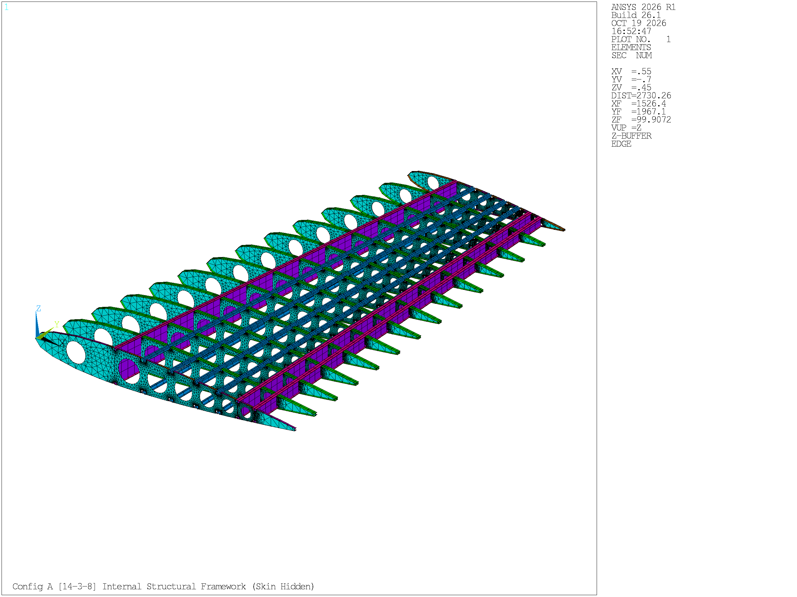
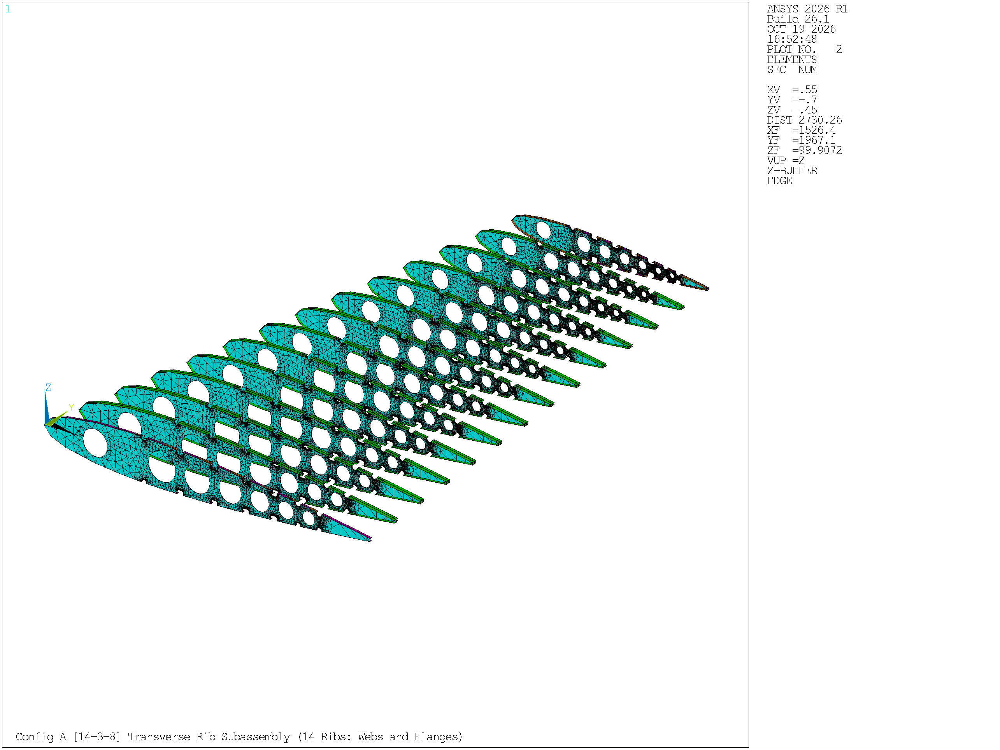
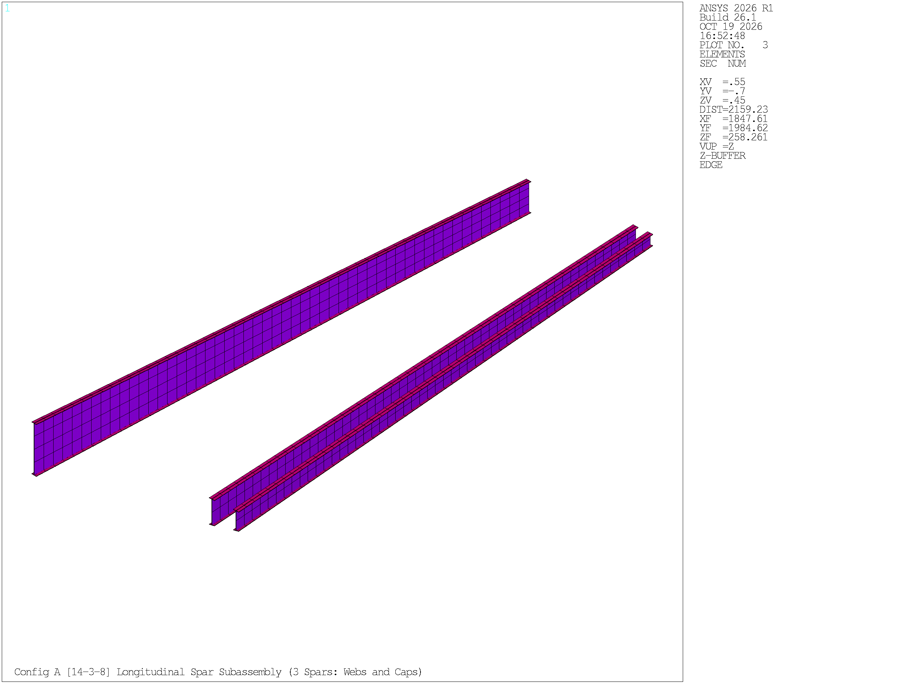
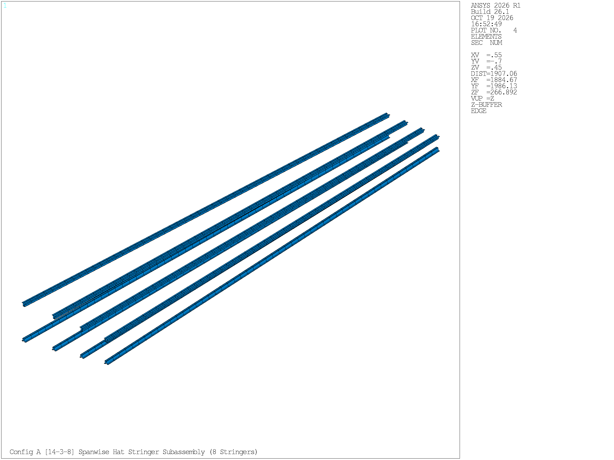
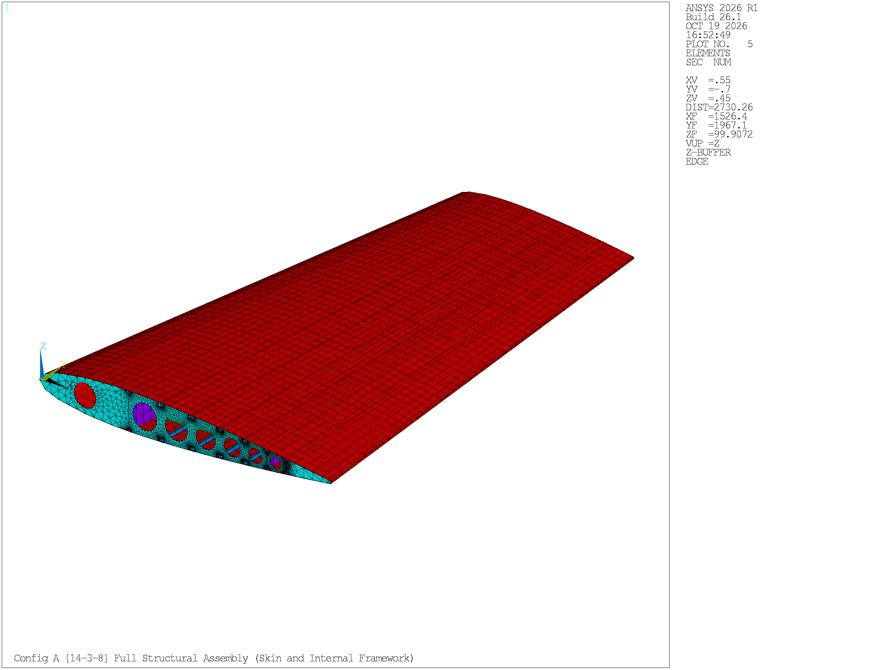
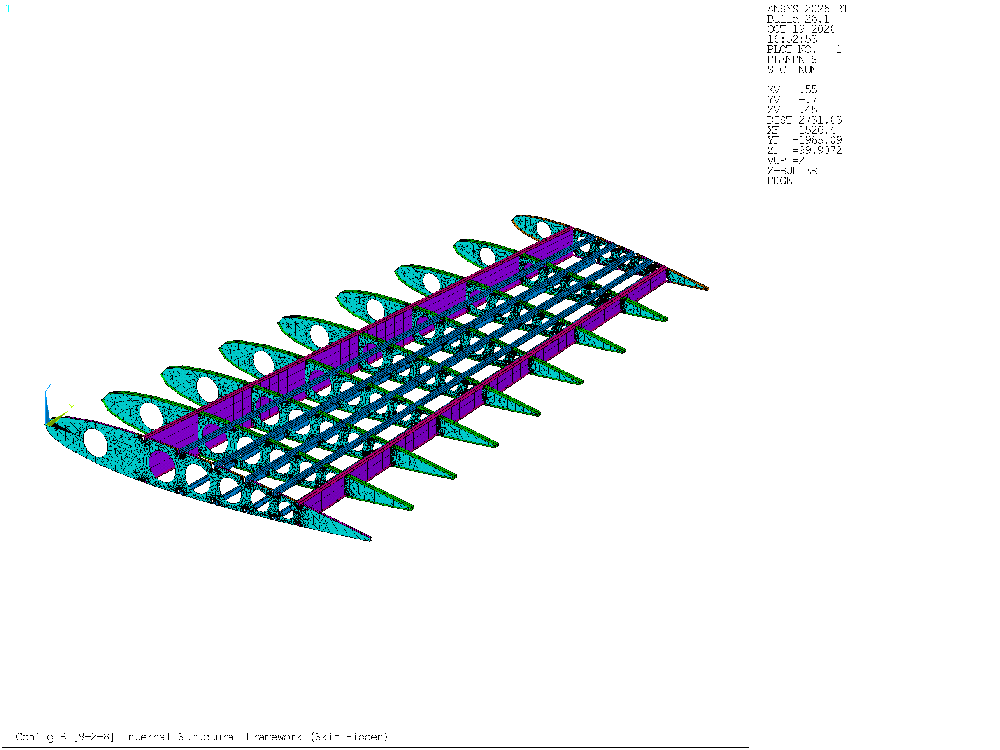
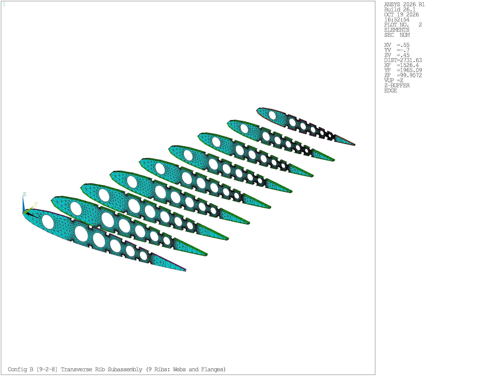
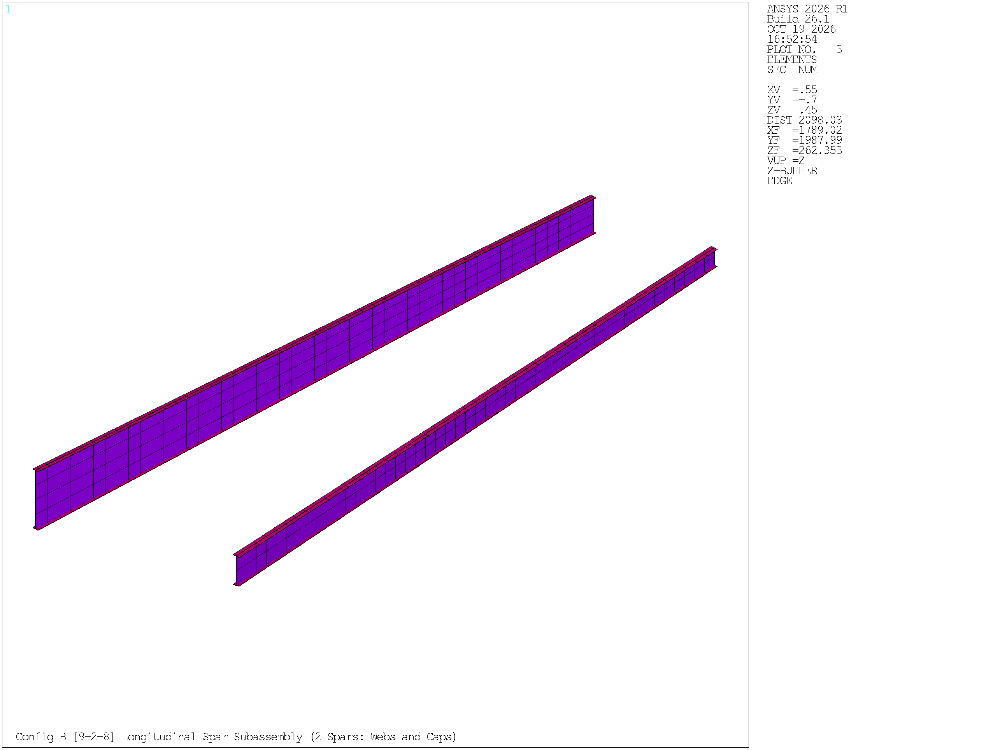
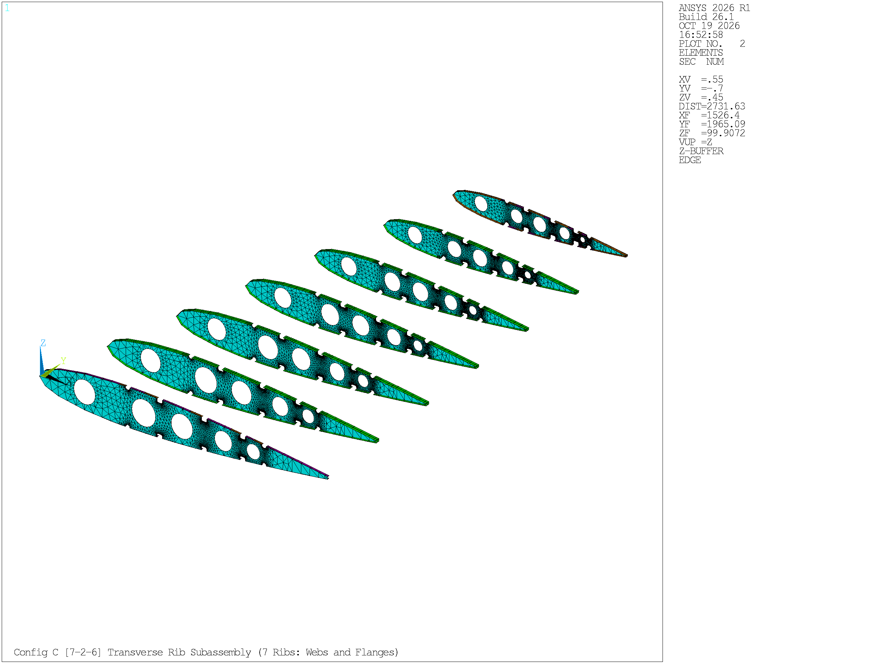
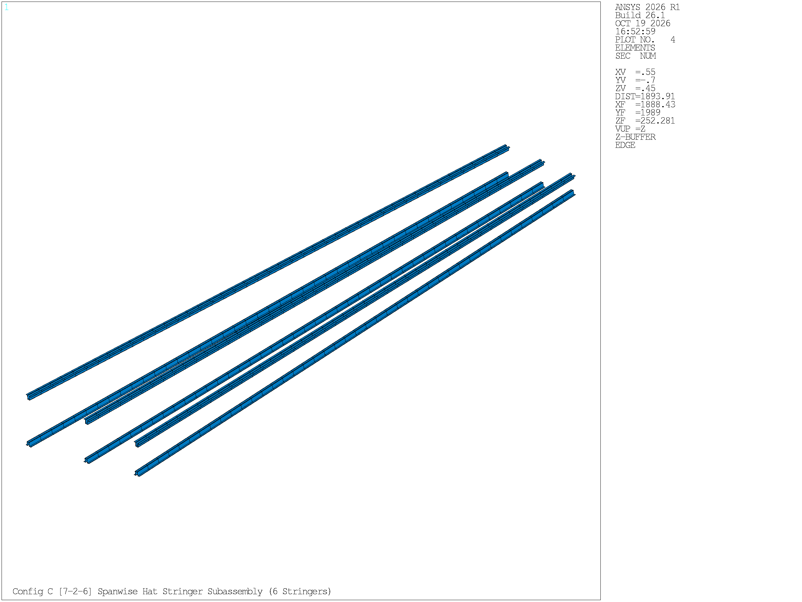

# Stage 2a: Parametric APDL Script Development

| Item | Detail |
| :--- | :--- |
| Project | Parametric APDL-Based Horizontal Tailplane Structural Analysis and Optimization |
| Stage / Task | Stage 2a / Task T-04 (Step 2: Parametric APDL script development) |
| Schedule Dates | 28 September – 15 October 2026 (18 Days) |
| Deliverable Status | Completed (Baseline Codebase Frozen at Release `v1.4.5-stable`, synchronized in `v1.5.0`) |
| Prepared by | Archawin Chindarattanaporn (67130043), Aryan Sajith (67130044), Thanatchai Khunpiluke (67130036), Sirasak Permsup (67130029), Peeradol Singsamran (67130061) |
| Primary Code Artifacts | `HTP_PARAMETRIC.mac`, `VERIFY_VISUAL.mac`, `RENDER_RIBS.mac`, `RENDER_STAGE2A_COMPONENTS.mac`, `RENDER_STAGE2A_ADDITIONAL.mac` |
| Primary Output Visuals | `visual_log/stage2a_component_gallery/` (Figures 2a.1 to 2a.17), `visual_log/snapshot_v1.4.5/` |

Following the completion of Stage 1 (Data Collection & Parameter Definition), the primary objective of Stage 2a is to translate the aircraft aerodynamic geometry, structural topology rules, and material properties into an end-to-end parametric script in pure ANSYS Parametric Design Language (APDL). 

Unlike conventional manual CAD-to-FEM translation workflows that suffer from geometry repair bottlenecks, non-conformal mesh interfaces, and manual remodel penalties, this framework constructs the complete three-dimensional internal structural assembly—including aerodynamic skins, 3 longitudinal spars, up to 14 transverse ribs with lightening holes and pass-through stringer mouseholes, 8 Hat-section stringers, spar caps, and contoured rib flanges—entirely from parametric code in ANSYS Mechanical APDL (MAPDL). The script serves as the geometric and finite element foundation for aerodynamic load mapping in Stage 2b and multi-configuration structural optimization in Stage 3.

---

## 1. Script Architecture & Modular Organization

The master parametric script `HTP_PARAMETRIC.mac` is partitioned into ten sequential, modular execution blocks. This architecture cleanly separates geometric parameter inputs from topological boolean operations, mesh generation, boundary conditions, and solution routines.

**Table 2a.1: Modular architecture of the parametric APDL script (`HTP_PARAMETRIC.mac`)**

| Block | Functional Scope | Primary APDL Commands Employed | Output / State Delivered |
| :--- | :--- | :--- | :--- |
| **Block 1** | Parametric inputs, configuration selector, sizing variables, and material allowables | `*IF`, `*ELSEIF`, scalar assignment, `*DIM` | Global geometric bounds, design variables, and material allowables loaded into database |
| **Block 2** | Spanwise station spacing, chord law, dihedral function, and NACA 0012 airfoil thickness profile | `*DO`, `*DIM`, `TAN`, `SQRT`, array indexing | Coordinate arrays for rib positions `Y_STA(I)`, chord lengths `C_STA(I)`, and 25 chordwise station points `XC_UP` |
| **Block 3** | Spar-aware hole bay intervals | `*DO`, `*IF`, `BAY_START`, `BAY_END`, `BAY_HOLES` | Defined boundaries and hole allocation rules for leading edge, main wingbox, and trailing edge bays |
| **Block 4** | Keypoints and boundary line generation | `/PREP7`, `K`, `L`, `*DO`, `BSPLIN` | Master 3D wireframe skeleton across all spanwise stations |
| **Block 5** | Area generation: solid ribs, dynamic cutouts (holes and mouseholes), skin panels, and spar webs | `AL`, `A`, `CYL4`, `WPOFFS`, `WPROTA`, `ASBA`, `CM`, `CMSEL` | Watertight 2D area assembly with Component-tracked area identities bypassing APDL ID recycling |
| **Block 6** | Topological consolidation and boundary line extraction | `NUMMRG, ALL, 1.0E-4`, `NUMCMP, ALL`, `LSLA`, `CM` | Cleaned area geometry with conformal boundary line sets prepared for 1D beam meshing |
| **Block 7** | Element type definitions, material property cards, and beam section definitions | `ET`, `KEYOPT`, `MP`, `SECTYPE`, `SECDATA`, `SECOFFSET` | `SHELL181` and `BEAM188` element definitions, material assignments (MAT 1 & 2), and calibrated centroidal offsets |
| **Block 8** | Finite element discretization, line orientation keypoints, and dual-zone normal blending | `ESIZE`, `LESIZE`, `AMESH`, `LMESH`, `K`, `NUMMRG, NODE, 0.01`, `NUMCMP, NODE` | Conformal finite element mesh across shells and beams with merged boundary nodes |
| **Block 9** | Boundary conditions and aerodynamic load application | `/SOLU`, `ANTYPE, 0`, `D, ALL, ALL, 0`, `/INPUT` | Clamped root cantilever boundary conditions ($Y=0$) and external aerodynamic nodal forces |
| **Block 10** | Static solution, stress extraction, and post-processing | `SOLVE`, `/POST1`, `SET, LAST`, `PLNSOL`, `*GET`, `NSORT` | Extracted peak Von Mises stresses, directional tip deflections, and reaction force balance |

The solver runs in the consistent unit system $(N, \text{mm}, \text{tonne}, \text{MPa})$, where length is in millimeters, force in Newtons, mass in metric tonnes ($1\text{ tonne} = 1,000\text{ kg}$), and stress or modulus in Megapascals ($\text{N/mm}^2$). Acceleration of gravity is consequently $g = 9,810\text{ mm/s}^2$, and density is entered in $\text{tonne/mm}^3$.

---

## 2. Parametric Inputs & Sizing Variables

All geometric and structural parameters are declared at the beginning of Block 1. They are categorized into fixed macro-geometry parameters (governed by the ATR 42-600 aerodynamic baseline), topological selectors, and sizing design variables (DVs) that can be overridden during structural optimization loops.

**Table 2a.2: Fixed macro-geometry parameters (ATR 42-600 / HERFUSE reference)**

| Parameter Name | APDL Variable | Numerical Value | Unit | Engineering Role & Aerodynamic Source |
| :--- | :--- | :---: | :---: | :--- |
| Half-Span | `SPAN` | 3,978.0 | mm | Total semi-span from root centerline ($Y=0$) to aerodynamic wingtip |
| Root Chord | `C_ROOT` | 3,090.0 | mm | Length of airfoil profile at the root carry-through joint ($Y=0$) |
| Tip Chord | `C_TIP` | 1,860.0 | mm | Length of airfoil profile at the outboard tip rib ($Y=3,978\text{ mm}$) |
| Dihedral Angle | `DIHED` | 7.0 | deg | Out-of-plane wing dihedral inclination ($\Lambda_{\text{dihed}} = 7.0^\circ$) |
| Thickness-to-Chord Ratio | `TC` | 0.12 | — | Maximum profile thickness ($12\% \text{ chord}$) based on NACA 0012 section |

**Table 2a.3: Baseline structural sizing parameters and detailing constants**

| Component / Feature | APDL Variable | Baseline Value | Unit | Structural Description |
| :--- | :--- | :---: | :---: | :--- |
| Composite Skin Thickness | `T_SKIN` | 2.0 | mm | Equivalent isotropic carbon/epoxy outer aerodynamic skin shell |
| Spar Web Thickness | `T_SPAR_WEB` | 3.0 | mm | Aluminum 7075-T6 shear web plate for front, mid, and rear spars |
| Rib Web Thickness | `T_RIB_WEB` | 2.0 | mm | Aluminum 7075-T6 transverse rib web plate |
| Stringer Section Height | `STR_H` | 30.0 | mm | Total vertical height ($W_4$) of the Hat-section stiffener |
| Stringer Crown Width | `STR_W3` | 20.0 | mm | Top horizontal cap width ($W_3$) of the Hat section |
| Stringer Brim Width | `STR_BRIM` | 15.0 | mm | Base attachment foot width ($W_1 = W_2 = 15.0\text{ mm}$) of the Hat section |
| Stringer Thickness | `STR_T` | 1.6 | mm | Wall thickness across crown, web, and brims of the Hat section |
| Spar Cap Flange Width | `SPAR_FW` | 45.0 | mm | Horizontal width of the rectangular spar cap stiffener |
| Spar Cap Flange Thickness | `SPAR_FT` | 2.5 | mm | Vertical thickness of the rectangular spar cap stiffener |
| Interior Rib Flange Width | `RIB_FW` | 40.0 | mm | Full symmetric horizontal width of interior rib flanges (Ribs 2–13) |
| Rib Flange Thickness | `RIB_FT` | 1.0 | mm | Thickness of rib perimeter flanges |
| Root / Tip Edge Flange Width| `RIB_FW_EDGE` | 20.0 | mm | Single-sided inward flange width for boundary ribs (Rib 1 and Rib 14) |
| Global Element Sizing | `ESIZE_V` | 100.0 | mm | Nominal mesh edge size for skin panels and spar webs |
| Local Rib Mesh Sizing | `ESIZE` | 15.0 | mm | Fine mesh sizing applied to rib webs to resolve circular cutouts |
| Hole Diameter Ratio | `HOLE_RATIO` | 0.50 | — | Lightening hole diameter set to $50\%$ of local vertical rib height |
| Mousehole Cutout Half-Width | `HW` | 28.0 | mm | Lateral clearance half-width ($56\text{ mm}$ total width for $50\text{ mm}$ stringer base) |
| Mousehole Fillet Radius | `R_FIL` | 10.0 | mm | Circular tangent arc fillet radius reducing stress concentration |

To support Stage 3d sizing optimization without re-parsing geometry scripts, Block 1 includes an optimization override hook (`OPT_OVERRIDE`):

```apdl
*IF, OPT_OVERRIDE, EQ, 1, THEN
    T_SKIN     = T_SKIN_IN
    T_SPAR_WEB = T_SPAR_IN
    T_RIB_WEB  = T_RIB_IN
    STR_T      = STR_T_IN
    SPAR_FT    = SPAR_FT_IN
    RIB_FT     = RIB_FT_IN
*ENDIF
```

---

## 3. Mathematical Geometry Formulation

The horizontal tailplane macro-geometry is formulated through continuous algebraic functions along the spanwise coordinate $y \in [0, \text{SPAN}]$:

### 3.1 Chord and Station Distribution
The chord length varies linearly from root to tip:

$$
C(y) = C_{\text{root}} + (C_{\text{tip}} - C_{\text{root}}) \frac{y}{\text{SPAN}} = 3090 - 1230 \left(\frac{y}{3978}\right) \quad [\text{mm}]
$$

The spanwise positions of the $N_{\text{rib}}$ transverse ribs are uniformly distributed:

$$
y_i = (i - 1) \cdot \frac{\text{SPAN}}{N_{\text{rib}} - 1}, \quad i = 1, 2, \dots, N_{\text{rib}}
$$

For the baseline configuration ($N_{\text{rib}} = 14$), the nominal rib pitch is:

$$
\Delta y = \frac{3978}{13} = 306.00\text{ mm}
$$

### 3.2 Dihedral and Planform Sweep Centerline
The dihedral elevation along the semi-span is defined by:

$$
Z_{\text{off}}(y) = y \cdot \tan(\Lambda_{\text{dihed}}), \quad \Lambda_{\text{dihed}} = 7.0^\circ \implies \tan(7.0^\circ) \approx 0.12278
$$

To establish a straight trailing edge (perpendicular to the aircraft longitudinal symmetry axis at the rear spar station), the leading edge is swept rearward by offsetting the chordwise reference origin:

$$
X_{\text{offset}}(y) = C_{\text{root}} - C(y) = 1230 \left(\frac{y}{3978}\right) \quad [\text{mm}]
$$

At the root ($y = 0$), $X_{\text{offset}} = 0.0\text{ mm}$; at the wingtip ($y = 3,978\text{ mm}$), $X_{\text{offset}} = 1,230.0\text{ mm}$.

### 3.3 NACA 0012 Airfoil Thickness Distribution
The profile geometry is governed by the standard symmetrical NACA 4-digit formulation for a profile with thickness-to-chord ratio $t_c = 0.12$:

$$
y_t(x) = 5 \cdot t_c \cdot C_i \left[ 0.29690 \sqrt{\frac{x}{C_i}} - 0.12600 \left(\frac{x}{C_i}\right) - 0.35160 \left(\frac{x}{C_i}\right)^2 + 0.28430 \left(\frac{x}{C_i}\right)^3 - 0.10150 \left(\frac{x}{C_i}\right)^4 \right]
$$

In the script, this is implemented via normalized non-dimensional thickness array `YT_FRAC` scaled by `TSCALE = TC / 0.20 = 0.60`. Twenty-five chordwise stations (`N_UP = 25`) discretize the upper surface from $X/C = 0.00$ to $X/C = 0.98$, with identical symmetrical reflection applied to the lower surface (`N_PROF = 49` total profile keypoints per rib). The resulting 3D aerodynamic wireframe forms the bounding loft for area meshing and structural stiffener placement detailed in subsequent sections.

---

## 4. Finite Elements, Materials & Structural Cross-Sections

The structural assembly employs thin-walled plate shells (`SHELL181`) for two-dimensional continuous membranes and Timoshenko beams (`BEAM188`) for one-dimensional stiffening members.

**Table 2a.4: Structural sections and cross-sectional properties (`SEC 1` to `SEC 8`)**

| Section ID | Structural Role | Element Type | Section Type | Dimensions [mm] | Material Assignment | Centroidal Offset (`SECOFFSET`) |
| :---: | :--- | :---: | :---: | :---: | :---: | :--- |
| `SEC 1` | Rib Webs | `SHELL181` | Shell | $t = 2.0$ | MAT 1 (Al 7075-T6) | Mid-plane (default) |
| `SEC 2` | Spar Webs | `SHELL181` | Shell | $t = 3.0$ | MAT 1 (Al 7075-T6) | Mid-plane (default) |
| `SEC 3` | Aerodynamic Skins | `SHELL181` | Shell | $t = 2.0$ | MAT 2 (CFRP Quasi-Isotropic)| Mid-plane (default) |
| `SEC 4` | Hat Stringers | `BEAM188` | Hat (`HATS`)| $30 \times 20 \times 15, t=1.6$ | MAT 1 (Al 7075-T6) | User offset: $\text{Offset}_Y = \text{CG}_Y$, $\text{Offset}_Z = 0$ |
| `SEC 5` | Spar Cap Flanges | `BEAM188` | Rectangular | $45.0 \times 2.5$ | MAT 1 (Al 7075-T6) | User offset: $\text{Offset}\_Z = -(t\_{\text{cap}}/2) = -1.25\text{ mm}$ |
| `SEC 6` | Interior Rib Flanges | `BEAM188` | Rectangular | $40.0 \times 1.0$ | MAT 1 (Al 7075-T6) | User offset: $\text{Offset}\_Z = -(t\_{\text{flange}}/2 + t\_{\text{skin}}/2) = -1.5\text{ mm}$ |
| `SEC 7` | Root Edge Flange | `BEAM188` | Rectangular | $20.0 \times 1.0$ | MAT 1 (Al 7075-T6) | User offset: $\text{Offset}\_Y = -10.0\text{ mm}, \text{Offset}\_Z = -1.5\text{ mm}$ |
| `SEC 8` | Tip Edge Flange | `BEAM188` | Rectangular | $20.0 \times 1.0$ | MAT 1 (Al 7075-T6) | User offset: $\text{Offset}\_Y = +10.0\text{ mm}, \text{Offset}\_Z = -1.5\text{ mm}$ |

**Table 2a.5: Material properties and design allowables**

| Material ID | Designation | Elastic Modulus $E$ | Poisson's Ratio $\nu$ | Density $\rho$ | Yield Strength $\sigma_y$ | Design Allowable $\sigma_{\text{allow}}$ ($\text{FS}=1.5$) |
| :---: | :--- | :---: | :---: | :---: | :---: | :---: |
| **MAT 1** | Aluminum 7075-T6 (Internal Structure) | $71,700\text{ MPa}$ | $0.33$ | $2.81 \times 10^{-9}\text{ t/mm}^3$ | $480.0\text{ MPa}$ (Design) / $503.0\text{ MPa}$ (ASM) | $320.0\text{ MPa}$ |
| **MAT 2** | Quasi-Isotropic Carbon/Epoxy (Skins) | $50,000\text{ MPa}$ | $0.28$ | $1.60 \times 10^{-9}\text{ t/mm}^3$ | $300.0\text{ MPa}$ (Design Allowable) | $200.0\text{ MPa}$ |

`SHELL181` uses full numerical integration (`KEYOPT(3) = 2`), while `BEAM188` utilizes cubic shape functions (`KEYOPT(3) = 3`) with three integration nodes along the length to accurately capture bending gradients without shear locking.

### 4.1 Baseline Structural Assembly & Component Isolation (Configuration A: 14-3-8)

To rigorously verify finite element discretization and cross-sectional assignment prior to solution, each primary structural subassembly of the baseline Configuration A (14 ribs, 3 spars, 8 Hat stringers) is isolated and visualized using true three-dimensional section expansion (`/ESHAPE, 1`) and section-based coloring (`/PNUM, SEC, 1`). The viewing perspective is set to a standard aerospace oblique projection (`XV = 0.55`, `YV = -0.70`, `ZV = 0.45` with vertical camera vector along global $+Z$).



The internal structural framework in Figure 2a.1 demonstrates the high-density rib spacing ($\Delta y = 306.00\text{ mm}$) and three-spar wingbox topology designed for maximum torsional stiffness and damage tolerance.



Figure 2a.2 isolates the 14 transverse ribs, highlighting the circular lightening holes and stringer pass-through cutouts across the forward, central, and rear bays, bounded by continuous extruded perimeter flanges.



Figure 2a.3 displays the three primary shear webs. The front and rear spars form the structural boundaries of the torsion box, while the central spar provides intermediate shear transfer and supports localized reaction forces.



Figure 2a.4 depicts the spanwise Hat-section stiffener layout. The 8 continuous stringers run unsegmented across the entire $3,978\text{ mm}$ semi-span, providing longitudinal bending stiffness and panel buckling resistance.



Figure 2a.5 displays the complete tailplane assembly with aerodynamic skins rendered. Outer mold lines match the NACA 0012 loft with a straight trailing edge and $7.0^\circ$ dihedral sweep.

### 4.2 Multi-Configuration Structural Variants (Configurations B & C)

The parametric APDL macro seamlessly switches topological arrangements through the master configuration selector `CONFIG`. To evaluate the structural trade-offs between rib density, spar redundancy, and weight, two alternative topologies were generated and verified using identical viewing and rendering parameters:

1. **Configuration B (9-2-8 Layout):** Features an intermediate rib spacing ($\Delta y = 497.25\text{ mm}$ with 9 ribs), 2 longitudinal spars (front at $0.15c$ and rear at $0.65c$, eliminating the mid spar), and 8 Hat stringers.
2. **Configuration C (7-2-6 Layout):** Features a widely spaced rib layout ($\Delta y = 663.00\text{ mm}$ with 7 ribs), 2 longitudinal spars, and 6 Hat stringers (3 upper, 3 lower), minimizing component piece count and initial structural mass.














---

## 5. Structural Detailing & Aeronautical Design Features

To match realistic airframe manufacturing and research literature (Palumbo et al., 2026), five advanced structural detailing features were implemented in code:

### 5.1 Tangent Circular Filleted Mouseholes
Hat stringers run continuously along the span, passing through cutouts in the transverse ribs (known as "mouseholes"). Rectangular cutouts create sharp $90^\circ$ re-entrant corners with theoretical stress concentration factors $K_t > 2.4$. 

In Block 5, mouseholes are parameterized with smooth circular tangent fillets of radius $R = 10.0\text{ mm}$ generated via an 8-keypoint contour. The cutout width ($56.0\text{ mm}$) provides a symmetric $3.0\text{ mm}$ clearance around the $50.0\text{ mm}$ wide stringer hat brim base, allowing continuous load path transfer without rigid clamping clips. The smooth fillet reduces localized notch concentration, lowering estimated $K_t$ to approximately $1.4$, as accommodated by the continuous stringer pass-throughs shown in Figures 2a.2 and 2a.4.

### 5.2 Dynamic Safe Pillar Capping for Lightening Holes
Circular lightening holes reduce dead weight in the rib webs. Their diameter is scaled harmonically:

$$
R_{\text{hole}}(y) = 0.50 \cdot h_{\text{local}}(y)
$$

Because the airfoil tapers toward the tip and spars converge, uncapped circular subtractions can breach adjacent mousehole fillets or vertical spar boundary lines. Block 5 enforces **Dynamic Safe Pillar Capping**:

$$
\text{Clearance: } D_{\text{adj}} = (X_{\text{mouse}} - X_{\text{hole}}) \cdot C_i - HW
$$

$$
\text{If } R_{\text{hole}} > D_{\text{adj}} - 14.0\text{ mm} \implies R_{\text{hole}} = D_{\text{adj}} - 14.0\text{ mm}
$$

This guarantees a minimum web bridge pillar of $14.0\text{ mm}$ across all bays and rib stations, preventing boolean subtraction errors (`ASBA`) and sliver meshing failures from the heavily loaded root rib out to the highly tapered tip rib (Figures 2a.2 and 2a.7).


Figure 2a.16 provides an unobstructed face view of an interior rib (Rib 2 at $Y = 306.0\text{ mm}$), confirming the geometric fidelity of the filleted mouseholes along the upper and lower surfaces, the harmonic reduction of lightening hole diameters, and the dense SHELL181 free-mesh discretization (`ESIZE = 15.0 mm`) surrounding internal cutouts.

### 5.3 Beam Section Centroidal Offsets (`SECOFFSET`)
In three-dimensional solid visualization (`/ESHAPE, 1`), standard beam elements render symmetrically about their node line. If unshifted, half of the beam cross-section penetrates through the shell surface.

To guarantee true physical flushness:
- **Hat Stringers (`SEC 4`):** The vertical offset is shifted by the distance between the reference node plane and the section centroid:

$$
\text{Offset}_Y = \text{CG}_Y
$$

  queried directly via `*GET, STR_YC, SECP, 4, PROP, CGY`. The stringer brims sit flush against the inner mold line of the skin.
- **Rib Flanges (`SEC 6`):** The offset shifts the $1.0\text{ mm}$ flange inward by:

$$
\text{Offset}_Z = -\left(\frac{t_{\text{flange}}}{2} + \frac{t_{\text{skin}}}{2}\right) = -(0.5 + 1.0) = -1.5\text{ mm}
$$

  ensuring zero penetration through the outer mold line (OML) and zero physical gap.

### 5.4 Dual-Zone Flange Normal Blending
When generating orientation keypoints ($K_{\text{or}}$) for `BEAM188` rib flanges:
1. At the leading edge nose ($X/C < 0.025$), steep profile slope ($TZ \to 1.0$) coupled with dihedral sweep generates an artificial out-of-plane normal component ($NY \neq 0$), causing the forward edge of the flange to curl into a protruding "beak."
2. Across the main wingbox ($X/C \ge 0.065$), the flange must tilt by exactly the $7.0^\circ$ wing dihedral angle to match the inclined aerodynamic skin. For a $40\text{ mm}$ wide flange, an in-plane orientation ($NY = 0$) causes the outer corner to elevate by:

$$
\Delta z = 20\text{ mm} \times \sin(7.0^\circ) \approx 2.44\text{ mm} > 1.0\text{ mm} \text{ (skin half-thickness)}
$$

puncturing through the composite skin.

Block 8 resolves both conflicting requirements via **Dual-Zone Normal Blending**:

$$
\text{Slope}_Y = \tan(\Lambda_{\text{dihed}}) + Z_{\text{frac}} \frac{dC}{dy} \approx 0.1089 \quad (6.2^\circ - 7.8^\circ)
$$

$$
\begin{aligned}
\text{BLEND}_{\text{FAC}} = \begin{cases} 
0.0 & \text{for } X/C < 0.025 \quad (\text{Pure In-Plane: zero nose beak overhang}) \\\\ 
\frac{X/C - 0.025}{0.040} & \text{for } 0.025 \le X/C < 0.065 \quad (\text{Smooth } C^0/C^1 \text{ linear transition}) \\\\ 
1.0 & \text{for } X/C \ge 0.065 \quad (\text{Full 3D Dihedral: flush against skin}) 
\end{cases}
\end{aligned}
$$

$$
NY = (-NZ_{\text{ip}}) \cdot \text{Slope}_Y \cdot \text{BLEND}_{\text{FAC}}
$$

This formulation guarantees that the flange is flush across the entire aerodynamic profile with zero outer surface puncture and zero forward beak overhang, fully consistent with the outer aerodynamic mold lines shown in Figures 2a.5, 2a.10, and 2a.15.

### 5.5 Single-Sided Inward Flanges for Boundary Ribs
For interior ribs, symmetrical flanges (`SEC 6`, width $40.0\text{ mm}$) project $20.0\text{ mm}$ forward and rearward. At the root rib ($Y = 0$) and tip rib ($Y = 3,978\text{ mm}$), symmetrical flanges would project outside the aircraft geometry ($Y < 0$ or $Y > \text{SPAN}$). 

Block 7 introduces single-sided inward sections (`SEC 7` for root, `SEC 8` for tip) with width reduced to $20.0\text{ mm}$ and lateral offset $\text{Offset}_Y = \pm 10.0\text{ mm}$, eliminating outward geometric protrusion beyond the root carry-through and tip planes (clearly visible on the rib subassemblies in Figures 2a.2, 2a.7, and 2a.12).


As demonstrated in Figure 2a.17, blanking the transverse ribs while retaining the outer composite skin exposes the internal wingbox cavity at the root cross-section. The Hat-section stringers seat continuously against the upper and lower skin inner mold lines, while the three vertical spar webs and spar caps establish direct, gap-free structural load paths into the root boundary attachment.

---

## 6. Finite Element Discretization & Mesh Integrity

Structural connectivity between 2D shell elements and 1D beam elements is achieved through native geometric line sharing followed by node merging (`NUMMRG, NODE, 0.01`).

1. **Elimination of Artificial MPC / Contact Equations:** By pre-partitioning skin panels along spar and stringer lines, the boundary lines of spar webs, rib perimeters, and skin segments share identical spatial coordinates. Merging nodes within a tolerance of $\epsilon_{\text{merge}} = 0.01\text{ mm}$ achieves direct displacement compatibility. This eliminates the numerical stiffness penalties, singular matrices, and artificial stress spikes associated with Multi-Point Constraint equations (`CERIG`) or surface-to-surface contact pairs (`CONTA174`).
2. **Node Collapse Safety Ratio:** The smallest element edge in the model occurs around the rib lightening holes and nose curvature ($L_{\text{elem, min}} \approx 15.0\text{ mm}$). The safety ratio against accidental element collapse during merging is:

$$
\frac{L_{\text{elem, min}}}{\epsilon_{\text{merge}}} = \frac{15.0}{0.01} = 1500 \gg 1
$$

   guaranteeing that adjacent nodes are never collapsed inadvertently.
3. **Finite Element Mesh Census (Config A Baseline):**
   * Total Active Nodes: **40,607 nodes**
   * Total Finite Elements: **63,460 elements**
     * 2D Shell Elements (`SHELL181`): **59,948 elements** (Skins: 40,896; Rib Webs: 13,200; Spar Webs: 5,852)
     * 1D Beam Elements (`BEAM188`): **3,512 elements** (Hat Stringers: 416; Spar Caps: 312; Rib Flanges: 2,784)

The mesh size respects the $128,000$-node ceiling of the ANSYS Student license while providing fine mesh density across internal cutouts, closely aligning with civil transport aircraft structural design conventions reported in aeronautical literature (Palumbo et al., 2026).

---

## 7. Diagnostic Snapshot Verification Suite (`VERIFY_VISUAL.mac`)

To automate post-execution quality control and prevent geometric regression during parameter sweeps, a companion diagnostic macro (`VERIFY_VISUAL.mac`) was developed. The script captures 18 standardized multi-scale diagnostic views in batch mode:

**Table 2a.6: Standardized diagnostic snapshots generated by `VERIFY_VISUAL.mac`**

| Snapshot ID | Target Perspective | Inspection Objective |
| :---: | :--- | :--- |
| `01` | Macro: Skeleton Wireframe | Verifies overall wingbox arrangement, spar positions, and rib counts |
| `02` | Macro: Planform Aerodynamic Loft | Confirms straight trailing edge, swept leading edge, and taper continuity |
| `03` | Meso: All Rib Flanges (Skin Hidden) | Confirms continuous $360^\circ$ perimeter meshing across all 14 ribs |
| `04` | Meso: Stiffener Assembly | Checks stringer (Hat) and spar flange (rectangular) spanwise alignment |
| `05` | Micro: Root Joint Interface | Inspects rib-to-spar-to-skin boundary junctions at the root ($Y=0$) |
| `06` | Micro: Tip Rib Details | Validates single-sided inward flange and safe pillar capping at $Y = 3,978\text{ mm}$ |
| `07` | Micro: Skin Offset Contact | Checks physical flushness between shell mid-planes and beam flange surfaces |
| `08` | Micro: Mid-Rib Upper Flange Cross-Section | Verifies parallel alignment of upper rib flange against inclined skin |
| `09` | Micro: Mid-Rib Lower Flange Cross-Section | Verifies parallel alignment of lower rib flange against lower skin |
| `10` | Micro: Root Flange Single-Sided Inward | Confirms zero flange protrusion outside the root boundary plane ($Y < 0$) |
| `11` | Micro: Tip Flange Single-Sided Inward | Confirms zero flange protrusion outside the tip boundary plane ($Y > \text{SPAN}$) |
| `12` | Literature Comparison: Rib Webs | Direct visual benchmark against published transport tailplane ribs (Figure 3a) |
| `13` | Literature Comparison: Mouseholes | Direct visual benchmark against published stringer pass-through cutouts (Figure 4b) |
| `14` | Post-Processing: True Physical Scale 1:1 | Confirms zero shell-to-beam gap under true physical displacement (`/DSCALE, 1, 1.0`) |
| `15` | Post-Processing: Autoscale Contours | Visualizes global stress flow and identifies localized gradient concentrations |
| `16` | Micro: Leading Edge Root Flanges | Confirms complete restoration of sharp nose rib flanges on Ribs 1 to 3 |
| `17` | Micro: Leading Edge Tip Flange | Confirms zero forward beak overhang at the outboard tip nose apex (Rib 14) |
| `18` | User Oblique Perspective: Flange Flushness | High-magnification check verifying zero skin puncture under user viewing angle |

---

## 8. Development Challenges & Engineering Solutions

During the maturation of the script from early prototypes to release `v1.4.5-stable`, eight major geometric and numerical challenges were diagnosed and resolved:

**Table 2a.7: Summary of major development issues resolved during Stage 2a**

| Issue / Defect Encountered | Root Cause in APDL Formulation | Engineering Solution Implemented |
| :--- | :--- | :--- |
| **Area ID Recycling Mesh Crash** | Boolean subtraction (`ASBA`) freed low Area IDs (1 to 6). Skin generation reused these IDs, while maximum-defined tracking (`MAXD`) selected stale IDs, dropping skin mesh. | Abolished `MAXD` tracking. Replaced with Component-based selection (`CM, PRE_AREAS, AREA` $\to$ `CMSEL, U, PRE_AREAS`). |
| **Lightening Holes Offset Error** | Working plane translation used `WPOFFS, 0, 0, -Y_STA(I)`, shifting along global $Z$ instead of spanwise $Y$. | Corrected working plane transformation to `WPOFFS, 0, Y_STA(I), 0`. |
| **Curvature Sliver Mesh Crash** | Using `SMRTSIZE` with spline line-splitting (`ASBL`) produced microscopic sliver elements near the sharp leading edge, triggering element aspect ratio errors ($>10^{20}$). | Eliminated `SMRTSIZE` and `ASBL`. Applied uniform `ESIZE, 15` on rib areas, enabling the free-mesher to discretize smoothly without slivers. |
| **Singular Matrix in Solver** | Boolean operations left orphaned, unattached geometry keypoints and nodes, creating unconstrained zero-stiffness blocks in the global stiffness matrix. | Placed automated node cleanup (`NSLE, S` $\to$ `NSEL, INVE` $\to$ `NDELE, ALL`) in `/PREP7` before solution initiation. |
| **Missing Nose Rib Flanges (Ribs 1–9)** | Midpoint sagitta of the sharp NACA 0012 nose segment reached $16.19\text{ mm}$ at root, exceeding the fixed $12.0\text{ mm}$ line selection filter. | Implemented dynamic dual-zone sagitta tolerance: `DM_TOL = 22.0 mm` at nose ($X/C < 0.05$) and `12.0 mm` across the main wingbox. |
| **Rib Flange Beak Overhang** | Calculating flange orientation keypoints using 3D cross-products coupled steep vertical profile tangent with sweep, thrusting the flange forward past the nose. | Enforced pure in-plane orientation ($NY \equiv 0.0$) at the nose apex ($X/C < 0.025$). |
| **Rib Flange Dihedral Skin Penetration** | Setting $NY \equiv 0.0$ globally prevented the beak but stripped dihedral tilt alignment across the main wingbox, causing $40\text{ mm}$ flanges to pierce the $2\text{ mm}$ skin by $2.44\text{ mm}$. | Architected Dual-Zone Normal Blending ( $NY = -NZ\_{\text{ip}} \cdot \text{Slope}\_Y \cdot \text{BLEND}\_\text{FAC}$ ) with linear transition between $X/C = 0.025$ and $0.065$. |
| **APDL Legacy Parser Math Bug** | Spaces around math multiplication operators (`NY = (-NZ_IP) * SLOPE_Y * BLEND_FAC`) caused APDL's legacy parser to treat ` * ` as a comment delimiter, truncating evaluations. | Stripped all whitespace around arithmetic operators in APDL assignment expressions (`NY = (-NZ_IP)*SLOPE_Y*BLEND_FAC`). |

---

## 9. Summary & Hand-off to Subsequent Stages

Stage 2a has delivered a fully automated, numerically robust, and verified parametric APDL script (`HTP_PARAMETRIC.mac`). The script reliably generates the horizontal tailplane finite element model without geometry repair bottlenecks or manual remeshing.

**Hand-off Deliverables:**
1. **To Stage 2b (Aerodynamic Load Mapping):** Block 9 provides the active conformal node export routine, extracting skin surface node IDs and coordinates (`htp_nodes.csv`) for MATLAB least-norm force distribution.
2. **To Stage 3a (Configuration Setup):** Block 1 provides the topological switcher (`CONFIG = 1, 2, 3`) and design variable hooks (`OPT_OVERRIDE`) required for multi-configuration studies and sizing optimization.

---

## 10. Data Notes

1. **Hat Stringer Cross-Section:** Early project notes mentioned legacy stringer sizes ($50 \times 80\text{ mm}$). In the frozen codebase (`HTP_PARAMETRIC.mac` lines 47–50), the Hat section is standardized to aerospace scale: height $W_4 = 30.0\text{ mm}$, crown width $W_3 = 20.0\text{ mm}$, brim width $W_1 = W_2 = 15.0\text{ mm}$, and thickness $t = 1.6\text{ mm}$, providing realistic flexural stiffness with minimal structural weight.
2. **Span Dimension:** The model represents a half-span cantilever with `SPAN = 3978.0 mm` ($3.978\text{ m}$), corresponding to an aerodynamic full span of $7.956\text{ m}$. Any earlier exploratory text referencing $2,100\text{ mm}$ was from initial sizing trials and is superseded.
3. **Dual Mesh Controls:** Mesh density is controlled via global `ESIZE_V = 100.0 mm` for broad aerodynamic skin and spar web panels, while local rib web areas with multiple cutouts are discretized with `ESIZE, 15.0 mm` (line 692) to maintain smooth stress contours around lightening holes.
4. **Material Yield Basis:** In `HTP_PARAMETRIC.mac`, the ASM typical tensile yield strength for Al 7075-T6 ($503.0\text{ MPa}$) is recorded as `SY_AL_ASM` (line 69), while the conservative design allowable `SY_AL = 480.0 MPa` (line 88) is utilized for structural safety margin calculations.

---

## References

1. Palumbo, C. et al. (2026). *A Parametric APDL-Based Workflow for Efficient Structural Design of a Civil Aircraft Horizontal Tailplane*. Engineering Proceedings, 133, 15.
2. Jacobs, E. N., Ward, K. E., & Pinkerton, R. M. (1933). *The Characteristics of 78 Related Airfoil Sections from Tests in the Variable-Density Wind Tunnel*. NACA Report No. 460.
3. ASM International Handbook Committee. (1990). *Properties and Selection: Nonferrous Alloys and Special-Purpose Materials*. ASM Handbook, Vol. 2 (Aluminum 7075-T6 Data Sheet).
4. Lundsgaard-Larsen, C. et al. (2012). *A Comparative Evaluation of Quasi-Isotropic Composite Laminates for Civil Aircraft Structures*.
5. European Aviation Safety Agency (EASA). (2023). *Certification Specifications for Large Aeroplanes (CS-25)*, Consolidated Version, Amendment 27.
