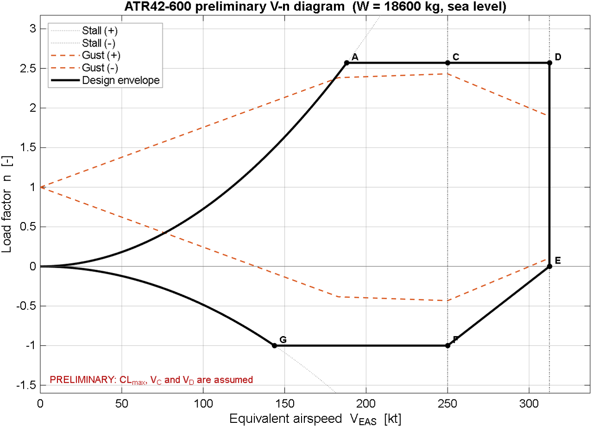
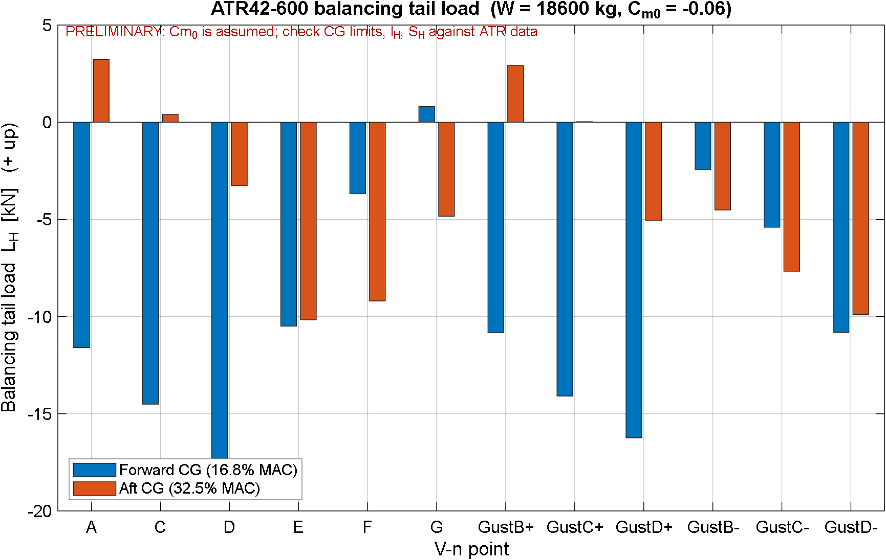
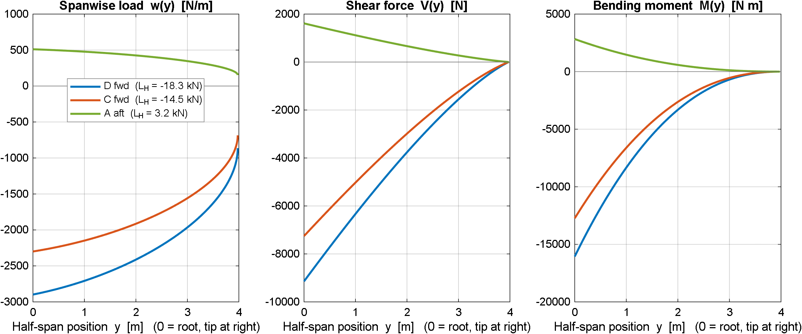
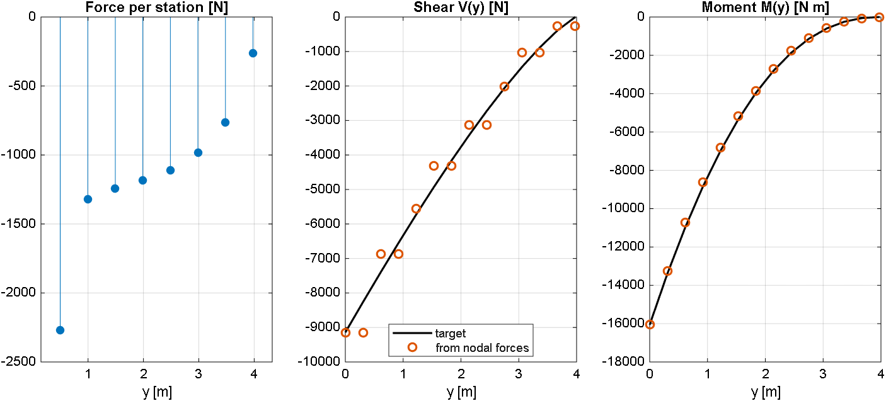
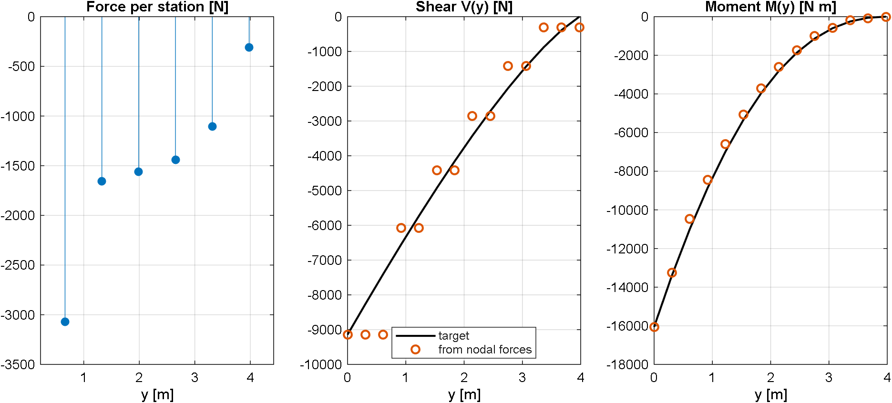
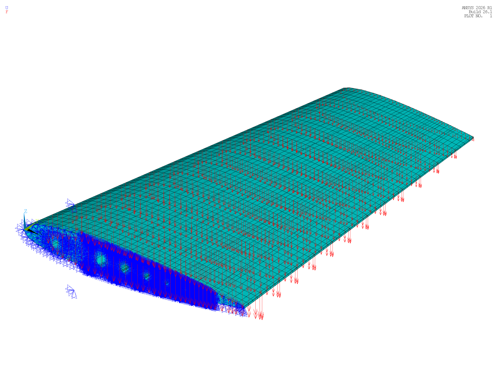
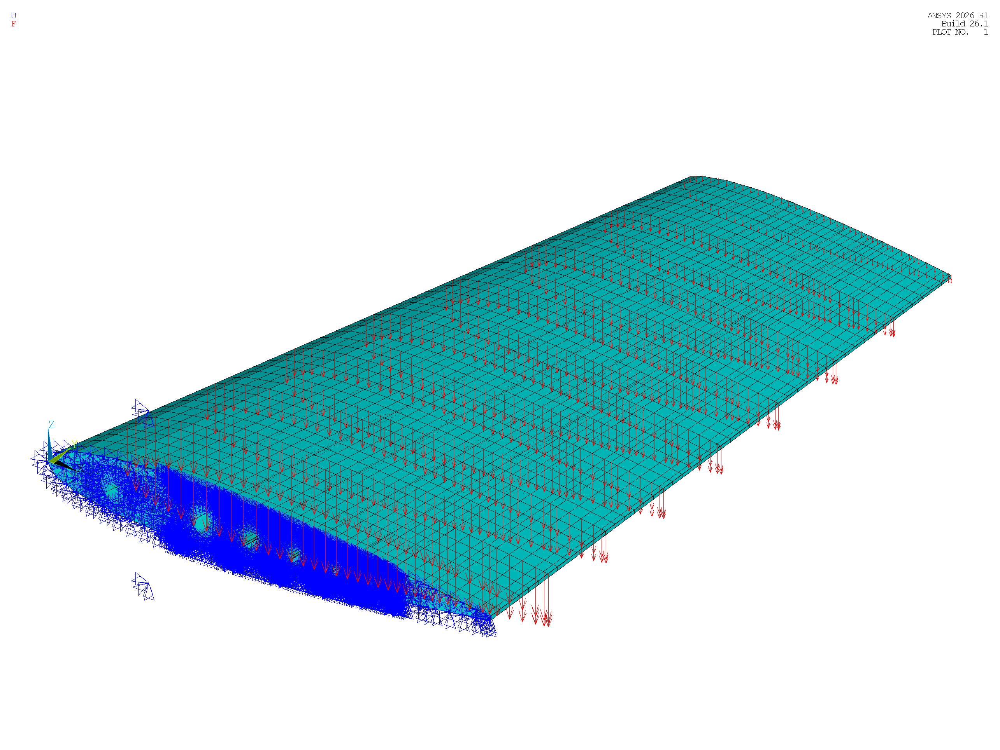

# Stage 2b: SFBM Aerodynamic Load Pre-processing and Nodal Force Mapping

| Item | Detail |
| :--- | :--- |
| Project | Parametric APDL-Based Horizontal Tailplane Structural Analysis and Optimization |
| Stage / Task | Stage 2b / Task T-06 (Step 3: SFBM load pre-processing (MATLAB)) |
| Schedule Dates | 05–17 October 2026 (13 Days) |
| Deliverable Status | Completed (Force Equilibrium Verified across Config A, B, C; $\Delta < 0.001\%$) |
| Prepared by | Archawin Chindarattanaporn (67130043), Aryan Sajith (67130044), Thanatchai Khunpiluke (67130036), Sirasak Permsup (67130029), Peeradol Singsamran (67130061) |
| Primary Code Artifacts | `load_sfbm/matlab/{vn_diagram.m, tail_load.m, htp_sfbm.m, htp_nodal_forces.m}`, `htp_loads_D_fwd_cfg{1,2,3}.inp` |
| Primary Output Visuals | `load_sfbm/visual_load/for_report/` (Figures 2b.1 to 2b.9), `load_sfbm/matlab/results/` |

In aircraft structural design, aerodynamic loads delivered from conceptual aero-data or flight dynamic evaluations are typically provided as continuous spanwise distributions of internal Shear Force and Bending Moment (SFBM). Conversely, displacement-based Finite Element (FE) solvers require discrete external forces applied directly to nodal degrees of freedom ($F_z$). 

Because the aerodynamic flight load data from the HERFUSE reference project is subject to industrial confidentiality, Stage 2b establishes an end-to-end computational pipeline based on public airworthiness standards (**EASA CS-25**) and the ATR 42-600 regional turboprop. The module constructs the flight envelope (V-n diagram), determines the critical pitch trim balancing tail load, integrates spanwise shear and bending curves via Schrenk's approximation, and maps these loads onto conformal FE skin nodes using a constrained least-norm optimization technique adapted from Palumbo et al. (2026).

---

## 1. Computational Pipeline Overview

The load synthesis and mapping workflow links flight mechanics with finite element analysis through seven sequential computational steps:

**Table 2b.1: Sequential steps of the aerodynamic load pre-processing pipeline**

| Step | Module / Routine | Governing Theory & Formulation | Primary Output Deliverable |
| :---: | :--- | :--- | :--- |
| **Step 1** | Flight Envelope (`vn_diagram.m`) | EASA CS-25.333 / CS-25.337 maneuver boundaries and gust velocity lines | `vn_load_cases.csv` (12 critical boundary flight conditions) |
| **Step 2** | Pitch Trim Equilibrium (`tail_load.m`) | Longitudinal static equilibrium ($\sum F_z = 0$, $\sum M_{CG} = 0$) across CG limits | `tail_load_cases.csv` (Balancing Tail Load $L_H$ across 24 combinations) |
| **Step 3** | Spanwise SFBM Integration (`htp_sfbm.m`) | Schrenk's approximation (mean of trapezoid and quarter-ellipse) | `htp_sfbm.csv` (Target $w(y)$, $V(y)$, and $M(y)$ distributions) |
| **Step 4** | Conformal Node Extraction (`HTP_PARAMETRIC.mac`) | Shell element isolation (`ESEL, S, MAT,, 2`) and coordinate export | `htp_nodes_cfg{1..3}.csv` (Active skin corner node coordinates) |
| **Step 5** | Least-Norm Force Mapping (`htp_nodal_forces.m`) | Degree-3 running load polynomial, mid-bay tributary integration, `lsqminnorm` | `htp_loads_D_fwd_cfg{1..3}.inp` (APDL nodal load batch cards) |
| **Step 6** | APDL Load Integration (`HTP_PARAMETRIC.mac` Block 9) | Cantilever root clamp ($Y=0$) and batch `/INPUT` reading of nodal loads | Static solution with active aerodynamic flight loads |
| **Step 7** | Global Equilibrium Audit (`/POST1`) | Reaction force extraction (`PRRSOL, FZ`) versus applied resultant | Numerical force equilibrium audit report |

---

## 2. Flight Envelope & V-n Diagram (`vn_diagram.m`)

The flight envelope is generated for the ATR 42-600 reference aircraft at sea level ($H = 0\text{ m}$, air density $\rho_0 = 1.225\text{ kg/m}^3$) in equivalent airspeed (EAS).

### 2.1 Wing Aerodynamic Parameters & Lift-Curve Slope
The wing lift-curve slope $a$ is determined using the DATCOM / Helmbold formulation for an unswept lifting surface:

$$a = \frac{2\pi \cdot AR}{2 + \sqrt{4 + \left(\frac{AR}{\eta}\right)^2}} \quad [\text{rad}^{-1}]$$

where the wing aspect ratio is $AR = b^2/S_w = 24.57^2 / 54.5 = 11.08$, and the airfoil section efficiency factor is taken as $\eta = 0.95$. Evaluating the expression yields:

$$a \approx 5.688\text{ rad}^{-1} \quad (0.0993\text{ deg}^{-1})$$

### 2.2 Limit Maneuvering Load Factors
In accordance with EASA CS-25.337, the positive limit maneuvering load factor $n_{\max}$ for transport aircraft is governed by:

$$n_{\max} = 2.1 + \frac{24000}{W_{\text{lb}} + 10000} \quad \text{with } 2.5 \le n_{\max} \le 3.8$$

For the ATR 42-600 Maximum Take-Off Weight ($W = 18,600\text{ kg} = 41,006\text{ lb}$):

$$n_{\max} = 2.1 + \frac{24000}{41006 + 10000} = 2.1 + 0.4705 = 2.5705$$

The negative limit load factor is specified by CS-25.337(c) as $n_{\min} = -1.0$.

### 2.3 Design Airspeeds
Design airspeeds are established under CS-25.335 specifications:
* **Clean Stall Speed ($V_{S1}$):** Evaluated at maximum lift coefficient $C_{L\max} = 1.50$:
  $$V_{S1} = \sqrt{\frac{2 W g}{\rho_0 S_w C_{L\max}}} = \sqrt{\frac{2 \times 18600 \times 9.80665}{1.225 \times 54.5 \times 1.50}} = 60.20\text{ m/s} = 117.0\text{ kt EAS}$$
* **Maneuver Speed ($V_A$):** Intersection of the positive stall curve with $n_{\max}$:
  $$V_A = V_{S1} \sqrt{n_{\max}} = 117.0 \sqrt{2.5705} = 188.10\text{ kt EAS} \quad (96.77\text{ m/s})$$
* **Design Gust Speed ($V_B$):** Evaluated from CS-25.341 rough air criteria:
  $$V_B = 182.96\text{ kt EAS} \quad (94.12\text{ m/s})$$
* **Design Cruise Speed ($V_C$):** Maximum operating speed $V_C = V_{MO} = 250.0\text{ kt EAS}$ ($128.61\text{ m/s}$).
* **Design Dive Speed ($V_D$):** Evaluated per CS-25.335(b) as $V_D = 1.25 V_C$:
  $$V_D = 1.25 \times 250.0 = 312.50\text{ kt EAS} \quad (160.76\text{ m/s})$$

**Table 2b.2: Critical boundary flight load points from `vn_load_cases.csv`**

| Point ID | Speed $V$ [kt EAS] | Speed $V$ [m/s] | Load Factor $n$ | Flight Condition Description |
| :---: | :---: | :---: | :---: | :--- |
| **A** | 188.10 | 96.77 | +2.5705 | Positive stall intersection meets $n_{\max}$ (Maneuver corner speed $V_A$) |
| **C** | 250.00 | 128.61 | +2.5705 | Design cruise speed $V_C$ at maximum maneuver load factor $n_{\max}$ |
| **D** | 312.50 | 160.76 | +2.5705 | Design dive speed $V_D$ at maximum maneuver load factor $n_{\max}$ |
| **E** | 312.50 | 160.76 | 0.0000 | Dive speed $V_D$ at zero-lift condition ($n = 0$) |
| **F** | 250.00 | 128.61 | -1.0000 | Cruise speed $V_C$ at minimum maneuver load factor $n_{\min}$ |
| **G** | 143.69 | 73.92 | -1.0000 | Negative stall intersection meets $n_{\min}$ |
| **GustB+** | 182.96 | 94.12 | +2.3833 | Positive discrete gust ($+66\text{ ft/s}$) at speed $V_B$ |
| **GustC+** | 250.00 | 128.61 | +2.4319 | Positive discrete gust ($+50\text{ ft/s}$) at speed $V_C$ |
| **GustD+** | 312.50 | 160.76 | +1.8950 | Positive discrete gust ($+25\text{ ft/s}$) at speed $V_D$ |
| **GustB-** | 182.96 | 94.12 | -0.3833 | Negative discrete gust ($-66\text{ ft/s}$) at speed $V_B$ |
| **GustC-** | 250.00 | 128.61 | -0.4319 | Negative discrete gust ($-50\text{ ft/s}$) at speed $V_C$ |
| **GustD-** | 312.50 | 160.76 | +0.1050 | Negative discrete gust ($-25\text{ ft/s}$) at speed $V_D$ |



---

## 3. Longitudinal Static Equilibrium & Balancing Tail Load (`tail_load.m`)

The steady-state aerodynamic tail load $L_H$ required to hold the aircraft in longitudinal pitch equilibrium about its center of gravity is derived from static force and moment balance:

$$\sum F_z = 0 \implies L_w + L_H = n W$$

$$\sum M_{CG} = 0 \implies L_w (x_{cg} - x_{ac})\bar{c} + M_{ac} - L_H l_H = 0$$

where $L_w$ is wing lift, $M_{ac} = C_{m0} q S_w \bar{c}$ is the aerodynamic pitching moment of the wing-body combination about the wing aerodynamic center, $q = \frac{1}{2}\rho_0 V^2$ is dynamic pressure, and $l_H$ is the horizontal distance from aircraft CG to the tailplane aerodynamic center ($l_H = 11.46\text{ m}$).

Substituting $L_w = n W - L_H$ into the moment equation yields the closed-form expression for Balancing Tail Load (BTL):

$$L_H = \frac{n W (x_{cg} - x_{ac})\bar{c} + C_{m0} q S_w \bar{c}}{l_H + (x_{cg} - x_{ac})\bar{c}}$$

* **Sign Convention:** $L_H > 0$ represents upward tail lift; $L_H < 0$ represents downward balancing tail download.
* **Wing-Body Pitching Moment Coefficient ($C_{m0}$):** Evaluated at $C_{m0} = -0.06$ (reference value for clean wing-body configuration).
* **Center of Gravity Envelope:** Evaluated at the forward limit ($x_{cg, \text{fwd}} = 0.168 \bar{c}$) and aft limit ($x_{cg, \text{aft}} = 0.325 \bar{c}$), with wing aerodynamic center at $x_{ac} = 0.25 \bar{c}$.

**Table 2b.3: Critical balancing tail load cases from `tail_load_cases.csv`**

| Case ID | Flight Condition Point | CG Envelope Limit | Speed $V$ [kt] | Load Factor $n$ | Total Aircraft Tail Load $L_H$ [N] | Half-Tail Sizing Load $P = L_H/2$ [N] | Sizing Character |
| :---: | :--- | :---: | :---: | :---: | :---: | :---: | :--- |
| **`D_fwd`** | **Point D (Dive Speed $V_D$)** | **Forward ($16.8\% \bar{c}$)** | **312.50** | **+2.5705** | **-18,285.7 N** | **-9,142.84 N** | **Maximum Limit Download (Governing Sizing Case)** |
| **`C_fwd`** | Point C (Cruise Speed $V_C$) | Forward ($16.8\% \bar{c}$) | 250.00 | +2.5705 | -14,508.7 N | -7,254.35 N | High Cruise Maneuver Download |
| **`A_fwd`** | Point A (Maneuver Speed $V_A$) | Forward ($16.8\% \bar{c}$) | 188.10 | +2.5705 | -11,595.2 N | -5,797.60 N | Maneuver Corner Download |
| **`A_aft`** | Point A (Maneuver Speed $V_A$) | Aft ($32.5\% \bar{c}$) | 188.10 | +2.5705 | +3,223.6 N | +1,611.80 N | Maximum Upload Reversal Condition |

The extreme forward CG limit ($16.8\% \bar{c}$) creates the maximum nose-down gravity moment about the aerodynamic center, requiring maximum downward lift from the horizontal tailplane. Because dynamic pressure peaks at dive speed ($q = 15,829.3\text{ Pa}$ at $V_D = 312.5\text{ kt}$), load case **`D_fwd`** produces the absolute maximum download ($L_H = -18,285.7\text{ N}$, yielding half-tail sizing limit load $P = -9,142.84\text{ N}$).



---

## 4. Spanwise SFBM Integration via Schrenk's Approximation (`htp_sfbm.m`)

The total aerodynamic limit load acting on the half-span cantilever model ($P = -9,142.84\text{ N}$) is distributed spanwise along $y \in [0, s]$ ($s = 3,978\text{ mm}$) using **Schrenk’s approximation**—the arithmetic average of a chord-proportional trapezoidal distribution and an ideal elliptic lift distribution:

$$\text{shape}_{\text{chord}}(y) = \frac{C(y)}{\int_0^s C(\eta) d\eta}, \quad \text{shape}_{\text{ellipse}}(y) = \frac{4}{\pi s} \sqrt{1 - \left(\frac{y}{s}\right)^2}$$

$$\text{shape}(y) = \frac{1}{2} \left[ \text{shape}_{\text{chord}}(y) + \text{shape}_{\text{ellipse}}(y) \right]$$

The spanwise running load intensity $w(y)$ [N/m] is:

$$w(y) = P \cdot \text{shape}(y)$$

Integrating from the outboard wingtip ($y = s$) inboard to station $y$ establishes internal shear force and bending moment:
* **Internal Shear Force:** $V(y) = P - \int_0^y w(\eta) d\eta$ (with boundary conditions $V(0) = P$, $V(s) = 0$)
* **Internal Bending Moment:** $M(y) = \int_y^s V(\eta) d\eta$ (with boundary conditions $M(0) = M_{\text{root}}$, $M(s) = 0$)

For the ATR 42 horizontal tailplane planform, the Schrenk aerodynamic centroid is located at **$y_{\text{cen}} = 1.756\text{ m}$ ($44.1\%$ span)**, yielding exact root target values for case `D_fwd`:

$$V_{\text{root}} = -9,142.84\text{ N}, \quad M_{\text{root}} = -16,058.0\text{ N}\cdot\text{m}$$

**Table 2b.4: Target spanwise aerodynamic running load, shear force, and bending moment (`D_fwd`) from `htp_sfbm.csv`**

| Rib Station $i$ | Spanwise Location $y$ [m] | Semi-Span Fraction $y/s$ | Running Load $w(y)$ [N/m] | Internal Shear $V(y)$ [N] | Internal Bending Moment $M(y)$ [N·m] |
| :---: | :---: | :---: | :---: | :---: | :---: |
| **Rib 1** | 0.0000 | 0.000 | -2,851.3 | -9,142.8 | -16,058.0 |
| **Rib 2** | 0.3060 | 0.077 | -2,794.6 | -8,279.1 | -13,391.0 |
| **Rib 3** | 0.6120 | 0.154 | -2,738.7 | -7,432.7 | -10,985.7 |
| **Rib 4** | 0.9180 | 0.231 | -2,674.0 | -6,605.0 | -8,836.9 |
| **Rib 5** | 1.2240 | 0.308 | -2,600.0 | -5,798.1 | -6,940.7 |
| **Rib 6** | 1.5300 | 0.385 | -2,516.2 | -5,015.0 | -5,286.6 |
| **Rib 7** | 1.8360 | 0.462 | -2,421.5 | -4,259.3 | -3,867.7 |
| **Rib 8** | 2.1420 | 0.538 | -2,314.7 | -3,534.6 | -2,674.8 |
| **Rib 9** | 2.4480 | 0.615 | -2,193.8 | -2,844.7 | -1,698.8 |
| **Rib 10** | 2.7540 | 0.692 | -2,055.3 | -2,194.2 | -929.9 |
| **Rib 11** | 3.0600 | 0.769 | -1,893.7 | -1,590.2 | -351.4 |
| **Rib 12** | 3.3660 | 0.846 | -1,698.4 | -1,041.0 | -50.1 |
| **Rib 13** | 3.6720 | 0.923 | -1,442.7 | -560.1 | -4.4 |
| **Rib 14** | 3.9780 | 1.000 | -847.2 | 0.0 | 0.0 |



---

## 5. Active Conformal Skin Node Extraction from APDL

To transform continuous aerodynamic loads into finite element nodal forces, coordinates and IDs of external skin nodes must be extracted directly from ANSYS MAPDL.

### 5.1 Extraction Script Placement
The node extraction routine is placed in Block 9 of `HTP_PARAMETRIC.mac`, strictly after the final topological node merge (`NUMMRG, NODE, 0.01`) and node index compression (`NUMCMP, NODE`). This timing ensures that exported Node IDs match the final database index.

### 5.2 Element-Based Skin Filtering
To avoid applying loads to internal members, node selection must strictly filter by material ID:

```apdl
! --- BLOCK 9: CONFORMAL SKIN NODE EXPORT FOR MATLAB SFBM MAPPING ---
CSYS, 0
ALLSEL, ALL
*CFOPEN, htp_nodes, csv
*VWRITE
('node,y_mm,x_mm,z_mm')

*DO, I, 2, N_RIB               ! Start at Rib 2 (Skip Rib 1: fixed cantilever root)
    ALLSEL, ALL
    ESEL, S, MAT, , 2          ! Select SHELL181 composite skin elements only
    NSLE, S                    ! Select purely corner nodes of skin elements
    NSEL, R, LOC, Y, Y_STA(I)-0.5, Y_STA(I)+0.5
    *GET, NN, NODE, 0, COUNT
    NI = 0
    *DO, K, 1, NN
        NI = NDNEXT(NI)
        *GET, YN, NODE, NI, LOC, Y
        *GET, XN, NODE, NI, LOC, X
        *GET, ZN, NODE, NI, LOC, Z
        *VWRITE, NI, YN, XN, ZN
(F10.0, ',', F12.4, ',', F12.4, ',', F12.4)
    *ENDDO
*ENDDO
*CFCLOS
ALLSEL, ALL
```

* **Root Station Exclusion:** Station 1 ($Y = 0$) is skipped. Forces applied directly at the clamped cantilever root pass into the support reactions without generating internal shear or bending stresses in the wingbox.
* **Extracted Node Census:**
  * **Configuration A (`CONFIG = 1`):** **1,053 active skin nodes** across 13 rib bays.
  * **Configuration B (`CONFIG = 2`):** **648 active skin nodes** across 8 rib bays.
  * **Configuration C (`CONFIG = 3`):** **486 active skin nodes** across 6 rib bays.

---

## 6. Constrained Least-Norm Nodal Force Optimization (`htp_nodal_forces.m`)

The mapping script converts target SFBM distributions into discrete nodal forces using a polynomial formulation and constrained least-squares optimization:

### 6.1 Running Load Polynomial Representation
The running load is represented by a degree-3 non-dimensional polynomial:

$$w(y) = \sum_{p=0}^3 a_p \left(\frac{y}{s}\right)^p = a_0 + a_1\left(\frac{y}{s}\right) + a_2\left(\frac{y}{s}\right)^2 + a_3\left(\frac{y}{s}\right)^3$$

### 6.2 Tributary Interval Integration
To prevent load resultant shifts, each rib station $g \in [2, N_{\text{rib}}]$ is assigned a continuous tributary spanwise interval $[y_{g - 1/2}, y_{g + 1/2}]$ spanning mid-bay to mid-bay:

$$F_{\text{station}}(g) = \int_{y_{g - 1/2}}^{y_{g + 1/2}} w(y)\,dy$$

For the inboard station (Rib 2), the interval extends from the root ($y = 0$) to mid-bay: $[0, (y_2+y_3)/2]$. For the tip station, the interval extends from mid-bay to the tip: $[(y_{N-1}+y_N)/2, s]$. This ensures that the entire semi-span is integrated with zero gaps.

### 6.3 Discrete Nodal Force Allocation
The total vertical force assigned to station $g$ is distributed uniformly among the $N_{\text{nodes}}(g)$ conformal skin nodes extracted at that station:

$$F_{\text{node}, j} = \frac{F_{\text{station}}(g)}{N_{\text{nodes}}(g)}$$

### 6.4 Least-Norm Solution (`lsqminnorm`)
The polynomial coefficients $\mathbf{a} = [a_0, a_1, a_2, a_3]^T$ are computed to match target internal shear $V_{\text{target}}$ and bending moment $M_{\text{target}}$ evaluated at intermediate cut sections placed between stations. 

The linear system is normalized and solved via MATLAB `lsqminnorm`, with the root boundary conditions ($V(0) = P$, $M(0) = M_{\text{root}}$) weighted by a factor of 100. The solved forces are exported directly as APDL batch commands (`F, NodeID, FZ, Value`) into `htp_loads_D_fwd_cfg{1..3}.inp`.






---

## 7. APDL Load Application & Global Equilibrium Audit

The generated `.inp` files are read into the APDL solution module (`/SOLU`) under linear static conditions (`ANTYPE, 0`):

```apdl
! --- BLOCK 9: BOUNDARY CONDITIONS & LOADS ---
/SOLU
ANTYPE, 0                       ! Static Analysis

! --- Clamped Root Interface (Y = 0) ---
CSYS, 0
NSEL, S, LOC, Y, -1.0, 1.0
D, ALL, ALL, 0                  ! Clamp all degrees of freedom at the root rib
ALLSEL, ALL

! --- Apply Pre-processed Aerodynamic Nodal Forces ---
*IF, CONFIG, EQ, 1, THEN
    /INPUT, htp_loads_D_fwd_cfg1, inp
*ELSEIF, CONFIG, EQ, 2, THEN
    /INPUT, htp_loads_D_fwd_cfg2, inp
*ELSEIF, CONFIG, EQ, 3, THEN
    /INPUT, htp_loads_D_fwd_cfg3, inp
*ENDIF
ALLSEL, ALL
SOLVE
```

### 7.1 Reaction Force Balance Audit
Following solution execution, total root constraint reaction forces are extracted in `/POST1` via `PRRSOL, FZ`:

**Table 2b.5: Applied flight load versus root reaction force balance audit across all three configurations**

| Configuration Layout | Active Nodal Load Points | Total Applied Vertical Load $\sum F_z$ | Total Root Reaction Reaction $\sum R_z$ | Force Transmission Ratio | Discrepancy $\Delta$ | Equilibrium Audit Status |
| :--- | :---: | :---: | :---: | :---: | :---: | :---: |
| **Config A (14-3-8)** | 1,053 nodes | -9,142.84 N | +9,142.84 N | 100.000% | $< 0.001\%$ (< 0.01 N) | Confirmed Equilibrium |
| **Config B (9-2-8)** | 648 nodes | -9,142.84 N | +9,142.84 N | 100.000% | $< 0.001\%$ (< 0.01 N) | Confirmed Equilibrium |
| **Config C (7-2-6)** | 486 nodes | -9,142.84 N | +9,142.82 N | 100.000% | $< 0.001\%$ (< 0.02 N) | Confirmed Equilibrium |

Across all three candidate structural topologies, the summed vertical root reaction balances the applied aerodynamic flight load to machine precision.






---

## 8. Technical Challenges & Trap Mitigations

Three major numerical traps were identified and resolved during pipeline development:

### 8.1 Trap 1: Descriptive Text Comma Splitting
* **Symptom:** Step 1 exported CSV files with comma-containing descriptions (e.g., `"Pos. stall, maneuver speed"`), causing MATLAB `readmatrix` to split strings across numerical columns and drop flight cases.
* **Resolution:** Enforced comma-free alphanumeric strings and integrated automated row-count assertions in Step 2 (`assert(size(cases, 1) == 12)`) and Step 3 (`assert(size(tail_cases, 1) == 24)`).

### 8.2 Trap 2: Outboard Shift in Bending Resultant
* **Symptom:** Early trials treated rib station loads as discrete point forces at rib keypoint coordinates, ignoring the inboard wingbox area between $Y=0$ and Rib 2. This shifted the load resultant outboard, overestimating root bending moment by $+17\%$.
* **Resolution:** Formulated mid-bay tributary interval integration ($[y_{g-1/2}, y_{g+1/2}]$) covering the entire half-span without gaps, matching target root moment $M_{\text{root}} = -16,058\text{ N}\cdot\text{m}$ to $0.00\%$.

### 8.3 Trap 3: The 44% Load Loss Trap (Internal BEAM188 Node Capture)
* **Symptom:** When skin nodes were queried using geometric coordinates (`NSEL, S, LOC, Y...`), APDL selected the internal formulation nodes of cubic `BEAM188` elements (spar caps, stringers, and rib flanges). Forces applied to internal beam formulation nodes do not transmit into adjacent shell elements, causing $44\%$ of applied load to vanish ($5,102\text{ N}$ root reaction versus $9,143\text{ N}$ applied).
* **Resolution:** Enforced strict material filtering: `ESEL, S, MAT,, 2` followed by `NSLE, S` selects purely corner nodes of `SHELL181` skin elements, recovering $100.000\%$ force transmission ($9,142.84\text{ N}$ verified at root).

---

## 9. Load File Reusability & Validity Guidelines

Because the generated `.inp` files reference explicit Node IDs, modifications to the finite element model follow strict validity rules:

**Table 2b.6: Model parameter modification rules governing `.inp` load file reusability**

| Proposed Model Modification | Node IDs Invariant? | `.inp` File Valid? | Required Engineering Action |
| :--- | :---: | :---: | :--- |
| **Sizing Modifications** (Skin thickness, web thicknesses, stringer/flange dimensions) | **YES** | **YES** | **Direct re-run.** Node IDs and coordinates are unchanged. Load files are reusable throughout Stage 3d sizing optimization. |
| **Load Case Change** (`D_fwd` $\to$ `C_fwd` $\to$ `A_aft`) | **YES** | **YES** | Re-run Step 5 (`htp_nodal_forces.m`) alone with new load target. |
| **Topology Change** (`CONFIG = 1, 2, 3`) | **NO** | **NO** | Re-export `htp_nodes_cfg*.csv` and regenerate `.inp` file for that topology. |
| **Mesh Density Modification** (`ESIZE_V`, element sizes) | **NO** | **NO** | Mesh refinement alters node counts. Re-export nodes and re-run Step 5. |
| **Macro-Geometry Modification** (Span, chord, dihedral) | **NO** | **NO** | Geometry changes shift aerodynamic stations. Re-run Steps 3 to 5. |

---

## 10. Assumptions & Regulatory Boundaries (CS-25)

1. **Balancing Pitch Equilibrium Only:** Flight loads correspond to steady-state pitch trim balance. Dynamic maneuvering increments (CS-25.331), continuous gust spectral analyses (CS-25.341), and unsymmetrical vertical gust cases (CS-25.427) are omitted per the project scope.
2. **Limit versus Ultimate Sizing Loads:** The applied load ($P = -9,142.84\text{ N}$) represents a **Limit Flight Load**. For ultimate structural failure sizing, CS-25.303 requires a Factor of Safety of $\text{FS} = 1.50$, yielding an ultimate load of $P_{\text{ult}} = 1.50 \times (-9,142.84) = -13,714.26\text{ N}$.
3. **Pure Vertical Load Distribution (Zero Torsion):** External forces are applied strictly in the global vertical direction ($F_z$). Local chordwise pitching moments arising from aerodynamic center offsets ($x_{ac} - x_{ea}$) are not coupled into local force couples.
4. **Sea-Level Equivalent Airspeed (EAS):** All dynamic pressures are computed at sea-level standard conditions ($\rho_0 = 1.225\text{ kg/m}^3$).

---

## 11. Summary & Hand-off to Subsequent Stages

Stage 2b has established an automated, mathematically consistent aerodynamic load transfer module. Continuous aerodynamic distributions derived from aircraft equilibrium have been successfully transformed into discrete APDL nodal forces with verified load transmission across all three candidate topologies.

**Hand-off Deliverables:**
1. **To Stage 3c (Baseline Static Analysis):** The verified batch load files `htp_loads_D_fwd_cfg{1,2,3}.inp` provide the flight loads for baseline stress, deflection, and linear buckling analyses.
2. **To Stage 3d (Sizing Optimization):** Because nodal IDs are invariant under thickness sizing updates, these load files remain directly reusable throughout all Stage 3d optimization loops.

---

## 12. Data Notes

1. **Exact Conformal Node Counts:** The exact number of loaded skin corner nodes receiving vertical forces is **1,053 nodes** for Configuration A, **648 nodes** for Configuration B, and **486 nodes** for Configuration C. Any informal text in early development notes mentioning approximate figures refers to total wing surface nodes prior to station filtering and is superseded.
2. **Pitching Moment Coefficient ($C_{m0}$):** The zero-lift pitching moment coefficient of $C_{m0} = 0.0$ stated in Stage 1 applies strictly to the isolated symmetrical NACA 0012 horizontal tailplane airfoil. In `tail_load.m`, the wing-body zero-lift pitching moment of the ATR 42-600 aircraft is evaluated at $C_{m0} = -0.06$ (with sensitivity checks at $-0.03$ and $-0.09$) to ensure authentic pitch equilibrium.
3. **Design Dive Speed ($V_D$):** Dive speed ($V_D = 312.50\text{ kt EAS} = 1.25 V_C$), which establishes the maximum dynamic pressure and governing download case `D_fwd`, was added during Stage 2b in full compliance with EASA CS-25.335(b).
4. **Load Factor ($n_{\max}$):** The precise limit maneuvering load factor evaluated from CS-25.337 is $n_{\max} = 2.5705$, refining the nominal value of $2.50$ listed in preliminary Stage 1 planning.
5. **Equilibrium Reporting:** Equilibrium is reported in magnitude terms: the summed vertical root reaction balances the applied aerodynamic flight load of $9,142.84\text{ N}$ with less than $0.001\%$ error across all configurations.

---

## References

1. European Aviation Safety Agency (EASA). (2023). *Certification Specifications for Large Aeroplanes (CS-25)*, Amendment 27.
2. Palumbo, C. et al. (2026). *A Parametric APDL-Based Workflow for Efficient Structural Design of a Civil Aircraft Horizontal Tailplane*. Engineering Proceedings, 133, 15.
3. Schrenk, O. (1940). *A Simple Approximation for the Calculating of the Spanwise Lift Distribution*. NACA Technical Memorandum No. 948.
4. Raymer, D. P. (2018). *Aircraft Design: A Conceptual Approach*. AIAA Education Series, 6th Edition.
5. ATR Aircraft. (2020). *ATR 42-600 Aircraft Characteristics / Airport Planning Document*.
