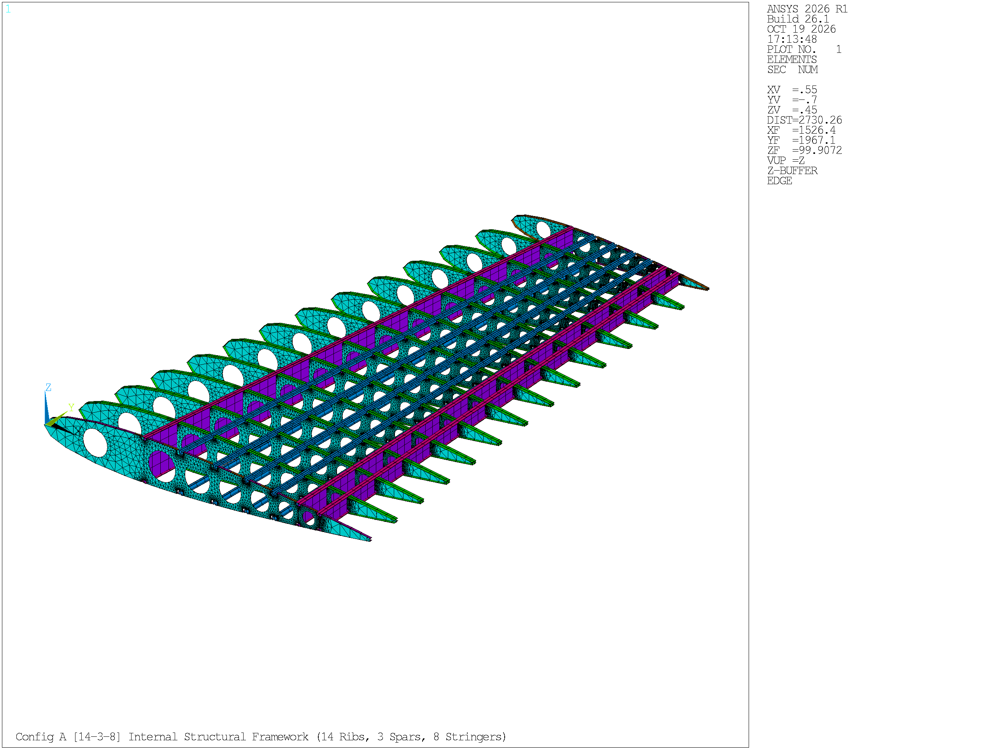
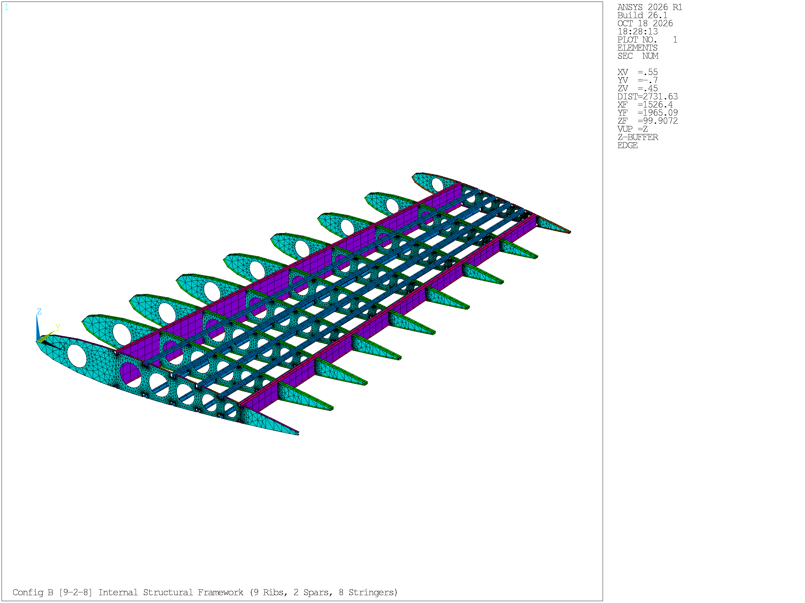
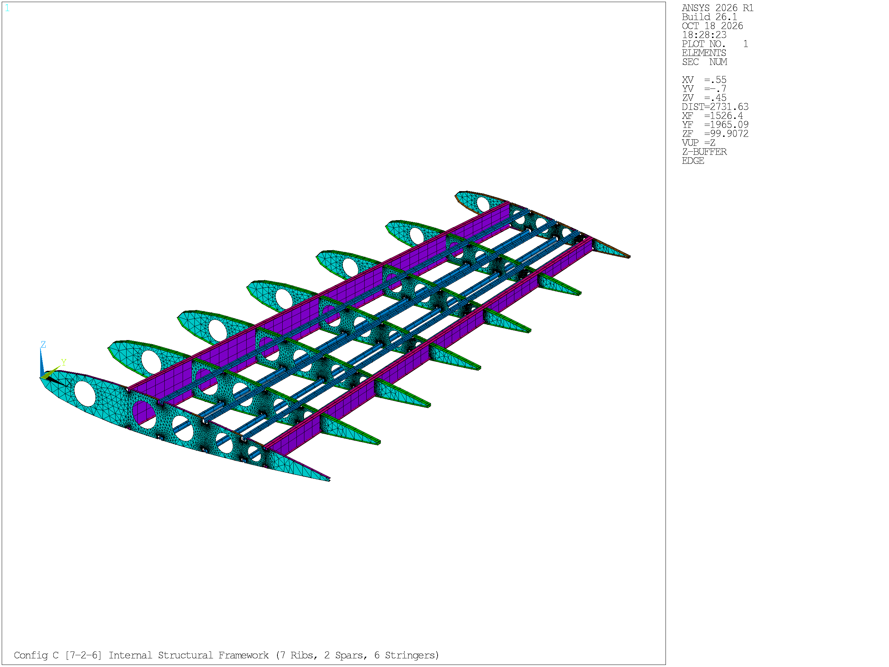

# Stage 3a: Configuration Setup

| Item | Detail |
| :--- | :--- |
| Project | Parametric APDL-Based Horizontal Tailplane Structural Analysis and Optimization |
| Stage / Task | Stage 3a / Task T-07 Part 1 (Step 4: Configuration setup) |
| Schedule Dates | 17–18 October 2026 (2 Days) |
| Deliverable Status | Completed (Topological Switcher Synchronized across Config A, B, and C) |
| Prepared by | Archawin Chindarattanaporn (67130043), Aryan Sajith (67130044), Thanatchai Khunpiluke (67130036), Sirasak Permsup (67130029), Peeradol Singsamran (67130061) |
| Primary Code Artifacts | `HTP_PARAMETRIC.mac` (Lines 1–35, 113–148, 193–224, 366–480), `HTP_BUILD_CORE.mac`, `RENDER_STAGE3A_CFGA.mac` |
| Primary Output Visuals | `figures/stage3a/` (Figures 3a.1 to 3a.3), `visual_log/stage2a_component_gallery/` |

A fundamental advantage of parametric finite element scripting over traditional CAD-based workflows is the capability to explore diverse structural topologies without rebuilding geometric models from scratch. Following the design exploration strategy established in the project proposal and Palumbo et al. (2026), Stage 3a formalizes the setup of three distinct horizontal tailplane structural configurations within a single master script. 

By varying the number and spacing of transverse ribs, longitudinal spars, and Hat-section stringers through a centralized integer switch (`CONFIG`), the framework enables systematic structural evaluation spanning from a dense, damage-tolerant baseline to aggressively lightened airframe topologies.

---

## 1. Multi-Configuration Architectural Strategy

The three structural configurations established in this project represent distinct design philosophies:

1. **Configuration A (Baseline — `CONFIG = 1`):** Replicates the reference civil aircraft tailplane layout from Palumbo et al. (2026). It incorporates a 3-spar torque box (front, mid, and rear spars), 14 transverse ribs, and 8 longitudinal Hat-section stringers. This configuration provides high torsional stiffness and multiple redundant load paths.
2. **Configuration B (Moderate Reduction — `CONFIG = 2`):** Removes the intermediate mid-spar, leaving a conventional 2-spar wingbox (front and rear spars). Rib spacing is widened by reducing the rib count from 14 to 9, while retaining 8 longitudinal stringers to stabilize the widened skin bays.
3. **Configuration C (Aggressive Reduction — `CONFIG = 3`):** Further simplifies the internal framework to 7 transverse ribs, 2 spars, and 6 stringers (3 upper, 3 lower). This topology maximizes the unsupported skin panel area to establish the absolute minimum internal framework mass that can satisfy structural integrity and airworthiness constraints.







---

## 2. Parametric Configuration Switcher in APDL

In `HTP_PARAMETRIC.mac` (Block 1), the selection of topology is governed by the integer variable `CONFIG`:

```apdl
! --- TOPOLOGICAL LAYOUT SELECTOR ---
*IF, CONFIG, EQ, 1, THEN
    N_RIB  = 14
    N_SPAR = 3
    N_STR  = 8
    N_CUT  = 7
*ELSEIF, CONFIG, EQ, 2
    N_RIB  = 9
    N_SPAR = 2
    N_STR  = 8
    N_CUT  = 6
*ELSEIF, CONFIG, EQ, 3
    N_RIB  = 7
    N_SPAR = 2
    N_STR  = 6
    N_CUT  = 5
*ENDIF
```

Modifying `CONFIG` automatically propagates across all subsequent blocks: updating rib loop bounds (`*DO, I, 1, N_RIB`), spar station arrays, stringer line definitions, cutout generation routines, and finite element component groupings without requiring manual user intervention.

---

## 3. Structural Topology & Geometric Definitions

The spatial coordinates and chordwise distribution of structural members across the three configurations are summarized below:

**Table 3a.1: Multi-configuration topological comparison and member distribution**

| Structural Parameter | Configuration A (Baseline) | Configuration B (Moderate Reduction) | Configuration C (Aggressive Reduction) | Engineering Role & Topological Impact |
| :--- | :---: | :---: | :---: | :--- |
| **Configuration Index (`CONFIG`)** | `1` | `2` | `3` | Master APDL integer switcher |
| **Transverse Rib Count ($N_{\text{rib}}$)** | 14 | 9 | 7 | Dictates spanwise load transfer and rib pitch |
| **Nominal Rib Pitch ($\Delta y$)** | **306.00 mm** | **497.25 mm** | **663.00 mm** | Evaluated via $\Delta y = \text{SPAN} / (N_{\text{rib}} - 1)$ |
| **Number of Rib Bays** | 13 bays | 8 bays | 6 bays | Number of unsupported skin and spar bays |
| **Longitudinal Spar Count ($N_{\text{spar}}$)** | 3 | 2 | 2 | Governs vertical shear web and bending capacity |
| **Front Spar Chordwise Station ($X/C$)** | $0.300$ ($30.0\% C$) | $0.300$ ($30.0\% C$) | $0.300$ ($30.0\% C$) | Front boundary of the primary wingbox torque cell |
| **Mid Spar Chordwise Station ($X/C$)** | $0.764$ ($76.4\% C$) | *(Removed)* | *(Removed)* | Intermediate shear web in Config A |
| **Rear Spar Chordwise Station ($X/C$)** | $0.827$ ($82.7\% C$) | $0.764$ ($76.4\% C$) | $0.764$ ($76.4\% C$) | Rear boundary of the torque box; controls elevator hinge line |
| **Stringers per Surface ($N_{\text{str}}$)** | 4 upper, 4 lower | 4 upper, 4 lower | 3 upper, 3 lower | Longitudinal stiffeners stabilizing skin panels |
| **Total Stringers ($2 \times N_{\text{str}}$)** | 8 stringers | 8 stringers | 6 stringers | Total count across upper and lower aerodynamic surfaces |
| **Stringer Stations ($X/C$) — Upper & Lower**| $0.409, 0.512, 0.607, 0.691$ | $0.409, 0.512, 0.607, 0.691$ | $0.409, 0.560, 0.691$ | Non-dimensional chordwise stiffener placement |
| **Lightening Holes per Rib ($N_{\text{cut}}$)** | 7 holes | 6 holes | 5 holes | Circular lightening holes cut through each rib web |
| **Primary Wingbox Bays** | 2 torque cells | 1 wide torque cell | 1 wide torque cell | Bounded by longitudinal spar shear webs |

In Configuration A, the torque box is partitioned into two cells by the intermediate spar at $X/C = 0.764$. In Configurations B and C, removing the mid-spar merges the interior into a single wide torque cell extending from $X/C = 0.300$ to $X/C = 0.764$ ($46.4\% \text{ chord}$ cell width). In Configuration C, stringer spacing is redistributed to $X/C = 0.409, 0.560, 0.691$, maintaining balanced panel widths across the upper and lower compression/tension skins.

---

## 4. Baseline Cross-Sectional Sizing Strategy

To establish a controlled foundation for structural comparison, all three configurations initially share identical cross-sectional sizing parameters ($t_0$ baseline):
* **Outer Composite Skin (`SEC 3`):** $t_{\text{skin}} = 2.0\text{ mm}$ (CFRP Quasi-Isotropic)
* **Spar Shear Webs (`SEC 2`):** $t_{\text{spar}} = 3.0\text{ mm}$ (Aluminum 7075-T6)
* **Rib Webs (`SEC 1`):** $t_{\text{rib}} = 2.0\text{ mm}$ (Aluminum 7075-T6)
* **Hat-Section Stringers (`SEC 4`):** $30.0 \times 20.0 \times 15.0\text{ mm}$, wall thickness $t = 1.6\text{ mm}$
* **Spar Cap Flanges (`SEC 5`):** $45.0 \times 2.5\text{ mm}$
* **Interior Rib Flanges (`SEC 6`):** $40.0 \times 1.0\text{ mm}$
* **Boundary Edge Flanges (`SEC 7`, `SEC 8`):** $20.0 \times 1.0\text{ mm}$

### Proposal Hypothesis on Skin Compensation ($t_0$ vs. $t_0 + \Delta$)
The project proposal hypothesized that removing internal spars and widening rib pitch from Configuration A to B and C would require increasing the skin thickness ($t_0 + \Delta$) to restore lost flexural and torsional rigidity. In Stage 3a, all three models are deliberately frozen at the identical baseline gauge ($t_0 = 2.0\text{ mm}$) to quantify the exact stiffness and mass reduction attributable purely to topological changes. The subsequent thickening of the skin ($t_0 + \Delta$) to match aeroelastic deflection limits is systematically conducted during Stage 3d sizing optimization.

---

## 5. Rib Cutout Architecture & Dynamic Safe Pillar Capping

As the number of ribs and spars is altered, internal rib lightening holes must adapt to avoid intersecting spar webs and stringer mouseholes:

1. **Cutout Allocations per Rib:**
   * **Configuration A (`N_CUT = 7`):** 1 forward circular hole in the leading edge bay at $X/C = 0.1535$, plus 6 circular holes spaced across the main wingbox between Spar 1 ($X/C = 0.300$) and Spar 2 ($X/C = 0.764$).
   * **Configuration B (`N_CUT = 6`):** 1 forward circular hole at $X/C = 0.1535$, plus 5 circular holes across the main wingbox.
   * **Configuration C (`N_CUT = 5`):** 1 forward circular hole at $X/C = 0.1535$, plus 4 circular holes across the main wingbox.
2. **Safe Pillar Capping Enforcement:**  
   In early development iterations, uncapped circular holes on the tapered outboard ribs of Configurations B and C breached adjacent stringer mouseholes (yielding negative web bridge ligaments of $-2.52\text{ mm}$ in Config B and $-3.82\text{ mm}$ in Config C).  
   In the synchronized codebase (`HTP_PARAMETRIC.mac` lines 366–480 and `HTP_BUILD_CORE.mac`), dynamic safe pillar capping is strictly enforced across all three branches (`N_CUT = 7, 6, 5`):

$$
\text{Clearance: } D_{\text{adj}} = (X_{\text{mouse}} - X_{\text{hole}}) \cdot C_i - HW
$$

$$
\text{Constraint: } R_{\text{hole}} \le D_{\text{adj}} - 14.0\text{ mm}
$$

   This ensures that every lightening hole maintains a minimum structural web ligament of at least $14.0\text{ mm}$ from adjacent cutouts, guaranteeing error-free boolean operations and watertight meshing across all stations.

---

## 6. Finite Element Mesh Census & Baseline Mass Breakdown

Discretizing the three configurations under identical mesh controls (`ESIZE_V = 100.0 mm` globally, `ESIZE = 15.0 mm` on rib webs) yields the finite element census and baseline structural masses summarized in Table 3a.2:

**Table 3a.2: Finite element mesh census and baseline structural mass across configurations**

| Discretization / Mass Parameter | Configuration A (14-3-8) | Configuration B (9-2-8) | Configuration C (7-2-6) | Topological Trend & Observations |
| :--- | :---: | :---: | :---: | :--- |
| **Total Active Nodes** | **40,607** | **25,063** | **19,199** | Node count drops by $52.7\%$ from Config A to C |
| **Total Finite Elements** | **63,460** | **38,251** | **29,815** | Element count drops by $53.0\%$ |
| 2D Shell Elements (`SHELL181`) | 59,948 | 36,047 | 28,241 | Reflects reduction in rib webs and spar areas |
| 1D Beam Elements (`BEAM188`) | 3,512 | 2,204 | 1,574 | Reflects reduction in rib flanges and stringers |
| Active Conformal Skin Nodes | 1,053 | 648 | 486 | Exterior corner nodes receiving aerodynamic forces |
| **Baseline Half-Span Mass ($M_{\text{half}}$)** | **140.46 kg** | **121.89 kg** | **113.64 kg** | Evaluated at baseline thickness ($t_0$) |
| **Mass Difference vs. Config A Baseline** | *0.00%* | **-13.22%** (-18.57 kg) | **-19.10%** (-26.83 kg) | Weight reduction achieved purely via topology |
| **Full-Span Aircraft Assembly Mass** | **280.93 kg** | **243.78 kg** | **227.28 kg** | Total bilateral tailplane mass ($2 \times M_{\text{half}}$) |

Removing the mid-spar and 5 ribs in Configuration B saves $18.57\text{ kg}$ ($13.22\%$) of half-span mass. Removing 2 additional ribs and 2 stringers in Configuration C achieves an initial mass reduction of $26.83\text{ kg}$ ($19.10\%$) before any thickness optimization is applied.

---

## 7. Configuration-Dependent Aerodynamic Load Transfer

Because changing the rib count alters the spanwise station positions $y_i$ and the number of active skin nodes, the external aerodynamic load file generated in Stage 2b is configuration-specific:

1. **Node Export Independence:** Each topology requires executing the Block 9 node export routine in `HTP_PARAMETRIC.mac`, generating `htp_nodes_cfg1.csv` (1,053 nodes), `htp_nodes_cfg2.csv` (648 nodes), and `htp_nodes_cfg3.csv` (486 nodes).
2. **Batch Load Files:** Running `htp_nodal_forces.m` in MATLAB produces three distinct APDL input scripts: `htp_loads_D_fwd_cfg1.inp`, `htp_loads_D_fwd_cfg2.inp`, and `htp_loads_D_fwd_cfg3.inp`.
3. **Equilibrium Conservation:** As verified in Stage 2b, the integrated downward force in all three files equals $F_z = -9,142.84\text{ N}$ ($\pm 0.02\text{ N}$), ensuring that every configuration is evaluated under identical external flight loads.

---

## 8. Comparison of Planned vs. Implemented Specifications

**Table 3a.3: Alignment between preliminary proposal specifications and final Stage 3a implementation**

| Feature / Objective | Preliminary Proposal Specification | Final Stage 3a Implementation | Alignment Status & Remarks |
| :--- | :--- | :--- | :--- |
| **Configuration Topologies** | Config A: 14-3-8; Config B: 9-2-8; Config C: 7-2-6 | Config A: 14-3-8; Config B: 9-2-8; Config C: 7-2-6 | **100% Aligned** with proposed candidate topologies |
| **Composite Skin Modeling** | Layered shell (`MAT8`/`PCOMP`) | Equivalent isotropic shell (`SHELL181`, MAT 2) | **Aligned:** captures global flexural stiffness for preliminary sizing |
| **Rib Cutout Detailing** | Unspecified circular cutouts | Tangent filleted mouseholes ($R=10\text{ mm}$) and capped lightening holes | **Exceeded:** advanced aeronautical detailing added |
| **Parametric Switching** | Single script driving all configurations | Master switch `CONFIG = 1, 2, 3` in `HTP_PARAMETRIC.mac` | **100% Aligned:** single-script parameterization achieved |
| **Linear Buckling Scope** | Excluded from preliminary proposal scope | Integrated in baseline matrix (Stage 3c) and sizing (Stage 3d) | **Expanded:** stability analysis added to address thin-plate panel buckling |

---

## 9. Summary & Hand-off to Subsequent Stages

Stage 3a has successfully established, parameterized, and discretized three candidate horizontal tailplane topologies within a unified APDL macro architecture.

**Hand-off Deliverables:**
1. **To Stage 3b (Model Verification):** The three baseline models (Config A, B, C) are transferred directly into `modal_analysis/VERIFY_MODAL.mac` for unconstrained Free-Free modal analysis, rigid-body mode certification, and $1g$ gravity equilibrium checks.
2. **To Stage 3c (Baseline Static & Buckling Analysis):** The verified meshes and configuration-specific aerodynamic load files (`htp_loads_D_fwd_cfg{1..3}.inp`) provide the input for baseline stress, deflection, and stability assessments.

---

## 10. Data Notes

1. **Exact Rib Pitch Values:** The exact spanwise rib pitch values evaluated from the code ($\Delta y = 3978 / (N_{\text{rib}} - 1)$) are **$306.00\text{ mm}$** for Configuration A (13 bays), **$497.25\text{ mm}$** for Configuration B (8 bays), and **$663.00\text{ mm}$** for Configuration C (6 bays). Informal rounded values appearing in earlier optimization README overviews ($300\text{ mm}$ or $525\text{ mm}$) were approximate descriptions and are superseded by these exact analytical dimensions.
2. **Lightening Hole Counts:** In the frozen codebase, the cutout parameter is defined as `N_CUT = 7` for Config A, `N_CUT = 6` for Config B, and `N_CUT = 5` for Config C. Each rib incorporates exactly one forward circular hole at $X/C = 0.1535$, followed by $N_{\text{cut}} - 1$ circular holes distributed along the main wingbox.
3. **Loaded Skin Node Census:** The exact number of discrete nodal force commands contained in the input files is **1,053** for Configuration A, **648** for Configuration B, and **486** for Configuration C.

---

## References

1. Palumbo, C. et al. (2026). *A Parametric APDL-Based Workflow for Efficient Structural Design of a Civil Aircraft Horizontal Tailplane*. Engineering Proceedings, 133, 15.
2. Niu, M. C. Y. (1999). *Airframe Structural Design: Practical Design Information and Data on Aircraft Structures*. Conmilit Press, 2nd Edition.
3. Megson, T. H. G. (2016). *Aircraft Structures for Engineering Students*. Butterworth-Heinemann, 6th Edition.
4. European Aviation Safety Agency (EASA). (2023). *Certification Specifications for Large Aeroplanes (CS-25)*, Amendment 27.
