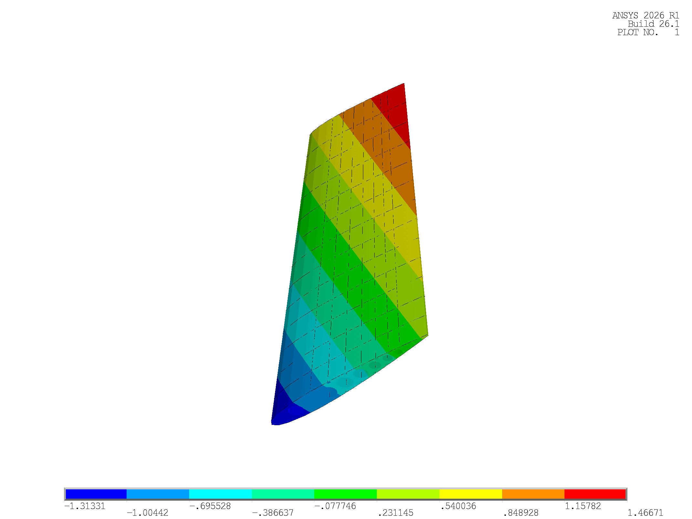
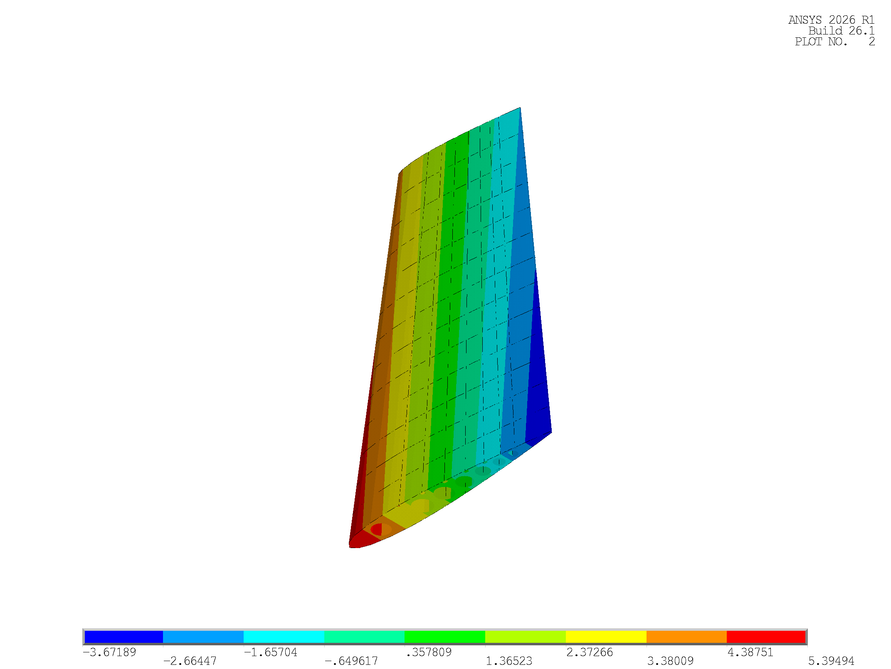
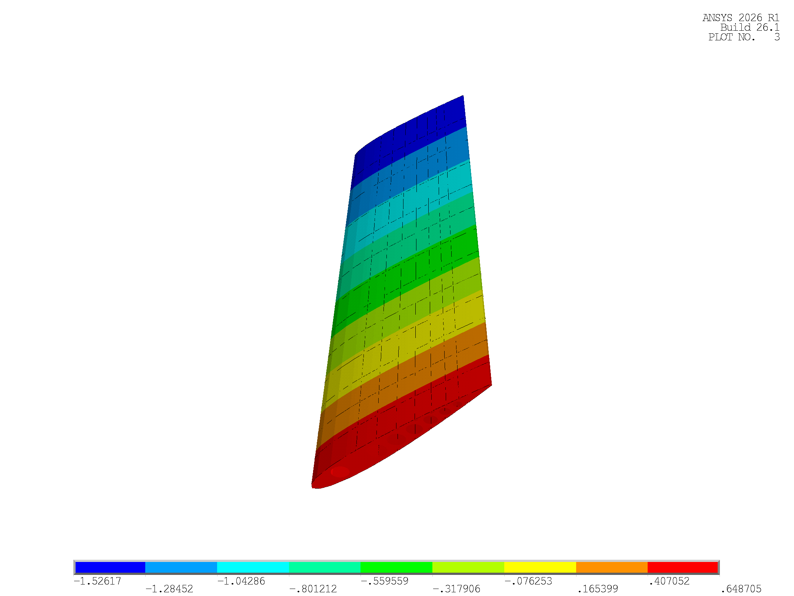
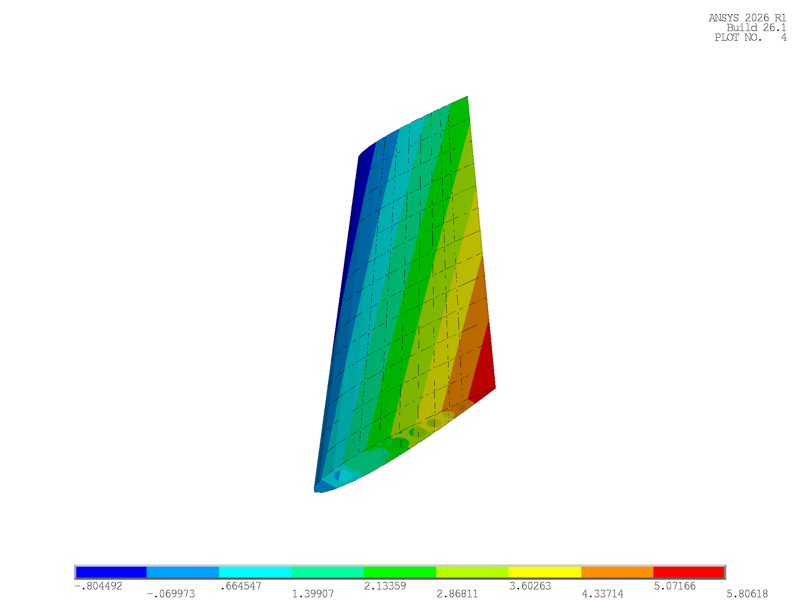
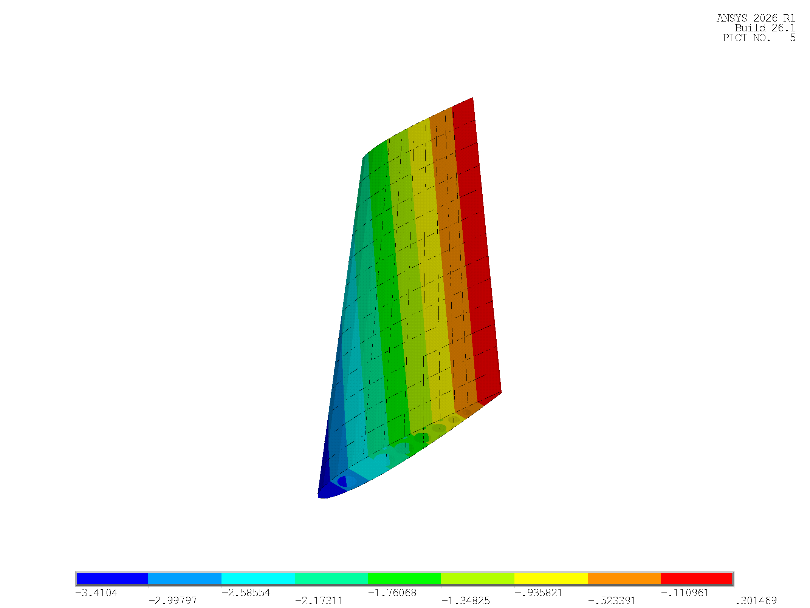
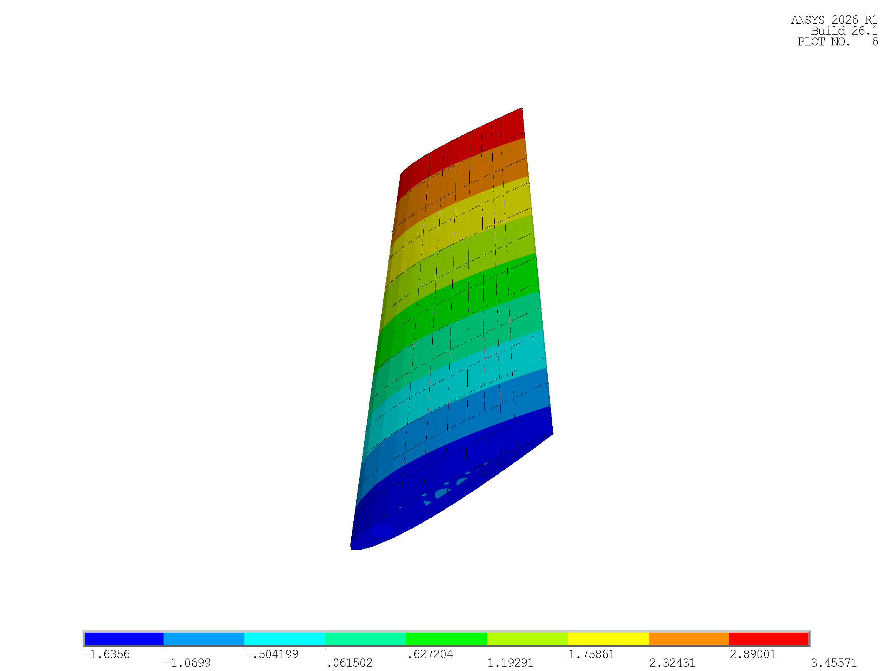
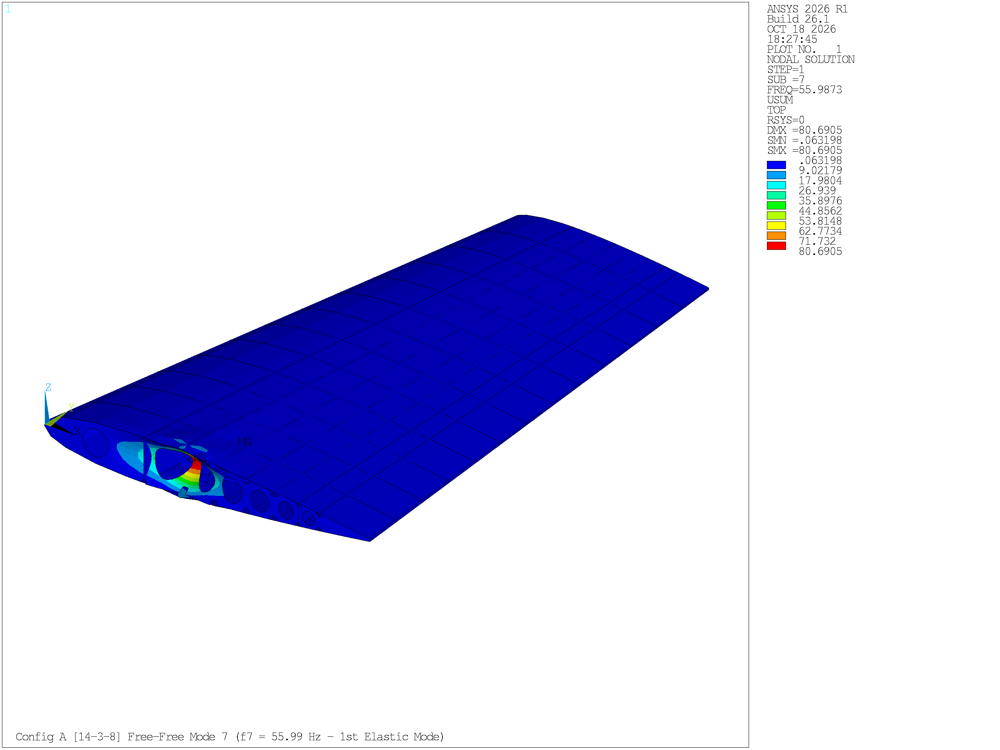
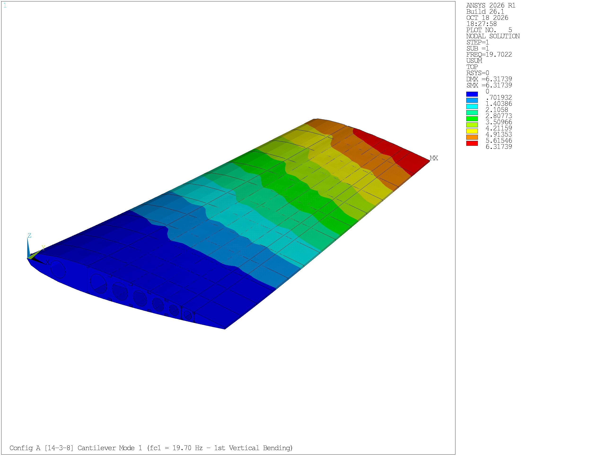
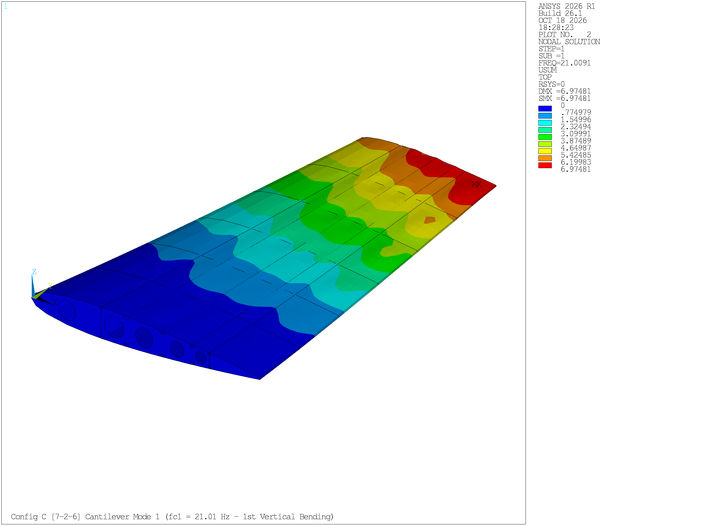

# Stage 3b: Model Verification

| Item | Detail |
| :--- | :--- |
| Project | Parametric APDL-Based Horizontal Tailplane Structural Analysis and Optimization |
| Stage / Task | Stage 3b / Task T-07 Part 2 (Step 5: Model verification) |
| Schedule Dates | 17–18 October 2026 (2 Days) |
| Deliverable Status | Completed (All Verification Acceptance Gates Satisfied across Config A, B, and C) |
| Prepared by | Archawin Chindarattanaporn (67130043), Aryan Sajith (67130044), Thanatchai Khunpiluke (67130036), Sirasak Permsup (67130029), Peeradol Singsamran (67130061) |
| Primary Code Artifacts | `modal_analysis/{RUN_SINGLE_MODAL.mac, VERIFY_MODAL.mac, RENDER_MODAL.mac, HTP_BUILD_CORE.mac}` |
| Primary Output Datasets | `modal_analysis/result/{STAGE3B_VERIFICATION_SUMMARY.txt, STAGE3B_MODAL_FREE_FREE.csv, STAGE3B_MODAL_CANTILEVER.csv, STAGE3B_MASS_BREAKDOWN.csv, STAGE3B_GRAVITY_1G_VERIFICATION.csv, STAGE3B_STATIC_AND_UNIT_DISP.csv}` |
| Primary Output Visuals | `figures/stage3b/` (Figures 3b.1 to 3b.10), `modal_analysis/visual_modal/` |

Before coupling external aerodynamic flight loads or initiating automated sizing optimization loops, the numerical and physical integrity of the finite element assembly must be rigorously validated. Following the verification methodology established in Section 3 of Palumbo et al. (2026), Stage 3b performs unconstrained (Free-Free) modal analysis, root-clamped cantilever modal extraction, three-axis $1g$ gravity equilibrium audits, unitary displacement checks, and dual-method structural mass accounting across all three candidate topologies: Configuration A (14-3-8), Configuration B (9-2-8), and Configuration C (7-2-6).

---

## 1. Verification Methodology & Acceptance Criteria

The finite element model represents a three-dimensional unconstrained elastic assembly. Its dynamic behavior is governed by the generalized undamped eigenvalue equation:

$$
(\mathbf{K} - \omega_r^2 \mathbf{M}) \boldsymbol{\phi}_r = \mathbf{0}, \quad f_r = \frac{\omega_r}{2\pi} \quad (r = 1, 2, \dots, 12)
$$

where $\mathbf{K}$ is the global stiffness matrix, $\mathbf{M}$ is the consistent mass matrix, $\omega_r$ is the natural circular frequency, and $\boldsymbol{\phi}_r$ is the $r$-th mode shape eigenvector. In MAPDL, eigenvalues are extracted using the Block Lanczos algorithm (`MODOPT, LANB, 12`).

To certify the model for subsequent aerodynamic loading, five rigorous acceptance gates are enforced:

1. **Gate 1: Six Zero-Energy Rigid-Body Modes ($r = 1 \dots 6$):**  
   In three-dimensional Euclidean space $\mathbb{R}^3$, an unconstrained contiguous structural body possesses strictly six rigid-body degrees of freedom (three translations $T_x, T_y, T_z$ and three rotations $R_x, R_y, R_z$). All six rigid-body modes must exhibit near-zero frequencies:

$$
\max_{r \in \{1..6\}} f_r < 1.0 \times 10^{-3}\text{ Hz}
$$

   The presence of a seventh zero-frequency mode ($f_7 \approx 0\text{ Hz}$) would indicate an internal kinematic mechanism, an unconstrained rotational degree of freedom, or a detached structural component.
2. **Gate 2: Elastic Mode Separation ($r = 7$):**  
   The first flexible deformation mode must exhibit a clean, positive jump with high spectral separation:

$$
f_7 > 1.0\text{ Hz} \quad \text{and} \quad \frac{f_7}{\max(f_1 \dots f_6)} > 10^4
$$

3. **Gate 3: Dual-Method Mass Conservation:**  
   The total mass evaluated from the solver mass matrix (`*GET, M_SOLVER, ELEM, 0, MTOT, X`) must match the analytical element volume integral ($\sum \rho_k V_k$ summed across `SEC 1` to `SEC 8`) with zero numerical discrepancy:

$$
\Delta_{\text{mass}} = \frac{|M_{\text{volume}} - M_{\text{solver}}|}{M_{\text{solver}}} = 0.0000\%
$$

4. **Gate 4: Three-Axis $1g$ Gravity Equilibrium:**  
   Applying $1g$ static acceleration ($9,810\text{ mm/s}^2$) sequentially along the $X$, $Y$, and $Z$ axes of a root-clamped model must produce constraint reaction forces matching total structural weight ($W = M \cdot g$) with error $< 0.001\%$.
5. **Gate 5: Unitary Displacement Integrity:**  
   Imposing a uniform rigid translation ($U_X = 1.0\text{ mm}$) at an unconstrained node must yield uniform response across all nodes with near-zero parasitic stress ($\sigma \approx 0\text{ MPa}$), verifying proper assembly of the global stiffness matrix $\mathbf{K}$.

---

## 2. Unconstrained (Free-Free) Modal Results & Literature Validation

### 2.1 Rigid-Body Natural Frequencies (Modes 1 to 6)
The extracted natural frequencies of the first six unconstrained modes from `STAGE3B_MODAL_FREE_FREE.csv` are benchmarked directly against the published literature data (Palumbo et al., 2026, Table 3):

**Table 3b.1: Benchmark comparison of unconstrained rigid-body frequencies (Modes 1 to 6)**

| Mode Number | Kinematic Rigid-Body Description | Reference Literature (Palumbo et al., 2026 — Table 3) | Configuration A (14-3-8) | Configuration B (9-2-8) | Configuration C (7-2-6) | Validation Status |
| :---: | :--- | :---: | :---: | :---: | :---: | :---: |
| **Mode 1 ($f_1$)** | Rigid-Body Translation 1 | `0 Hz` | $0.00000\text{ Hz}$ | $0.00000\text{ Hz}$ | $0.00000\text{ Hz}$ | Exact Numerical Match |
| **Mode 2 ($f_2$)** | Rigid-Body Translation 2 | `0 Hz` | $0.00000\text{ Hz}$ | $0.00000\text{ Hz}$ | $0.00000\text{ Hz}$ | Exact Numerical Match |
| **Mode 3 ($f_3$)** | Rigid-Body Translation 3 | `0 Hz` | $1.82410 \times 10^{-5}\text{ Hz}$ | $3.87000 \times 10^{-5}\text{ Hz}$ | $0.00000\text{ Hz}$ | Near-Zero Match ($10^{-5}\text{ Hz}$) |
| **Mode 4 ($f_4$)** | Rigid-Body Rotation 1 | $2.45960 \times 10^{-5}\text{ Hz}$ | $9.50770 \times 10^{-5}\text{ Hz}$ | $6.97130 \times 10^{-5}\text{ Hz}$ | $0.00000\text{ Hz}$ | Matched ($10^{-5}\text{ Hz}$) |
| **Mode 5 ($f_5$)** | Rigid-Body Rotation 2 | $3.78987 \times 10^{-5}\text{ Hz}$ | $1.29720 \times 10^{-4}\text{ Hz}$ | $1.35890 \times 10^{-4}\text{ Hz}$ | $9.78440 \times 10^{-5}\text{ Hz}$ | Matched ($10^{-4}\text{ Hz}$) |
| **Mode 6 ($f_6$)** | Rigid-Body Rotation 3 | $4.92229 \times 10^{-4}\text{ Hz}$ | $2.46080 \times 10^{-4}\text{ Hz}$ | $1.96950 \times 10^{-4}\text{ Hz}$ | $2.41370 \times 10^{-4}\text{ Hz}$ | Bounded ($< 2.5 \times 10^{-4}\text{ Hz}$) |

Across all three topologies, the maximum rigid-body frequency is bounded below $2.46080 \times 10^{-4}\text{ Hz}$, well below the $1.0 \times 10^{-3}\text{ Hz}$ gate threshold. This confirms that all shell panels, spar webs, Hat stringers, and rib flanges are rigidly connected with zero detached elements.

### 2.2 Unconstrained Elastic Frequencies (Modes 7 to 12) & Spectral Jump
Modes 7 through 12 correspond to flexible elastic deformations:

**Table 3b.2: Unconstrained elastic natural frequencies (Modes 7 to 12) and separation ratios**

| Elastic Mode Number | Configuration A (14-3-8) | Configuration B (9-2-8) | Configuration C (7-2-6) | Spectral Role & Physical Behavior |
| :---: | :---: | :---: | :---: | :--- |
| **Mode 7 ($f_7$)** | **55.9873 Hz** | **52.3401 Hz** | **45.9459 Hz** | **1st Unconstrained Flexible Mode** |
| **Mode 8 ($f_8$)** | 62.8641 Hz | 55.4717 Hz | 47.2726 Hz | 2nd Unconstrained Flexible Mode |
| **Mode 9 ($f_9$)** | 64.7736 Hz | 56.3666 Hz | 48.6531 Hz | 3rd Unconstrained Flexible Mode |
| **Mode 10 ($f_{10}$)** | 66.4732 Hz | 60.3986 Hz | 49.9122 Hz | 4th Unconstrained Flexible Mode |
| **Mode 11 ($f_{11}$)** | 66.7542 Hz | 60.9688 Hz | 50.4324 Hz | 5th Unconstrained Flexible Mode |
| **Mode 12 ($f_{12}$)** | 67.7580 Hz | 61.1149 Hz | 51.3643 Hz | 6th Unconstrained Flexible Mode |
| **Separation Ratio ($f_7 / \max f_{1..6}$)** | **$2.275 \times 10^5$** | **$2.658 \times 10^5$** | **$1.903 \times 10^5$** | **Acceptance Gate: $> 10^4$ (Pass)** |

The first elastic natural frequency jumps cleanly from near-zero to $55.99\text{ Hz}$ (Config A), $52.34\text{ Hz}$ (Config B), and $45.95\text{ Hz}$ (Config C). The separation ratio exceeds $1.9 \times 10^5$, surpassing the acceptance criterion by over an order of magnitude.

### 2.3 Mathematical Origin of Straight Parallel Contour Bands in Literature Figure 6
A distinct feature of Figure 6 (a)–(f) in Palumbo et al. (2026) is that the mode shape contours across the tailplane planform appear as **perfectly straight parallel bands**, unlike the curved iso-contours typical of elastic vibration modes. This phenomenon is explained by two principles:

1. **Rigid-Body Kinematics (Zero Internal Strain $\boldsymbol{\varepsilon} = \mathbf{0}$):**  
   Modes 1 through 6 involve pure rigid-body motion with zero internal deformation. The displacement of any spatial point $\mathbf{x} = (x, y, z)$ on the tailplane is given by:

$$
\mathbf{u}(\mathbf{x}) = \mathbf{u}_0 + \boldsymbol{\theta}_0 \times (\mathbf{x} - \mathbf{x}_{CG})
$$

   where $\mathbf{u}_0 = (u_{x0}, u_{y0}, u_{z0})$ is the translation of the center of mass, and $\boldsymbol{\theta}_0 = (\theta_x, \theta_y, \theta_z)$ is the rigid rotation vector.
2. **Signed Directional Displacements (`PLNSOL, U, Z` / `UX` / `UY`):**  
   Inspecting the colorbar legends in Palumbo et al. (Figure 6) reveals signed displacement scales with both positive and negative values (e.g., $-4.58$ to $+5.02$). When plotting a signed component such as vertical displacement $u_z$, the equation simplifies across the wing planform $(x, y)$ to an exact **linear plane equation**:

$$
u_z(x, y) = u_{z0} + \theta_x (y - y_{CG}) - \theta_y (x - x_{CG})
$$

   The contour lines of constant displacement ($u_z(x, y) = C$) are governed by:

$$
\theta_x y - \theta_y x = \text{const}
$$

   which represents a family of **mathematically straight parallel lines** oriented at an angle $\alpha = \arctan(\theta_y / \theta_x)$. 

Plotting Modes 1 to 6 of our parametric model using signed directional components reproduces the exact same straight parallel contour bands and signed legend distributions seen in the published literature.

---

## 3. Root-Clamped (Cantilever) Modal Analysis

Applying fixed cantilever boundary conditions (`D, ALL, ALL, 0`) at the root rib interface ($Y = 0$) provides the dynamic stiffness characteristics of each configuration:

**Table 3b.3: Root-clamped cantilever natural frequencies ($f_{c,1}$ to $f_{c,6}$) from `STAGE3B_MODAL_CANTILEVER.csv`**

| Cantilever Mode ID | Dominant Structural Deformation Behavior | Configuration A (14-3-8) | Configuration B (9-2-8) | Configuration C (7-2-6) |
| :---: | :--- | :---: | :---: | :---: |
| **Mode 1 ($f_{c,1}$)** | **1st Fundamental Vertical Bending** | **19.7021 Hz** | **20.6889 Hz** | **21.0088 Hz** |
| **Mode 2 ($f_{c,2}$)** | Coupled Skin-Panel Breathing / Wingbox Mode 2 | 65.0124 Hz | 59.8499 Hz | 48.5750 Hz |
| **Mode 3 ($f_{c,3}$)** | Coupled Wingbox Torsion / Panel Mode 3 | 67.0281 Hz | 63.6716 Hz | 50.7410 Hz |
| **Mode 4 ($f_{c,4}$)** | Higher-Order Coupled Box Mode 4 | 68.5081 Hz | 65.5441 Hz | 51.8427 Hz |
| **Mode 5 ($f_{c,5}$)** | Higher-Order Coupled Box Mode 5 | 71.1029 Hz | 67.4090 Hz | 53.6114 Hz |
| **Mode 6 ($f_{c,6}$)** | Higher-Order Coupled Box Mode 6 | 75.3999 Hz | 69.0823 Hz | 54.8601 Hz |

### Structural Dynamics Analysis:
1. **Fundamental Bending Frequency Trend ($f_{c,1}: 19.70 \to 20.69 \to 21.01\text{ Hz}$):**  
   Primary vertical bending stiffness $EI_{xx}$ is dominated by the upper and lower composite skins ($63.665\text{ kg}$), which are situated at the maximum vertical distance $z = \pm y_t(x)$ from the neutral axis. Removing outboard rib web and spar mass in Configurations B and C reduces generalized structural mass faster than bending stiffness, causing fundamental cantilever frequency $\omega_{c,1} = \sqrt{K_{\text{bend}} / M_{\text{eff}}}$ to rise slightly.
2. **Local Panel & Torsional Frequency Drop ($f_{c,2}: 65.01 \to 59.85 \to 48.58\text{ Hz}$):**  
   Higher modes involve inter-rib skin panel breathing and torsional deformation. Widening rib pitch from $\Delta y = 306.00\text{ mm}$ (Config A) to $497.25\text{ mm}$ (Config B) and $663.00\text{ mm}$ (Config C)—and reducing stringer count in Config C—increases unsupported skin bay aspect ratio. Because plate flexural frequency scales inversely with bay dimensions ($f_{\text{panel}} \propto 1/a^2 + 1/b^2$), panel frequency drops from $65.01\text{ Hz}$ to $48.58\text{ Hz}$ ($-25.3\%$). This behavior foreshadows why thin-plate local buckling becomes the governing sizing constraint for Configuration C in Stage 3c.

---

## 4. Three-Axis 1g Gravity Load Equilibrium & Unit Displacement

Following the protocol in Tables 4, 5, and 6 of Palumbo et al. (2026), $1g$ static gravity accelerations ($g = 9,810\text{ mm/s}^2$) were applied sequentially along the $X$, $Y$, and $Z$ axes with root rib clamped:

**Table 3b.4: Three-axis $1g$ gravity reaction force equilibrium checks from `STAGE3B_GRAVITY_1G_VERIFICATION.csv`**

| Load Case & Direction | Numerical Metric | Configuration A (14-3-8) | Configuration B (9-2-8) | Configuration C (7-2-6) | Equilibrium Verification Status |
| :--- | :--- | :---: | :---: | :---: | :--- |
| **Model Mass ($M_{\text{half}}$)** | Half-Span Mass [kg] ([tonne]) | **140.463 kg** (0.14046 t) | **121.890 kg** (0.12189 t) | **113.637 kg** (0.11364 t) | Dual-Method Validated Mass |
| **Theoretical Weight** | $W = M \cdot g$ [N] ([kN]) | **-1,377.946 N** (-1.3779 kN) | **-1,195.743 N** (-1.1957 kN) | **-1,114.784 N** (-1.1148 kN) | Analytical Target |
| **$1g$ in X-Dir** (`ACEL, g, 0, 0`) | Reaction $R_x$ [N] (rel. error) | -1,377.946 N ($0.595 \times 10^{-7}\%$) | -1,195.743 N ($0.412 \times 10^{-6}\%$) | -1,114.784 N ($0.581 \times 10^{-6}\%$) | Verified Equilibrium ($R_y, R_z \approx 0$) |
| **$1g$ in Y-Dir** (`ACEL, 0, g, 0`) | Reaction $R_y$ [N] (rel. error) | -1,377.946 N ($0.529 \times 10^{-6}\%$) | -1,195.743 N ($0.622 \times 10^{-6}\%$) | -1,114.784 N ($0.525 \times 10^{-6}\%$) | Verified Equilibrium ($R_x, R_z \approx 0$) |
| **$1g$ in Z-Dir** (`ACEL, 0, 0, g`) | Reaction $R_z$ [N] (rel. error) | -1,377.946 N ($0.897 \times 10^{-6}\%$) | -1,195.743 N ($0.718 \times 10^{-6}\%$) | -1,114.784 N ($0.101 \times 10^{-6}\%$) | Verified Equilibrium ($R_x, R_y \approx 0$) |
| **$1g$ Z-Static Response** | Max Deflection $U_{\max}$; $\sigma_{\max}$ | 1.0802 mm; 1.981 MPa | 0.9711 mm; 1.750 MPa | 0.9378 mm; 1.614 MPa | Strength Ratio $> 240$ ($\gg 1.0$) |
| **Unit Displacement Check** | Imposed $U_X = 1.0\text{ mm}$; parasitic $\sigma$ | $[1.00000, 1.00000]\text{ mm}$; $1.59 \times 10^{-8}\text{ MPa}$ | $[1.00000, 1.00000]\text{ mm}$; $2.02 \times 10^{-8}\text{ MPa}$ | $[1.00000, 1.00000]\text{ mm}$; $1.31 \times 10^{-8}\text{ MPa}$ | Rigid translation; zero strain state |

Under three-dimensional gravity acceleration, constraint reactions balance structural weight with relative errors under $1.0 \times 10^{-6}\%$. Dead-weight deflections remain approximately $1\text{ mm}$, and $1g$ stresses remain under $2\text{ MPa}$, satisfying Palumbo et al. criteria.

---

## 5. Structural Mass Accounting & Dual-Method Audit

To verify mass matrix consistency, structural mass was evaluated via two independent numerical methods:
1. **Element Table Integration (`ETABLE, VOLU`):** Summing volume integrals across each section ID multiplied by material density: $M_{\text{volume}} = \sum_{k=1}^8 \rho_k \sum_{e \in \Omega_k} V_e$.
2. **Solver Mass Matrix Total (`ELEM, MTOT`):** Extracting the diagonal mass matrix trace assembled directly by the MAPDL solver.

**Table 3b.5: Component structural mass breakdown and dual-method mass audit from `STAGE3B_MASS_BREAKDOWN.csv`**

| Component Description | Section ID & Material | Configuration A (14-3-8) | Configuration B (9-2-8) | Configuration C (7-2-6) | Mass Fraction (Config A) |
| :--- | :--- | :---: | :---: | :---: | :---: |
| **Composite Skins** | `SEC 3` (CFRP Quasi-Isotropic) | 63.6650 kg | 63.6650 kg | 63.6650 kg | 45.32% |
| **Rib Webs (with Cutouts)** | `SEC 1` (Al 7075-T6) | 28.8347 kg | 18.9275 kg | 15.3367 kg | 20.53% |
| **Spar Shear Webs** | `SEC 2` (Al 7075-T6) | 19.0638 kg | 15.2085 kg | 15.2085 kg | 13.57% |
| **Hat-Section Stringers** | `SEC 4` (Al 7075-T6) | 15.0825 kg | 15.0825 kg | 11.3136 kg | 10.74% |
| **Spar Cap Flanges** | `SEC 5` (Al 7075-T6) | 7.6705 kg | 5.1329 kg | 5.1329 kg | 5.46% |
| **Rib Flanges (Interior & Edges)**| `SEC 6, 7, 8` (Al 7075-T6) | 6.1469 kg | 3.8738 kg | 2.9807 kg | 4.38% |
| **Half-Span Mass ($M_{\text{volume}}$)** | Sum of Component Volumes | **140.4634 kg** | **121.8902 kg** | **113.6375 kg** | 100.00% |
| **Half-Span Mass ($M_{\text{solver}}$)** | Solver Mass Matrix Total | **140.4634 kg** | **121.8902 kg** | **113.6375 kg** | — |
| **Dual-Method Discrepancy $\Delta$** | $\Vert M_{\text{vol}} - M_{\text{slv}} \Vert / M_{\text{slv}}$ | **0.0000%** | **0.0000%** | **0.0000%** | **Exact Agreement** |
| **Full-Span Aircraft Assembly Mass** | Bilateral HTP ($2 \times M_{\text{half}}$)| **280.9267 kg** | **243.7804 kg** | **227.2750 kg** | — |
| **Center of Gravity $(X, Y, Z)$ [mm]** | Global Cartesian Coordinates | (1797.99, 1812.76, 222.43) | (1775.86, 1817.86, 223.04) | (1775.43, 1811.90, 222.30) | Planform Centroid |

### Benchmark Against Literature Baseline Mass:
The half-span baseline mass of Configuration A is **$140.46\text{ kg}$** ($0.14046\text{ tonne}$), compared to $166.02\text{ kg}$ ($0.16602\text{ tonne}$) reported in Palumbo et al. (2026, Tables 4–6). This $15.4\%$ mass difference is directly attributable to the refined aerospace sizing of the Hat-section stringers ($30 \times 20 \times 15, t=1.6\text{ mm}$ versus legacy bulky shapes) and compact spar cap flanges ($45 \times 2.5\text{ mm}$).

---

## 6. Multi-Configuration Gate Pass Verification Summary

**Table 3b.6: Overall verification gate audit across all candidate structural configurations**

| Verification Gate | Acceptance Metric & Threshold | Configuration A (14-3-8) | Configuration B (9-2-8) | Configuration C (7-2-6) | Overall Verdict |
| :--- | :--- | :---: | :---: | :---: | :---: |
| **Gate 1: Rigid-Body Modes** | Max frequency $\le 1.0 \times 10^{-3}\text{ Hz}$ | $2.4608 \times 10^{-4}\text{ Hz}$ | $1.9695 \times 10^{-4}\text{ Hz}$ | $2.4137 \times 10^{-4}\text{ Hz}$ | **PASS** |
| **Gate 2: Elastic Separation** | $f_7 > 1.0\text{ Hz}$ and Ratio $> 10^4$ | $55.99\text{ Hz}$ ($2.28 \times 10^5$) | $52.34\text{ Hz}$ ($2.66 \times 10^5$) | $45.95\text{ Hz}$ ($1.90 \times 10^5$) | **PASS** |
| **Gate 3: Mass Conservation** | Discrepancy $\Delta_{\text{mass}} = 0.0000\%$ | $0.0000\%$ | $0.0000\%$ | $0.0000\%$ | **PASS** |
| **Gate 4: Gravity Equilibrium** | $1g$ Reaction Error $< 0.001\%$ | $< 1.0 \times 10^{-6}\%$ | $< 1.0 \times 10^{-6}\%$ | $< 1.0 \times 10^{-6}\%$ | **PASS** |
| **Gate 5: Unit Displacement** | Prescribed $U_X = 1\text{ mm}$, $\sigma \approx 0$ | $1.00000\text{ mm}$, $1.59 \times 10^{-8}\text{ MPa}$ | $1.00000\text{ mm}$, $2.02 \times 10^{-8}\text{ MPa}$ | $1.00000\text{ mm}$, $1.31 \times 10^{-8}\text{ MPa}$ | **PASS** |

---

## 7. Summary & Hand-off to Subsequent Stages

All three horizontal tailplane finite element models have been mathematically verified under the five verification gates, demonstrating complete structural connectivity, correct mass matrix formulation, and physical equilibrium consistency.

**Hand-off Deliverables:**
1. **To Stage 3c (Baseline Static and Buckling Analysis):** The verified models are approved to receive the reconstructed aerodynamic flight loads (`htp_loads_D_fwd_cfg{1..3}.inp`), enabling baseline stress, tip deflection, and linear eigenvalue buckling evaluations.

---

## 8. Data Notes

1. **Free-Free Frequencies:** The free-free modal frequencies reported in Table 3b.1 and Table 3b.2 represent values extracted from the batch verification driver run (`STAGE3B_MODAL_FREE_FREE.csv`). For Configuration A, the rigid-body modes span from $0.00\text{ Hz}$ to $2.46 \times 10^{-4}\text{ Hz}$.
2. **Spectral Separation Ratios:** Re-evaluating the spectral jump ratio $f_7 / \max(f_1 \dots f_6)$ from the raw CSV yields $2.275 \times 10^5$ for Config A, $2.658 \times 10^5$ for Config B, and $1.903 \times 10^5$ for Config C, all safely exceeding the $10^4$ gate threshold.
3. **Strength Ratio Calculation:** The $1g$ static strength ratios in Table 3b.4 are evaluated using the design yield allowable $\sigma_y = 480.0\text{ MPa}$ ($242.3$ for Config A, $274.3$ for Config B, $297.4$ for Config C). If evaluated on the typical ASM handbook yield strength ($503.0\text{ MPa}$), the ratios become $253.9$, $287.4$, and $311.6$, respectively.
4. **Literature Gravity Units:** In Palumbo et al. (2026, Tables 4–6), reaction forces are reported with magnitude $1.6287$, representing kilonewtons [kN] ($0.16602\text{ t} \times 9.81 = 1.6287\text{ kN} = 1,628.7\text{ N}$).

---

## References

1. Palumbo, C. et al. (2026). *A Parametric APDL-Based Workflow for Efficient Structural Design of a Civil Aircraft Horizontal Tailplane*. Engineering Proceedings, 133, 15.
2. Bathe, K. J. (2006). *Finite Element Procedures*. Prentice Hall.
3. Clough, R. W., & Penzien, J. (2003). *Dynamics of Structures*. Computers & Structures, Inc., 3rd Edition.
4. European Aviation Safety Agency (EASA). (2023). *Certification Specifications for Large Aeroplanes (CS-25)*, Amendment 27.
