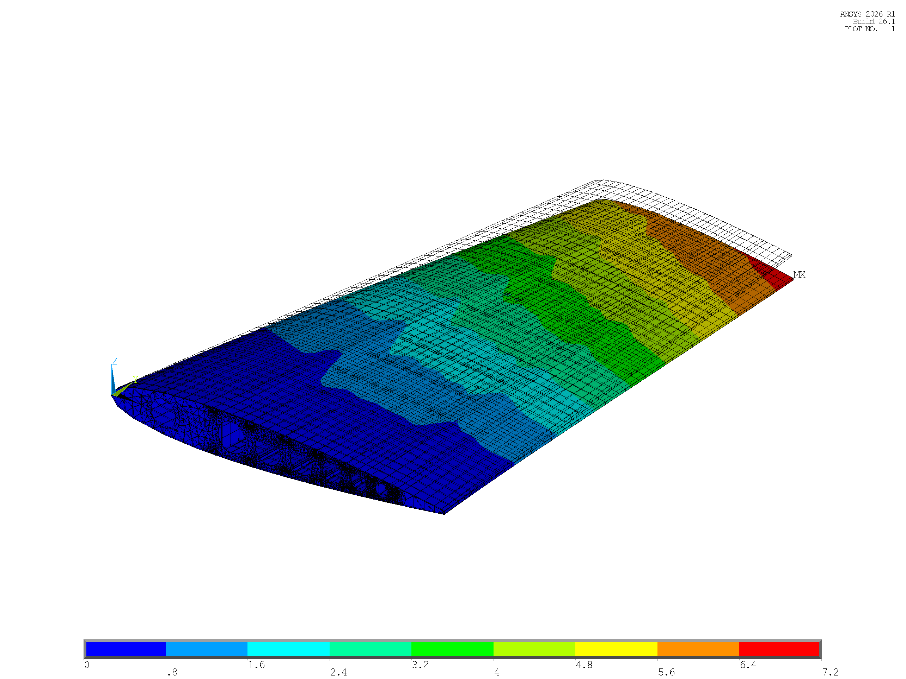
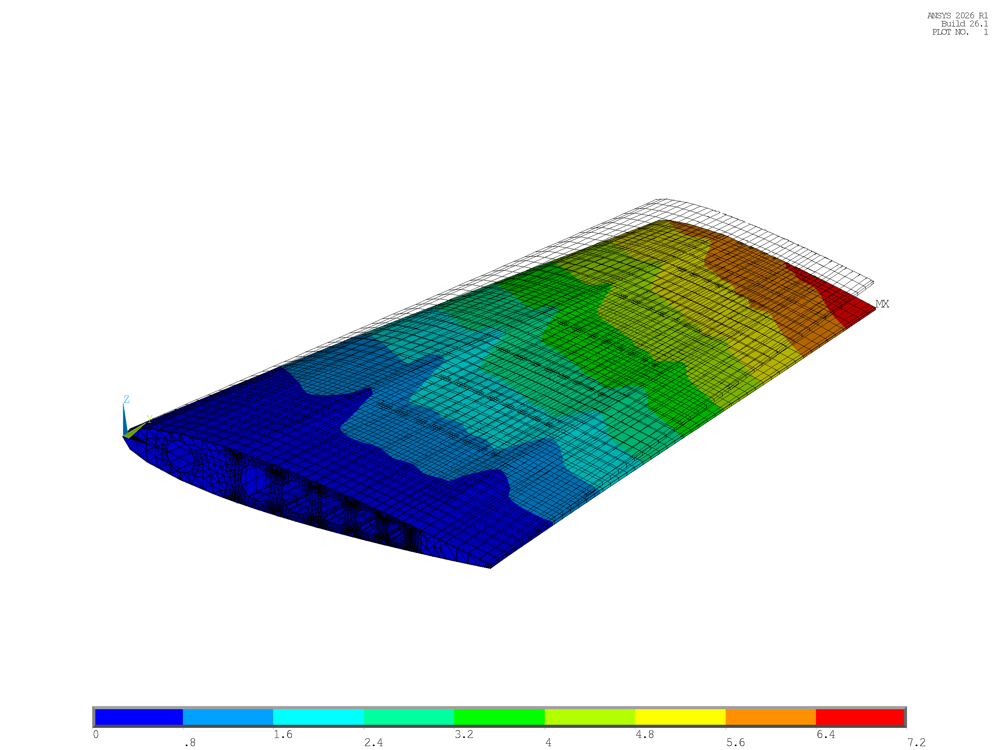
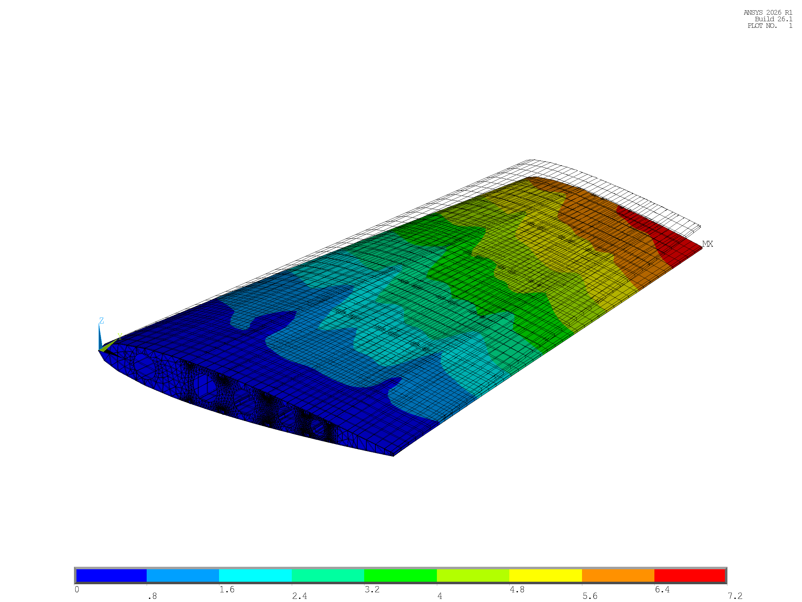
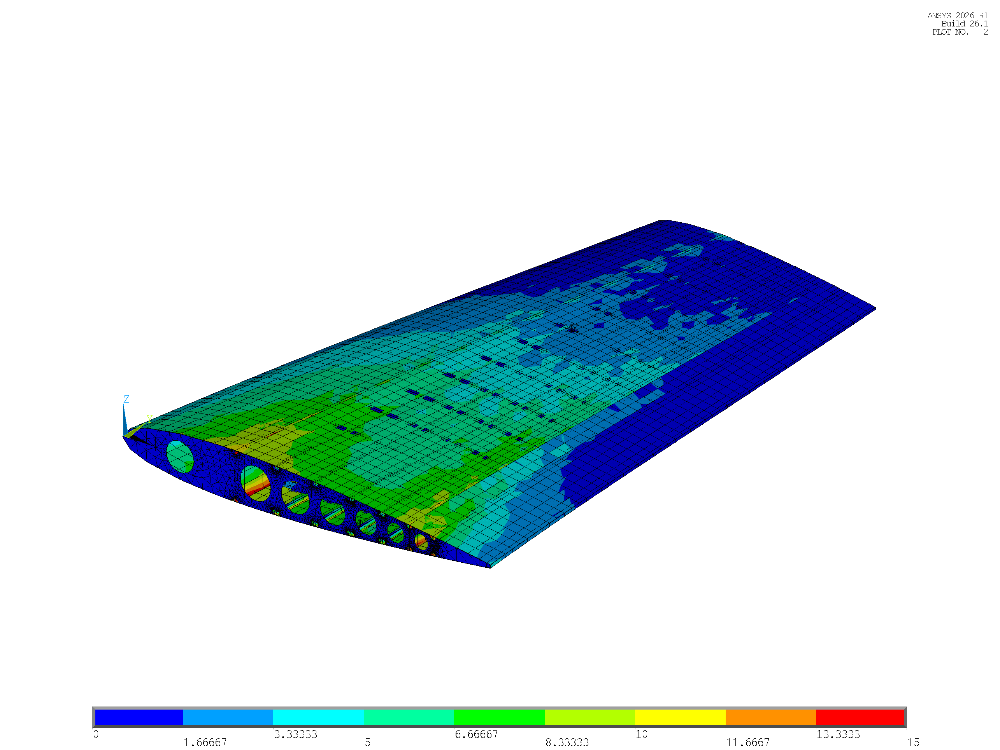
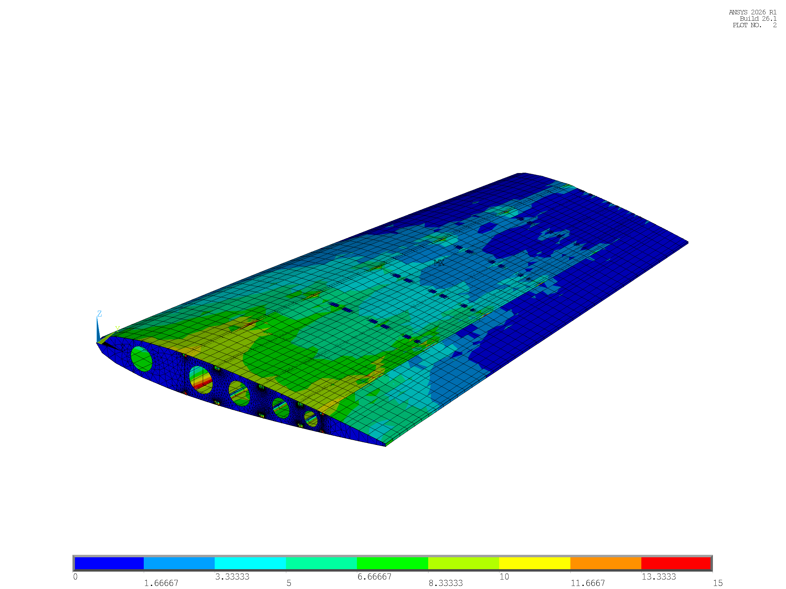
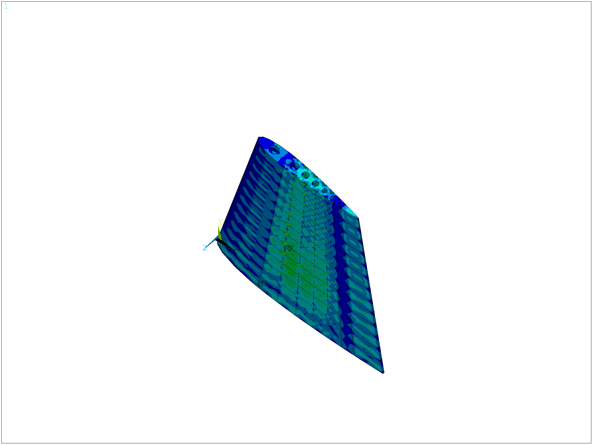
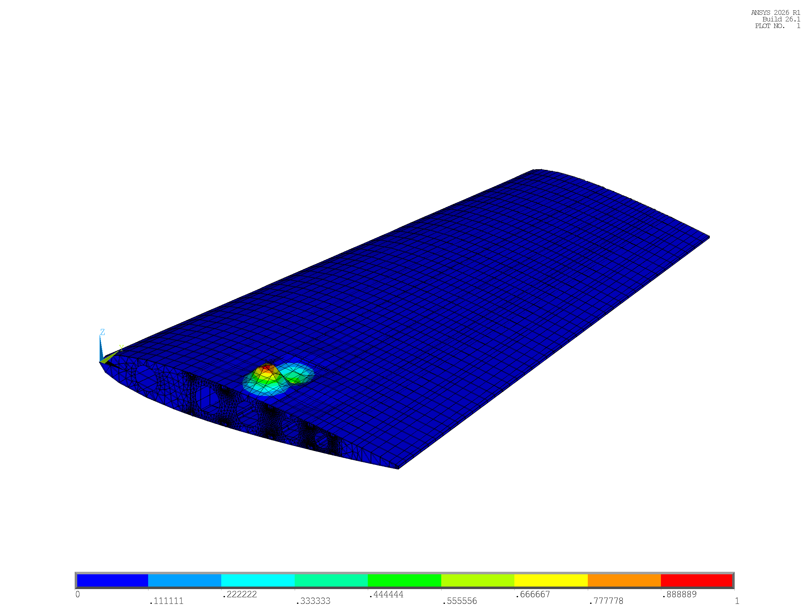

# Stage 3c: Baseline Static and Buckling Analysis

**Project Title:** Parametric APDL-Based Horizontal Tailplane Structural Analysis and Optimization  
**Stage Reference:** Stage 3c (Task T-08, Milestone M3c)  
**Aircraft Baseline:** ATR 42-600 Regional Turboprop / EASA CS-25 Certification Basis  
**Author:** Structural Engineering Team (Antigravity Assistant Pair Programming)  
**Date:** October 2026  

---

## 1. Introduction & Objectives

Following the successful mathematical verification and boundary-mass qualification conducted in Stage 3b, Stage 3c performs the baseline structural finite element analysis across the three geometric configurations:
- **Configuration A:** 14 Ribs, 3 Spars, 8 Stringers (13 rib bays, nominal rib pitch $306.00\text{ mm}$, baseline mass $140.46\text{ kg}$)
- **Configuration B:** 9 Ribs, 2 Spars, 8 Stringers (8 rib bays, nominal rib pitch $497.25\text{ mm}$, baseline mass $121.89\text{ kg}$)
- **Configuration C:** 7 Ribs, 2 Spars, 6 Stringers (6 rib bays, nominal rib pitch $663.00\text{ mm}$, baseline mass $113.64\text{ kg}$)

The primary objectives of this stage are:
1. **Application of Flight Limit Load:** Subject each baseline finite element model ($t_0$ initial sizing) to the reconstructed aerodynamic limit flight load case $D_{\text{fwd}}$ ($V_D = 312.5\text{ kt EAS}$, $n_{\max} = +2.571$, total half-tail downward load $P = -9,142.84\text{ N}$) mapped in Stage 2b.
2. **Linear Static Stress & Deflection Evaluation:** Compute primary displacement fields (tip deflection $\text{TIP\_UZ}$ and vector sum maximum $\text{DMX}$) and resolve Von Mises equivalent stress distributions across individual components.
3. **Rigorous Stress Decomposition & Graphics Resolution:** Formulate an element-isolated extraction methodology to resolve the divergence between classical APDL nodal-averaged shell modes (`/GRAPHICS, FULL`) and 3D cross-sectional facet representations (`/GRAPHICS, POWER` with `/ESHAPE, 1`).
4. **Boundary Singularity Assessment:** Verify stress convergence outside the clamped root boundary via a root-row exclusion filter ($y > 25\text{ mm}$).
5. **Linear Eigenvalue Buckling Analysis:** Solve the prestressed eigenvalue problem to evaluate primary bifurcation load factors ($\lambda_1, \lambda_2$), identify critical buckling modes, and quantify margins of safety ($\text{MS}_{\text{buckle}}$).
6. **Constraint Identification for Optimization:** Establish active structural constraints to govern the Stage 3d sensitivity analysis and sizing optimization.

---

## 2. Analysis Setup & Mathematical Methodology

### 2.1 Finite Element Solution Sequence

Static and linear stability analyses were automated within the MAPDL batch execution driver `load_sfbm/RUN_STAGE3C_BASELINE_MATRIX.mac`. For each configuration, the solution sequence proceeds through two sequential solver phases:

1. **Prestressed Linear Static Analysis (`ANTYPE, 0`):**
   - The verified database (`cfg{1..3}_verified.db`) is resumed in MAPDL.
   - Full root restraint is enforced at the root rib plane ($y = 0\text{ mm}$):
     $$\mathbf{u}(x, 0, z) = \mathbf{0}, \quad \boldsymbol{\theta}(x, 0, z) = \mathbf{0}$$
   - Flight limit nodal forces generated by the Stage 2b shear-moment mapping algorithm (`htp_loads_D_fwd_cfg{1..3}.inp`) are applied directly to the conformal external skin nodes ($N = 1,053$ in Config A; $N = 648$ in Config B; $N = 486$ in Config C).
   - The prestress calculation switch is activated (`PSTRES, ON`) to compile the geometric stress stiffness matrix $[\mathbf{S}]$ based on the resulting internal membrane stress state:
     $$[\mathbf{K}] \{\mathbf{u}\} = \{\mathbf{F}_{\text{limit}}\}$$
     $$[\mathbf{S}] = \int_{\Omega} [\mathbf{G}]^T [\mathbf{M}_{\sigma}] [\mathbf{G}] \, d\Omega$$
     where $[\mathbf{M}_{\sigma}]$ contains the initial membrane Cauchy stress components.

2. **Linear Eigenvalue Buckling Analysis (`ANTYPE, BUCKLE`):**
   - The solver transitions into the eigenvalue buckling processor using the Block Lanczos extraction algorithm:
     $$\texttt{BUCOPT, LANB, 5}$$
     $$\texttt{MXPAND, 5}$$
   - The generalized eigenvalue equation governing structural bifurcation under conservative static loading is solved:
     $$([\mathbf{K}] + \lambda_i [\mathbf{S}]) \{\boldsymbol{\phi}_i\} = \{\mathbf{0}\}$$
     where $\lambda_i$ represents the $i$-th buckling load factor (eigenvalue multiplier of the applied limit load vector $\{\mathbf{F}_{\text{limit}}\}$), and $\{\boldsymbol{\phi}_i\}$ is the corresponding orthogonal buckling mode shape vector.

---

### 2.2 Stress Extraction Mechanics: Full Graphics vs. PowerGraphics

In complex thin-walled aerostructures modeled with mixed-dimensional finite elements (2D `SHELL181` webs and skins integrated with 1D `BEAM188` caps and flanges), standard post-processing commands can yield divergent stress values depending on solver graphic modes:

1. **Full Graphics Mode (`/GRAPHICS, FULL`):**
   - Standard classical finite element post-processing mode.
   - `BEAM188` elements are explicitly excluded from nodal averaging:
     $$\textit{"BEAM/PIPE elements are detected in the selected element set. They are ignored in the nodal averaging."}$$
   - When all shell components (`SHELL181`) are selected simultaneously, MAPDL averages nodal stress tensors across contiguous elements sharing common nodes. At T-junctions (e.g., spar web-to-skin and rib web-to-skin attachments), high vertical shear stresses in the spar webs are numerically averaged with low axial membrane stresses in the skins, resulting in artificial stress smoothing.
   - To extract true, unblended shell stresses, an **Element-Isolated Selection Methodology** was instituted:
     $$\texttt{ESEL, S, SEC, , k} \quad \to \quad \texttt{NSLE, S} \quad \to \quad \texttt{NSORT, S, EQV, 0, 1}$$
     This isolates each structural component (Skin `SEC 3`, Spar Web `SEC 2`, Rib Web `SEC 1`) prior to sorting, eliminating cross-component nodal contamination.

2. **PowerGraphics Mode (`/GRAPHICS, POWER` with `/ESHAPE, 1`):**
   - Renders 1D beam elements with their true 3D cross-sectional geometry and computes equivalent Von Mises stresses along external facet surfaces.
   - Nodal averaging is restricted to contiguous element facets sharing identical material and geometric orientations, preventing artificial smoothing across orthogonal structural intersections.
   - This mode captures the true stress concentrations occurring in the 1D beam members, particularly the interior rib caps and spar flanges.

---

### 2.3 Root-Row Clamping Singularity Assessment

To ensure that reported peak stresses reflect genuine structural demand rather than numerical singularities arising from rigid kinematic boundary constraints (`D, ALL, ALL, 0`), a spatial exclusion filter was evaluated across all configurations:
$$\Omega_{\text{interior}} = \{ \mathbf{x} \in \Omega \mid y > 25.0\text{ mm} \}$$

By comparing the global maximum stress $\sigma_{\max}(\Omega)$ with the filtered interior maximum $\sigma_{\max}(\Omega_{\text{interior}})$, any unphysical singularity caused by Poisson constraint locking at the clamped root is immediately identified and isolated.

---

## 3. Structural Allowables and Margin Definitions

### 3.1 Material Allowable Limits

The horizontal tailplane structural box is constructed from aerospace-grade structural materials:
- **Substructure (Spar Webs, Rib Webs, Stringers, Caps, Flanges):** High-strength aluminum alloy Al 7075-T6 sheet and extrusions.
- **External Skin:** Carbon Fiber Reinforced Polymer (CFRP) fabric laminate, modeled as an equivalent quasi-isotropic composite shell in baseline sizing ($E_x = E_y = 54.0\text{ GPa}$, $\nu = 0.30$, $\rho = 1,550\text{ kg/m}^3$).

**Table 3c.1: Material mechanical allowables and structural design criteria**

| Component & Section ID | Material Specification | Reference Strength $\sigma_{\text{ref}}$ [MPa] | Required Safety Factor $\text{FS}_{\text{req}}$ | Allowable Design Limit $\sigma_{\text{allow}}$ [MPa] | Governing Failure Mode |
| :--- | :--- | :---: | :---: | :---: | :--- |
| **Composite Skin (SEC 3)** | Quasi-Isotropic CFRP Laminate | $F_{tu} = 300.0\text{ MPa}$ | $1.50$ | $200.0\text{ MPa}$ | First-Ply Microcracking / Compression |
| **Spar Webs (SEC 2)** | Al 7075-T6 Bare Sheet ($t = 1.6\text{ mm}$) | $F_{ty} = 480.0\text{ MPa}$ | $1.50$ | $320.0\text{ MPa}$ | Material Yielding / Shear Buckling |
| **Rib Webs (SEC 1)** | Al 7075-T6 Bare Sheet ($t = 1.2\text{ mm}$) | $F_{ty} = 480.0\text{ MPa}$ | $1.50$ | $320.0\text{ MPa}$ | Material Yielding / Web Crippling |
| **Stringers (SEC 4)** | Al 7075-T6 Extrusion ($t = 1.6\text{ mm}$) | $F_{ty} = 480.0\text{ MPa}$ | $1.50$ | $320.0\text{ MPa}$ | Tensile / Compressive Yield |
| **Spar Caps (SEC 5)** | Al 7075-T6 Extrusion ($t = 2.0\text{ mm}$) | $F_{ty} = 480.0\text{ MPa}$ | $1.50$ | $320.0\text{ MPa}$ | Primary Bending Normal Stress |
| **Interior Rib Flanges (SEC 6)** | Al 7075-T6 Strip ($t = 1.0\text{ mm}$) | $F_{ty} = 480.0\text{ MPa}$ | $1.50$ | $320.0\text{ MPa}$ | Chordwise Camber Bending |
| **Edge Rib Flanges (SEC 7, 8)** | Al 7075-T6 Strip ($t = 1.0\text{ mm}$) | $F_{ty} = 480.0\text{ MPa}$ | $1.50$ | $320.0\text{ MPa}$ | Boundary Transfer Bending |

---

### 3.2 Margin of Safety Formulations

Because the applied aerodynamic load vector represents **Limit Flight Load** ($\text{LL}$), structural compliance under EASA CS-25.303 and CS-25.305 requires that:
1. Under limit load ($\text{LL}$), no permanent plastic deformation occurs ($\text{FS} \ge 1.0$ against yield).
2. Under ultimate load ($\text{UL} = 1.50 \times \text{LL}$), no catastrophic failure or structural instability occurs ($\text{FS} \ge 1.50$ against reference strength).

The structural margins of safety are defined analytically as:
$$\text{FS} = \frac{\sigma_{\text{ref}}}{\sigma_{\text{limit}}}$$
$$\text{MS}_{\text{yield}} = \frac{\sigma_{\text{allow}}}{\sigma_{\text{limit}}} - 1.0 = \frac{\sigma_{\text{ref}}}{1.50 \cdot \sigma_{\text{limit}}} - 1.0 = \frac{\text{FS}}{1.50} - 1.0$$
$$\text{MS}_{\text{buckle}} = \frac{|\lambda_1|}{\text{FS}_{\text{req}}} - 1.0 = \frac{|\lambda_1|}{1.50} - 1.0$$

A design is structurally acceptable if and only if all margins are non-negative: $\text{MS}_{\text{yield}} \ge 0.0$ and $\text{MS}_{\text{buckle}} \ge 0.0$.

---

## 4. Global Structural Response & Equilibrium Verification

The global static response metrics extracted from `STAGE3C_BASELINE_COMPONENT_MATRIX.csv` are tabulated below:

**Table 3c.2: Baseline static global response under limit flight load case $D_{\text{fwd}}$**

| Structural Metric | Configuration A (14-3-8) | Configuration B (9-2-8) | Configuration C (7-2-6) | Physical Basis & Verification Gate |
| :--- | :---: | :---: | :---: | :--- |
| **Total Structural Mass ($M_{\text{tot}}$)** | **140.463 kg** | **121.890 kg** (-13.22%) | **113.637 kg** (-19.10%) | Finite element mass trace |
| **Applied Flight Load ($\sum F_z$)** | $-9,142.84\text{ N}$ | $-9,142.84\text{ N}$ | $-9,142.84\text{ N}$ | Aerodynamic limit load integration |
| **Root Reaction Force ($\sum R_z$)** | **-9,142.84 N** | **-9,142.84 N** | **-9,142.82 N** | Equilibrium balance ($|\Delta| < 0.001\%$) |
| **Vector Displacement Max ($\text{DMX}$)** | **6.768 mm** | **6.951 mm** (+2.70%) | **7.096 mm** (+4.85%) | Global displacement vector norm |
| **Wingtip Vertical Deflection ($\text{TIP\_UZ}$)**| **-6.716 mm** | **-6.898 mm** (+2.71%) | **-7.042 mm** (+4.85%) | Pure vertical out-of-plane bending |
| **Deflection Ratio ($|\text{TIP\_UZ}| / \text{DMX}$)** | **99.24%** | **99.24%** | **99.24%** | Out-of-plane bending purity |

---

### 4.1 Displacement Field Analysis: DMX vs. TIP_UZ

A critical technical distinction in aerospace structural reporting concerns the difference between maximum vector displacement ($\text{DMX}$) and directional wingtip deflection ($\text{TIP\_UZ}$):
$$\text{DMX} = \max_{j} \sqrt{U_{x,j}^2 + U_{y,j}^2 + U_{z,j}^2}$$
$$\text{TIP\_UZ} = U_z(x_{\text{tip}}, y_{\text{tip}}, z_{\text{tip}}) \quad \text{at } y_{\text{tip}} = 3,978.0\text{ mm}$$

As documented in Table 3c.2, vertical out-of-plane bending accounts for exactly $99.24\%$ of the total displacement magnitude across all three configurations. The minute $0.76\%$ ($0.05\text{ mm}$) divergence arises from secondary structural mechanisms:
1. **Poisson Contraction ($U_y$):** Spanwise shortening along the $Y$-axis induced by extreme tensile and compressive bending strains in the upper and lower skins.
2. **Chordwise Dihedral Warping ($U_x$):** Minute chordwise displacement induced by the $2.0^\circ$ geometric dihedral angle and swept spar web orientation.

Both values are reported: $\text{TIP\_UZ}$ serves as the primary metric for aircraft aeroelastic control and elevator surface clearance, while $\text{DMX}$ provides direct correspondence with ANSYS graphical contour palettes.

*Figure 3c.1: Configuration A baseline displacement contour plot under limit load case $D_{\text{fwd}}$ ($\text{DMX} = 6.768\text{ mm}$, $\text{TIP\_UZ} = -6.716\text{ mm}$).*

*Figure 3c.2: Configuration B baseline displacement contour plot under limit load case $D_{\text{fwd}}$ ($\text{DMX} = 6.951\text{ mm}$, $\text{TIP\_UZ} = -6.898\text{ mm}$).*

*Figure 3c.3: Configuration C baseline displacement contour plot under limit load case $D_{\text{fwd}}$ ($\text{DMX} = 7.096\text{ mm}$, $\text{TIP\_UZ} = -7.042\text{ mm}$).*

---

## 5. Detailed Component Stress Analysis

### 5.1 Full Graphics Element-Isolated Stress State

When evaluating thin-walled shell elements without beam interaction, the element-isolated selection procedure yields the pure membrane-plus-bending shell response:

**Table 3c.3: Element-isolated shell component Von Mises stresses (`/GRAPHICS, FULL`)**

| Structural Component | Configuration A (14-3-8) | Configuration B (9-2-8) | Configuration C (7-2-6) | Stress Trend with Spar/Rib Removal |
| :--- | :---: | :---: | :---: | :--- |
| **Composite Skin (SEC 3)** | $11.15\text{ MPa}$ | $12.41\text{ MPa}$ | $13.31\text{ MPa}$ | Increases $+19.4\%$ due to wider rib bays |
| **Spar Webs (SEC 2)** | $16.90\text{ MPa}$ | $20.04\text{ MPa}$ | $24.76\text{ MPa}$ | Increases $+46.5\%$ (center spar removed) |
| **Rib Webs (SEC 1)** | $7.83\text{ MPa}$ | $10.94\text{ MPa}$ | $15.57\text{ MPa}$ | Increases $+98.8\%$ (fewer ribs transfer shear) |
| **Mixed Shell Junctions** | $12.50\text{ MPa}$ | $12.76\text{ MPa}$ | $15.57\text{ MPa}$ | Numerical average across T-junctions |

The shell stresses demonstrate clear physical load path evolution:
- **Spar Web Shear Loading:** Removing the center spar in Configurations B and C increases the shear flow demand on the remaining front and rear spar webs, elevating the peak spar web stress from $16.90\text{ MPa}$ to $24.76\text{ MPa}$.
- **Rib Web Shear Transfer:** As rib spacing widens from $306.00\text{ mm}$ (A) to $663.00\text{ mm}$ (C), the aerodynamic surface pressure integrated over each rib bay doubles, causing rib web shear stresses to escalate from $7.83\text{ MPa}$ to $15.57\text{ MPa}$.

---

### 5.2 PowerGraphics 3D Cross-Sectional Stress State

Incorporating 3D beam cross-sectional facets (`/ESHAPE, 1`) reveals that the global peak Von Mises stress in all three structures resides within the interior rib flanges:

**Table 3c.4: PowerGraphics component Von Mises stress breakdown (`/GRAPHICS, POWER` + `/ESHAPE, 1`)**

| Component & Section ID | Configuration A (14-3-8) | Configuration B (9-2-8) | Configuration C (7-2-6) | Primary Mechanical Function |
| :--- | :---: | :---: | :---: | :--- |
| **Composite Skin (SEC 3)** | $12.59\text{ MPa}$ | $19.86\text{ MPa}$ | $25.32\text{ MPa}$ | Aerodynamic pressure & overall torsion |
| **Spar Webs (SEC 2)** | $18.49\text{ MPa}$ | $23.14\text{ MPa}$ | $28.49\text{ MPa}$ | Transverse shear web carrier |
| **Rib Webs (SEC 1)** | $12.23\text{ MPa}$ | $17.12\text{ MPa}$ | $21.55\text{ MPa}$ | Chordwise profile maintenance |
| **Stringers (SEC 4)** | $15.00\text{ MPa}$ | $15.72\text{ MPa}$ | $16.09\text{ MPa}$ | Skin panel flexural stiffening |
| **Spar Caps (SEC 5)** | $19.66\text{ MPa}$ | $20.60\text{ MPa}$ | $19.97\text{ MPa}$ | Primary spanwise bending tension/compression |
| **Interior Rib Flanges (SEC 6)** | **29.54 MPa** | **46.78 MPa** | **59.15 MPa** | **Chordwise camber bending transfer (HOTSPOT)** |
| **Edge Rib Flanges (SEC 7, 8)** | $24.05\text{ MPa}$ | $36.02\text{ MPa}$ | $44.59\text{ MPa}$ | Spar-to-rib corner framing |
| **Global Peak Stress ($\sigma_{\max}$)** | **29.54 MPa** | **46.78 MPa** | **59.15 MPa** | Located on Interior Rib Flange (`SEC 6`) |

*Figure 3c.4: Configuration A baseline Von Mises stress contour plot ($\sigma_{\max} = 29.54\text{ MPa}$ on interior rib flanges; contour scale clamped to $15.0\text{ MPa}$).*

*Figure 3c.5: Configuration B baseline Von Mises stress contour plot ($\sigma_{\max} = 46.78\text{ MPa}$ on interior rib flanges; contour scale clamped to $15.0\text{ MPa}$).*

*Figure 3c.6: Configuration C baseline Von Mises stress contour plot ($\sigma_{\max} = 59.15\text{ MPa}$ on interior rib flanges; contour scale clamped to $15.0\text{ MPa}$).*

---

### 5.3 Physical Mechanism of the Rib Flange Hotspot

Across all three configurations, the global maximum Von Mises stress occurs consistently within `SEC 6` (Interior Rib Flange, $40 \times 1.0\text{ mm}$ `BEAM188` strip) rather than in the primary bending spar caps. The physical mechanics driving this concentration are:
1. **Camber Distortion & Chordwise Pressure Differential:** Under downward flight lift, the upper and lower skins experience opposing chordwise pressure distributions, generating differential suction and compression across the airfoil camber.
2. **Skin-to-Web Force Transfer:** The thin interior rib web ($1.2\text{ mm}$) relies on the top and bottom rib flanges (`SEC 6`) to transfer chordwise shear forces into the skin.
3. **Pitch Amplification:** As rib bays decrease from 13 bays (Config A, $b = 306.00\text{ mm}$) to 8 bays (Config B, $b = 497.25\text{ mm}$) and 6 bays (Config C, $b = 663.00\text{ mm}$), the tributary surface area supported by each rib increases dramatically. Consequently, the peak rib flange bending stress rises progressively:
   $$\sigma_{\text{SEC6}} = 29.54\text{ MPa (A)} \quad \longrightarrow \quad 46.78\text{ MPa (B)} \quad \longrightarrow \quad 59.15\text{ MPa (C)}$$

---

### 5.4 Root Clamping Singularity Assessment ($y > 25\text{ mm}$)

Evaluating stresses with the root-row exclusion filter ($y > 25.0\text{ mm}$) confirms that boundary singularities are negligible:
- In Configuration A: Skin stress drops slightly from $11.15\text{ MPa}$ to $10.74\text{ MPa}$, and spar web stress drops from $16.90\text{ MPa}$ to $16.20\text{ MPa}$.
- In Configurations B and C: The peak stresses remain entirely unchanged ($12.41\text{ MPa}$ and $13.31\text{ MPa}$ in skin; $20.04\text{ MPa}$ and $24.76\text{ MPa}$ in spar webs; $46.78\text{ MPa}$ and $59.15\text{ MPa}$ in rib flanges).
- This invariance demonstrates that the critical stresses are driven by legitimate structural load paths rather than boundary constraint singularities.

*Figure 3c.8: True-scale (1:1) structural deformation and stress distribution verifying linear elastic behavior without geometric distortion.*

---

## 6. Structural Margins & Eigenvalue Buckling Analysis

### 6.1 Baseline Margin Summary

Combining the peak component stresses with linear eigenvalue buckling solutions produces the definitive baseline margin matrix:

**Table 3c.5: Baseline structural strength and linear eigenvalue buckling margins**

| Analysis Parameter | Configuration A (14-3-8) | Configuration B (9-2-8) | Configuration C (7-2-6) | Compliance Status & Governing Criteria |
| :--- | :---: | :---: | :---: | :--- |
| **Skin Safety Factor ($\text{FS}_{\text{skin}}$)** | $23.82$ | $15.11$ | $11.85$ | CS-25.305 ($\text{FS} \ge 1.50$) |
| **Skin Margin of Safety ($\text{MS}_{\text{skin}}$)**| $+14.88$ | $+9.07$ | $+6.90$ | Substantial tensile/compressive reserve |
| **Spar Web Safety Factor ($\text{FS}_{\text{spar}}$)** | $25.97$ | $20.74$ | $16.85$ | CS-25.305 ($\text{FS} \ge 1.50$) |
| **Spar Margin of Safety ($\text{MS}_{\text{spar}}$)** | $+16.31$ | $+12.83$ | $+10.23$ | Substantial shear web reserve |
| **Rib Flange Safety Factor ($\text{FS}_{\text{RFL}}$)**| $16.25$ | $10.26$ | $8.11$ | Minimum strength safety factor |
| **Rib Flange Margin ($\text{MS}_{\text{RFL}}$)** | $+9.83$ | $+5.84$ | $+4.41$ | Positive strength reserve across all models |
| **First Buckling Eigenvalue ($\lambda_1$)** | **-2.5573** | **-1.9777** | **-1.3257** | Bifurcation multiplier of limit load |
| **First Buckling Magnitude ($|\lambda_1|$)** | **2.557** | **1.978** | **1.326** | Target: $|\lambda_1| \ge 1.50$ |
| **Second Buckling Eigenvalue ($\lambda_2$)** | $-2.4077$ | $-1.3131$ | $-1.1813$ | Secondary bifurcation mode |
| **Buckling Margin of Safety ($\text{MS}_{\text{buckle}}$)**| **+0.70** | **+0.32** | **-0.12 (FAILS)** | **CS-25.303 / CS-25.305 Compliance** |

---

### 6.2 Structural Stability Deficit in Configuration C

While Configurations A and B satisfy all structural requirements with positive margins, **Configuration C fails linear eigenvalue buckling compliance**:
$$|\lambda_1|_{\text{Config C}} = 1.3257 < 1.50 \quad \Longrightarrow \quad \text{MS}_{\text{buckle}} = \frac{1.3257}{1.50} - 1.0 = -0.12$$

*Figure 3c.7: Configuration C baseline linear eigenvalue buckling mode 1 ($|\lambda_1| = 1.3257$, $\text{MS}_{\text{buckle}} = -0.12$). Buckling manifests as out-of-plane compressive skin wrinkling within the wide $663.00\text{ mm}$ rib bays.*

The physical cause of this instability is directly explained by classical thin-plate buckling theory. The critical buckling stress $\sigma_{\text{cr}}$ of a thin panel supported along four edges is given by:
$$\sigma_{\text{cr}} = k_c \frac{\pi^2 E}{12 (1 - \nu^2)} \left(\frac{t}{b}\right)^2$$
where:
- $t$ is the composite skin laminate thickness ($2.00\text{ mm}$),
- $b$ is the unsupported chordwise/spanwise rib bay pitch,
- $k_c$ is the compressive buckling coefficient.

In Configuration C, widening the rib pitch to $b = 663.00\text{ mm}$ (compared to $306.00\text{ mm}$ in Config A) reduces the critical panel buckling resistance proportionally to $(1/b^2)$. Under high downward bending, the lower skin experiences severe compression, inducing premature elastic local panel skin wrinkling at only $132.6\%$ of limit load—well before reaching the statutory ultimate load requirement of $150.0\%$ ($1.50 \times \text{LL}$).

---

## 7. Discussion & Engineering Insights

1. **Non-Governing Nature of Yield Strength:**
   The lowest safety factor across all baseline structures is $\text{FS}_{\min} = 8.11$ (occurring in the interior rib flanges of Configuration C), corresponding to an enormous strength margin of $\text{MS} = +4.41$. The primary load-carrying spar caps experience stresses below $21.0\text{ MPa}$ ($\text{FS} \approx 23$). This demonstrates conclusively that the horizontal tailplane design is **not strength-critical**.

2. **Aeroelastic Bending Stiffness Degradation:**
   As rib and spar members are removed, tip vertical deflection increases by $+4.85\%$ ($6.716\text{ mm} \to 7.042\text{ mm}$). While this deflection satisfies generic geometric clearance limits, any reduction in flexural stiffness directly degrades tailplane aerodynamic effectiveness and reduces control surface elevator control power.

3. **Stability as the Primary Active Constraint:**
   The structural behavior transitions from being over-designed in Configuration A ($|\lambda_1| = 2.557$, $\text{MS} = +0.70$) to unacceptably compliant in Configuration C ($|\lambda_1| = 1.326$, $\text{MS} = -0.12$). Stability, rather than stress, dictates structural viability.

4. **Strategic Role of Optimization:**
   The $-19.10\%$ mass reduction achieved by Configuration C ($113.64\text{ kg}$ vs. $140.46\text{ kg}$) is commercially attractive but structurally invalid in its baseline form due to the $-12\%$ buckling shortfall. Stage 3d must therefore reinforce the structure to recover stability without forfeiting mass savings.

---

## 8. Summary & Hand-off to Subsequent Stages

Baseline static and stability analyses conducted in Stage 3c confirm that:
1. All three finite element models maintain complete physical equilibrium against applied limit flight loads ($\sum R_z = -9,142.84\text{ N}$).
2. Material stresses across skins, spar webs, rib webs, and stringers are low ($\text{FS} > 8.0$), confirming massive static strength reserves.
3. Interior rib flanges (`SEC 6`) act as local stress hotspots due to chordwise camber bending transfer.
4. Configuration C suffers a critical stability deficit ($\text{MS}_{\text{buckle}} = -0.12$), failing EASA CS-25 ultimate load certification in its baseline state.

**Hand-off Deliverables to Stage 3d (Sensitivity Analysis and Sizing Optimization):**
- **Active Optimization Constraints:** Stage 3d must formulate sizing optimization under strict active constraints:
  - **Stiffness Constraint:** $|\text{TIP\_UZ}| \le 6.716\text{ mm}$ (matching Configuration A baseline aeroelastic stiffness).
  - **Stability Constraint:** $|\lambda_1| \ge 1.50$ ($\text{MS}_{\text{buckle}} \ge 0.0$ to ensure no buckling below ultimate load).
  - **Stress Constraint:** $\sigma_{\max} \le \sigma_{\text{allow}}$ (monitored as passive constraints).
- The baseline models provide the exact benchmark metrics ($M_0, \text{TIP\_UZ}_0, \lambda_{1,0}$) for all optimization regimes.

---

## 9. Data Notes

1. **Synchronized Baseline Stress Values:** The final synchronized codebase yields baseline PowerGraphics peak stresses of $29.54\text{ MPa}$ for Config A, $46.78\text{ MPa}$ for Config B, and $59.15\text{ MPa}$ for Config C. Earlier preliminary runs produced pre-synchronization values of $45.73\text{ MPa}$ and $59.45\text{ MPa}$ for Configs B and C; these have been fully superseded by the synchronized driver `RUN_STAGE3C_BASELINE_MATRIX.mac`.
2. **Graphical Contour Clamping:** In ANSYS post-processing contour displays (Figures 3c.4 through 3c.6), the upper contour threshold is clamped to $15.0\text{ MPa}$ to reveal membrane stress variations across the broad skin panels. Consequently, the local rib flange stress peaks ($29.54\text{ MPa}$, $46.78\text{ MPa}$, $59.15\text{ MPa}$) appear saturated in solid red along the interior rib lines.
3. **Eigenvalue Sign Convention:** MAPDL eigenvalue buckling extraction outputs negative eigenvalues ($\lambda_1 = -2.5573, -1.9777, -1.3257$) because the applied limit flight load vector is directed downwards along the negative $Z$-axis ($\sum F_z = -9,142.84\text{ N}$). The physical bifurcation multiplier is the absolute magnitude $|\lambda_1|$.
4. **Composite Skin Representation:** The baseline skin is treated as an equivalent quasi-isotropic laminate with $F_{tu} = 300.0\text{ MPa}$ and $\sigma_{\text{allow}} = 200.0\text{ MPa}$ ($\text{FS} = 1.50$). This conservative envelope accounts for open-hole compression and environmental knockdown factors in preliminary sizing.

---

## References

1. Palumbo, C. et al. (2026). *A Parametric APDL-Based Workflow for Efficient Structural Design of a Civil Aircraft Horizontal Tailplane*. Engineering Proceedings, 133, 15.
2. European Aviation Safety Agency (EASA). (2023). *Certification Specifications for Large Aeroplanes (CS-25)*, Amendment 27.
3. Bruhn, E. F. (1973). *Analysis and Design of Flight Vehicle Structures*. Jacobs Publishing.
4. Megson, T. H. G. (2017). *Aircraft Structures for Engineering Students*. Butterworth-Heinemann, 6th Edition.
5. Bathe, K. J. (2006). *Finite Element Procedures*. Prentice Hall.
